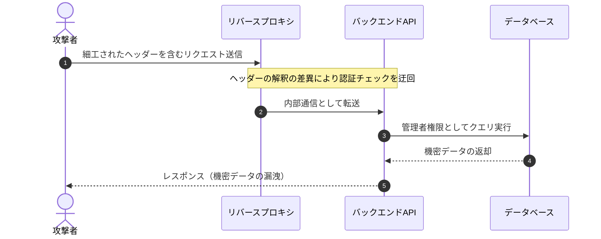
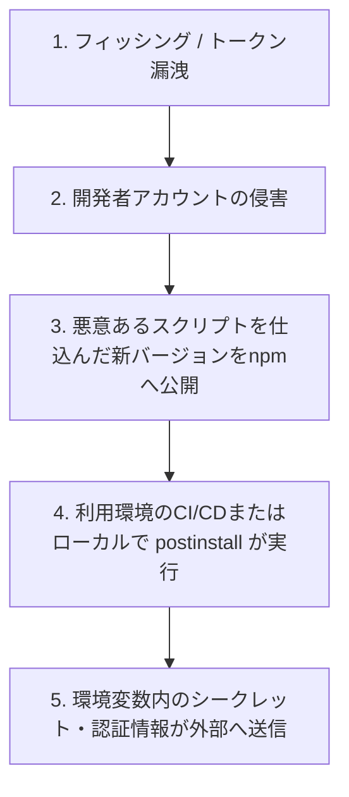

# Zenn記法・Mermaid図解・執筆ガイドライン

Zennで脆弱性・セキュリティインシデント記事をわかりやすく、かつ安全に表現するための記法ルールです。

---

## 1. Zenn固有記法の活用パターン

### 警告・補足情報（メッセージボックス）

- **警告・緊急性の高い注意喚起（赤枠）**: `:::message alert`
  - 直ちにアップデートが必要なクリティカルな警告や、破壊的変更・設定上の注意点に使用する（※定型の悪用厳禁・免責事項には使用しない）。
  ```markdown
  :::message alert
  **注意**: この緩和策を適用すると、レガシーなクライアントからの接続が遮断される可能性があるため、事前にトラフィック影響を確認すること。
  :::
  ```

- **補足情報・時点情報の注記（黄枠）**: `:::message`
  - 執筆時点の情報である旨や、前提条件の補足に使用します。
  ```markdown
  :::message
  本記事は 2026年MM月DD日 時点の公開情報をもとに執筆している。最新の緩和策やパッチ情報は公式アドバイザリを確認してほしい。
  :::
  ```

### 長いログや設定ファイル（アコーディオン）

長いスタックトレース、詳細な設定ファイル、IoC（ハッシュ値一覧など）は記事の読みやすさを損なわないよう `:::details` で折りたたみます。

```markdown
:::details 修正前の設定ファイル全体を表示
（ここに長いコードやログを記載）
:::
```

### コードブロックのDiff（差分）表示とファイル名表示

脆弱性の原因コードと修正パッチを比較する際は、`diff <言語>` とファイル名指定を組み合わせます。

````markdown
```diff ts:src/auth/middleware.ts
  export function verifyToken(token: string) {
-   const decoded = jwt.decode(token);
+   const decoded = jwt.verify(token, process.env.JWT_SECRET!);
    return decoded;
  }
```
````

### 出典の紐づけ（`[[1]][ref-1]` 参照リンク記法）

「どの情報がどのリンク先から得られたか」を読者が追跡でき、かつZennの脚注記法（`[^1]`）による `[1:1]`、`[1:2]` といった枝番表示を防ぐため、**`[^1]` は使わず、Markdownの参照リンク記法 `[[1]][ref-1]` を使用する**。

- **本文（文章）内**: `[[1]][ref-1]` のように記述する（何回参照しても常に `[1]` と表示され、クリックすると一次情報のURLへ遷移する）。
- **テーブル（表）内**: 「出典 / 情報源」の専用列は作らず、他の列の適切な箇所（バージョン番号、スコア、対応状況の末尾など）に直接 `[[1]][ref-1]` を記載する。
- **記事末尾（参考資料・出典一覧）**: 前置き文は入れず、番号付きリスト（`1. [NVD - ...][ref-1]`）でシンプルに一覧化し、ファイル末尾に `[ref-1]: https://...` のリンク定義を置く。

```markdown
NVDの評価ではCVSS 9.8とされている一方[[1]][ref-1]、Red Hatは競合条件の成立難易度からCVSS 8.1と評価している[[2]][ref-2]。

## 参考資料・出典一覧

1. [NVD - CVE-XXXX-YYYY][ref-1]
2. [Red Hat CVE Portal][ref-2]

[ref-1]: https://nvd.nist.gov/vuln/detail/CVE-XXXX-YYYY
[ref-2]: https://access.redhat.com/security/cve/CVE-XXXX-YYYY
```

---

## 2. Mermaidによるセキュリティ図解のベストプラクティス

### 構文エラーを防ぐルール（必須）
- ノードのラベル内に括弧 `(` `)`、`[` `]`、コロン `:`、スラッシュ `/` などの記号が含まれる場合は、**必ずラベル全体をダブルクォーテーション `""` で囲む**こと。
  - NG例: `A[攻撃者 (Attacker)] --> B[Webサーバー (/api/login)]`
  - OK例: `A["攻撃者 (Attacker)"] --> B["Webサーバー (/api/login)"]`
- ラベル内にHTMLタグ（`<br>` など）は極力使わず、簡潔なテキストにする。

### よく使う図解パターン1：攻撃・脆弱性悪用シーケンス図 (`sequenceDiagram`)

認証バイパス、SSRF、CSRF、リクエストスマグリングなど、登場人物（攻撃者・サーバー・内部システム等）間のやり取りを示す場合に適しています。

````markdown

````

### よく使う図解パターン2：インシデント侵害経路・サプライチェーン攻撃フロー (`flowchart TD`)

初期侵入から横展開（ラテラルムーブメント）、被害発生までの因果関係を示す場合に適しています。

````markdown

````

---

## 3. セキュリティ記事における倫理・表現ガイドライン

1. **Weaponized Exploit（そのまま悪用可能な攻撃コード）を載せない**
   - 脆弱性の仕組みを説明するための最小限の概念コードやペイロード構造の解説は問題ありませんが、特定ターゲットに対してそのままコピー＆ペーストで攻撃が成立するようなスクリプト全体は掲載しないこと。
2. **被害組織・開発者へのリスペクト**
   - インシデントに遭った企業や、脆弱性が発見されたOSSのメンテナーを過度に批判・揶揄するような表現は避け、技術的・構造的な原因分析と「そこから何を学べるか」という建設的なトーンで執筆すること。
3. **不確定情報の扱い**
   - SNS上の噂や未確認のリーク情報を確定事実のように書かないこと。公式発表・信頼できるセキュリティベンダーの分析レポートに依拠し、未判明の点は「現時点では未公表」と明記すること。
