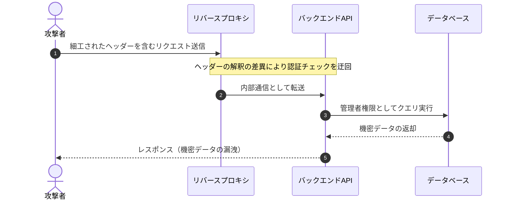
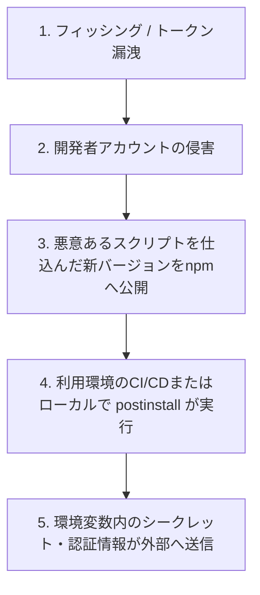

# Zenn記法・Mermaid図解・執筆ガイドライン

Zennで脆弱性・セキュリティインシデント記事をわかりやすく、かつ安全に表現するための記法ルールです。

---

## 1. Zenn固有記法・Frontmatterのルール

### タイトル（`title`）の統一フォーマットと文字数制限（厳守）

- **統一フォーマット**:
  - **脆弱性解説記事**: **`【<CVE番号>】<脆弱性の簡単な説明>（<脆弱性の通称>）`**
    - 例: `【CVE-2026-114938】OpenJDK Base64デコーダの脆弱性（Java4Shell）`
    - 通称がない場合: `【<CVE番号>】<対象ソフト名>の<脆弱性の種類>脆弱性`
  - **インシデント分析記事**: `【YYYY年MM月】<対象組織/サービス名>における<インシデントの概要>`
- **最大70文字以内（必須）**: Zennのシステム仕様上、記事タイトル（`title`）は**最大70文字**と定められており、70文字を超えると `zenn-cli` のプレビューや公開時にバリデーションエラーとなる。
- フォーマットに沿いつつ、文字数カウントを行って70文字以内に収まっていることを必ず確認する。

### 警告・補足情報（メッセージボックス）

- **警告・緊急性の高い注意喚起（赤枠）**: `:::message alert`
  - 直ちにアップデートが必要なクリティカルな警告や、破壊的変更・設定上の注意点に使用する（※定型の悪用厳禁・免責事項には使用しない）。
  - **同一の注意喚起の重複配置禁止**: 「再読み込み（reload）ではなく完全再起動が必要」「破壊的変更がある」などの警告メッセージボックスを、記事冒頭の概要部と本文（対策節など）の両方に二重配置しないこと。冒頭では結論のみを端的に記載し、詳細な技術的理由を添えた警告ボックスは該当する本文セクション（対策など）に1箇所のみ配置する。
  ```markdown
  :::message alert
  **注意**: この緩和策を適用すると、レガシーなクライアントからの接続が遮断される可能性があるため、事前にトラフィック影響を確認すること。
  :::
  ```

- **補足情報・時点情報の注記（黄枠）**: `:::message`
  - 執筆時点の情報である旨や、前提条件の補足に使用します。
  ```markdown
  :::message
  本記事は 2026年MM月DD日 時点の公開情報をもとに執筆している。最新の緩和策やパッチ情報は公式アドバイザリを確認してほしい。
  :::
  ```

### 長いログや設定ファイル（アコーディオン）

長いスタックトレース、詳細な設定ファイル、IoC（ハッシュ値一覧など）は記事の読みやすさを損なわないよう `:::details` で折りたたみます。

```markdown
:::details 修正前の設定ファイル全体を表示
（ここに長いコードやログを記載）
:::
```

### コードブロックのDiff（差分）表示とファイル名表示

脆弱性の原因コードと修正パッチを比較する際は、`diff <言語>` とファイル名指定を組み合わせます。

````markdown
```diff ts:src/auth/middleware.ts
  export function verifyToken(token: string) {
-   const decoded = jwt.decode(token);
+   const decoded = jwt.verify(token, process.env.JWT_SECRET!);
    return decoded;
  }
```
````

### 出典の紐づけ（`[[1]][ref-1]` 参照リンク記法）

「どの情報がどのリンク先から得られたか」を読者が追跡でき、かつZennの脚注記法（`[^1]`）による `[1:1]`、`[1:2]` といった枝番表示を防ぐため、**`[^1]` は使わず、Markdownの参照リンク記法 `[[1]][ref-1]` を使用する**。

- **複数出典の乱立禁止（1つの出典で十分なら1つに集約）**:
  - `[[1]][ref-1][[2]][ref-2]` のように、同じ文やセルに複数の出典を並べるのは原則禁止。
  - 参照している文章や数値の論拠として1つの一次情報で十分であれば、**最も包括的な1つの出典リンクのみに絞って記載する**。
- **連続・近接する重複脚注の徹底排除（集約ルール）**:
  - **本文（文章）内**: 連続する文章が同一の資料に基づく場合、文ごとに毎回同じ `[[1]][ref-1]` を貼らず、**段落の最後（または文のまとまりの最後）に1箇所だけ付与する**。
  - **箇条書き内**: 各項目の末尾に同じ出典を繰り返さず、**箇条書きの導入文の末尾（またはブロック全体の最後）に1箇所だけ付与する**。
  - **テーブル（表）内**:
    - 「出典 / 情報源」の専用列は作らず、補足列等の末尾に直接 `[[1]][ref-1]` を記載する。
    - **複数行にわたって同じ出典リンクが同じ表現・項目に付いている場合、最初の行（または表の導入文）にのみ1箇所記載し、2行目以降は省略する**（例：修正版列や補足列で毎行同じ `[[8]][ref-8]` を繰り返さない）。
    - 1行の複数のセルに同じ出典リンクを重複して貼らない。
  - **誤帰属の防止**: `[[1]][ref-1]` を付与した文には、実際に `[ref-1]` のリンク先に文字通り書かれている事実のみを含めること。筆者の考察や一般的な仕様、中間組織（JPCERT/CC等）の定型文言を特定のベンダーに曲解・誤帰属させてはならない。
- **記事末尾（参考資料・出典一覧）**: 前置き文は入れず、番号付きリスト（`1. [NVD - ...][ref-1]`）でシンプルに一覧化し、ファイル末尾に `[ref-1]: https://...` のリンク定義を置く。

```markdown
NVDの評価ではCVSS 9.8とされている一方[[1]][ref-1]、Red Hatは競合条件の成立難易度からCVSS 8.1と評価している[[2]][ref-2]。

## 参考資料・出典一覧

1. [NVD - CVE-XXXX-YYYY][ref-1]
2. [Red Hat CVE Portal][ref-2]

[ref-1]: https://nvd.nist.gov/vuln/detail/CVE-XXXX-YYYY
[ref-2]: https://access.redhat.com/security/cve/CVE-XXXX-YYYY
```

---

## 2. Mermaidによるセキュリティ図解のベストプラクティス

### 構文エラーを防ぐルール（必須）
- ノードのラベル内に括弧 `(` `)`、`[` `]`、コロン `:`、スラッシュ `/` などの記号が含まれる場合は、**必ずラベル全体をダブルクォーテーション `""` で囲む**こと。
  - NG例: `A[攻撃者 (Attacker)] --> B[Webサーバー (/api/login)]`
  - OK例: `A["攻撃者 (Attacker)"] --> B["Webサーバー (/api/login)"]`
- ラベル内にHTMLタグ（`<br>` など）は極力使わず、簡潔なテキストにする。

### よく使う図解パターン1：攻撃・脆弱性悪用シーケンス図 (`sequenceDiagram`)

認証バイパス、SSRF、CSRF、リクエストスマグリングなど、登場人物（攻撃者・サーバー・内部システム等）間のやり取りを示す場合に適しています。

````markdown

````

### よく使う図解パターン2：インシデント侵害経路・サプライチェーン攻撃フロー (`flowchart TD`)

初期侵入から横展開（ラテラルムーブメント）、被害発生までの因果関係を示す場合に適しています。

````markdown

````

---

## 3. セキュリティ記事における倫理・表現ガイドライン

1. **Weaponized Exploit（そのまま悪用可能な攻撃コード）を載せない**
   - 脆弱性の仕組みを説明するための最小限の概念コードやペイロード構造の解説は問題ありませんが、特定ターゲットに対してそのままコピー＆ペーストで攻撃が成立するようなスクリプト全体は掲載しないこと。
2. **被害組織・開発者へのリスペクト**
   - インシデントに遭った企業や、脆弱性が発見されたOSSのメンテナーを過度に批判・揶揄するような表現は避け、技術的・構造的な原因分析と「そこから何を学べるか」という建設的なトーンで執筆すること。
3. **不確定情報の扱い**
   - SNS上の噂や未確認のリーク情報を確定事実のように書かないこと。公式発表・信頼できるセキュリティベンダーの分析レポートに依拠し、未判明の点は「現時点では未公表」と明記すること。
