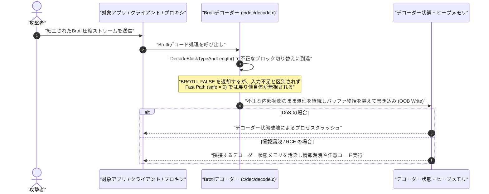

## 概要

Googleが開発するデータ圧縮ライブラリ「Brotli」において、細工された圧縮ストリームを展開（デコード）する際に境界外書き込みが発生する脆弱性が公表された。未認証の遠隔の攻撃者から悪意あるBrotli圧縮ストリームを処理させられることで、隣接するデコーダー状態メモリの破壊、機密メモリ内容の漏洩、サービス拒否（DoS）、または任意のコード実行（RCE）に至る可能性がある[[1]][ref-1]。

| 項目 | 内容 |
| :--- | :--- |
| **CVE ID** | CVE-2026-111497 |
| **対象ソフトウェア** | Google Brotli（C言語デコーダー実装 `c/dec/decode.c`） |
| **CVSSスコア** | ・**9.2 Critical** (`CVSS:4.0/AV:N/AC:L/AT:P/PR:N/UI:N/VC:H/VI:H/VA:H/SC:N/SI:N/SA:N` — Google CNA / GitHub)<br>・**9.8 Critical** (`CVSS:3.1/AV:N/AC:L/PR:N/UI:N/S:U/C:H/I:H/A:H` — NVD)<br>・**8.1 High / Important** (`CVSS:3.1/AV:N/AC:H/PR:N/UI:N/S:U/C:H/I:H/A:H` — Microsoft / Red Hat / AWS) |
| **脆弱性種別** | CWE-252: 戻り値の未チェック（Unchecked Return Value）、CWE-787: 境界外書き込み（Out-of-bounds Write） |
| **発見・報告者** | Khai Tran 氏、Sylvie Mayer 氏（OpenAI Codex Security） |
| **悪用・KEV登録状況** | Imperva社がNode.js `24.22.0`（Linux arm64公式イメージ）環境でのRCE実証を報告。2026年10月27日付で米国CISA KEVに追加（対策期限: 2026年11月10日） |

本脆弱性は、発見から波及範囲の判明に至る経緯の中で以下の3つの通称で呼ばれている。

- **Node2Shell**: 2026年10月21日のNode.jsセキュリティリリース公表後、Imperva Red TeamがNode.js組み込みBrotliデコーダーにおける解析およびRCE実証に命名した呼称である[[4]][ref-4]。
- **HTTP2Shell**: 当初はNode.jsに関連して「Node2Shell」と呼称されていたが、根本原因がHTTP通信（`Content-Encoding: br`）等で広く利用されるBrotliのC言語実装にあり、複数製品が影響を受けることから「HTTP2Shell」とも呼称されている（HTTP/2プロトコル自体の脆弱性ではない）[[5]][ref-5]。
- **Broccoli / Broccoli2Shell**: セキュリティ研究者のJuliano Rizzo氏が「Node2Shellという名称は影響範囲を狭く見せてしまう」として「Broccoli」と呼ぶことを提唱したことに端を発し、追跡サイト「broccoli2shell.com」等で用いられている呼称である[[6]][ref-6]。

## 影響を受けるバージョンと修正バージョン

### 1. Brotli の影響範囲と修正状況

Brotliの公式C実装において、バージョン **1.0.3 から 1.2.0** までのデコーダーが影響を受ける。各系統の修正バージョンは以下の通りである[[1]][ref-1]。

| 系統 / ブランチ | 影響を受けるバージョン | 修正版 | 補足 |
| :--- | :--- | :--- | :--- |
| **1.0 系** | `>= 1.0.3, < 1.0.10` | **`1.0.10`** | コミット `50a9b70a`（`0ed4268a` のバックポート） |
| **1.1 系** | `>= 1.1.0, < 1.1.1` | **`1.1.1`** | コミット `da980636`（`0ed4268a` のバックポート） |
| **1.2 系** | `>= 1.2.0, < 1.2.1` | **`1.2.1`** | コミット `b418fa81` / `0ed4268a` |

### 2. 主要ランタイム・言語パッケージ・アプライアンスの対応状況

BrotliのC言語デコーダーをバンドルまたはバインディングとして組み込んでいる各ランタイム・パッケージおよびネットワーク製品の対応状況は以下の通りである。

| ランタイム / 製品 | 影響を受けるバージョン | 修正版 | 補足 |
| :--- | :--- | :--- | :--- |
| **Node.js (v24 LTS)** | 24.x（`< 24.22.1`） | **`v24.22.1` / `v24.22.2`** [[3]][ref-3] | `v24.22.1` で修正（`v24.22.2` はリグレッション修正版） |
| **Node.js (v22 LTS)** | 22.x（`< 22.23.4`） | **`v22.23.4`** | 組み込みBrotliの更新（2026年10月セキュリティリリース） |
| **Node.js (v26 Current)** | 26.x（`< 26.12.1`） | **`v26.12.1`** | 組み込みBrotliの更新（EOL系統の `<= 20.x`, `23.x`, `25.x` も影響対象） |
| **Bun** | `>= 1.0.21, < 1.4.4` | **`1.4.4`** [[8]][ref-8] | バンドルするBrotliを `1.2.0` から `1.2.1` へ更新（`GHSA-663w-cv8g-jj2p`） |
| **Python (`brotli` / PyPI)** | `>= 1.0.3, < 1.2.1` | **`1.2.1`** [[7]][ref-7] | PyPI上の公式C拡張パッケージ（`GHSA-9v8h-qqgm-4m35`） |
| **Python (`brotlicffi` / PyPI)** | `>= 1.0.3, < 1.2.1.0` | **`1.2.1.0`** | Brotli C実装のCFFIバインディング（`GHSA-9v8h-qqgm-4m35`） |
| **.NET 8 / 9 / 10** | `8.0.0`〜`8.0.32`<br>`9.0.0`〜`9.0.21`<br>`10.0.0`〜`10.0.13` | **Runtime `8.0.33`**<br>**Runtime `9.0.22`**<br>**Runtime `10.0.14`** [[9]][ref-9] | SDKは `8.0.133`/`8.0.427`、`9.0.123`/`9.0.320`、`10.0.114`/`10.0.403` で修正 |
| **Palo Alto Networks PAN-OS** | PAN-OS 12.2 / 12.1 / 11.2 の未修正版 | **`12.2.4-h1`**<br>**`12.1.7-h11`** 等 [[6]][ref-6] | データプレーンでTLS復号とBrotli検査を有効化している場合のみ影響（デフォルト無効） |

### 3. 主要Linuxディストリビューションの対応状況

OSの共有ライブラリ（`libbrotli`）およびディストリビューション提供パッケージにおける対応状況は以下の通りである。ディストリビューションによってはNode.jsや.NETパッケージがOS標準の共有ライブラリ（`libbrotli`）を動的リンクしているため、影響有無がパッケージ単位で異なる点に注意が必要である。

| ディストリビューション | 対象パッケージ | 修正版 | 補足 |
| :--- | :--- | :--- | :--- |
| **Amazon Linux 2023** | `brotli`, `libbrotli`, `python3-brotli`<br>`nodejs24`, `dotnet8.0` | **`1.1.0-1.amzn2023.0.2`** | アドバイザリ: `ALAS2023-2026-3334`（`brotli`）、`ALAS2023-2026-3330`（`nodejs24`）、`ALAS2023-2026-3367`（`dotnet8.0`）。`nodejs22`・`dotnet9.0`・`dotnet10.0` は影響なし |
| **Ubuntu** | `brotli`, `libbrotli1`, `python3-brotli`<br>`dotnet8`, `dotnet10`, `dotnet11` | 24.04 LTS: **`1.1.0-2ubuntu0.1`**<br>22.04 LTS: **`1.0.9-2ubuntu0.1`** | アドバイザリ: `USN-8956-1`（Brotli）、`USN-8958-1`（.NET `8.0.33` / `10.0.14`） |
| **Debian** | `brotli`, `libbrotli1` | Trixie (13): **`1.1.0-2+deb13u1`**<br>Bookworm (12): **`1.0.9-2+deb12u1`** | `DSA-6582-1` / `DLA-4855-1`。Debianの `nodejs` と `python-brotlicffi` はシステムの `brotli` を利用 |
| **RHEL (Red Hat)** | `brotli`, `nodejs:24`, `dotnet8.0`, `firefox`, `thunderbird` | **提供済（各RHSA）** | `RHSB-2026-015`（Important）。RHEL 8/9の `nodejs:22`、RHEL 10の `nodejs22`/`nodejs24`、および `dotnet9.0`/`10.0`/`11.0` はシステムの `brotli` を利用 |

### 4. AWS マネージドサービスの対応状況

AWSの `2026-155-AWS` で公表されている主要マネージドサービスの対応状況は以下の通りである[[10]][ref-10]。

| 対象サービス / リソース | 修正版 | 補足 |
| :--- | :--- | :--- |
| **AWS Lambda（Node.js 22/24/26、.NET 8/9/10）** | **更新済** | マネージドランタイム・ベースイメージ更新済。コンテナイメージ利用時は最新ベースイメージでの再ビルドが必要（Python/Ruby/`provided.al2023` はBrotli非同梱） |
| **AWS Elastic Beanstalk (Node.js)** | **`6.11.12`** | Node.js `24.22.1` および `22.23.4` を含むプラットフォームバージョン `6.11.12` を提供済 |
| **AWS App Runner / Amplify / CodeBuild / Synthetics** | **更新済** | App Runnerは2026年10月26日に全リージョン更新済（未デプロイのサービスは1回再デプロイが必要） |

## 影響を受ける条件

本脆弱性は、ライブラリがシステム上に存在するだけでは発火せず、**「信頼できないBrotli圧縮ストリームを、対象アプリケーションやプロキシがデコード（展開）する」** 処理が行われた際に成立する[[6]][ref-6]。

### 1. 前提となるシステム・ネットワーク構成

攻撃が成立する代表的な経路は以下の4パターンである。

- **パターン1：クライアントからの圧縮HTTPリクエストボディを展開するサーバー / API**
  - クライアントから送信された `Content-Encoding: br` ヘッダー付きのリクエストボディを、ミドルウェア（Node.jsのExpress 5.0.0〜5.3.0やbody-parser 2.0.0〜2.3.0における `raw()` / `json()` 等）やバックエンドアプリケーションが自動または明示的にBrotli展開している構成（なお、素の `node:http` サーバー自体は単体ではリクエストボディを自動展開しない）。
- **パターン2：外部サーバーからの圧縮HTTPレスポンスを展開するHTTPクライアント / クローラー**
  - 接続先サーバーから返却された `Content-Encoding: br` レスポンスを自動展開する構成（Node.jsやBunの組み込み `fetch()`、Brotliパッケージがインストールされた環境でのPython `urllib3` / `requests` / `aiohttp` / `httpx[brotli]` 等）。
  - 多くのHTTPクライアントはリクエスト時に `Accept-Encoding: br` を送信したかどうかにかかわらず、レスポンスヘッダーに `Content-Encoding: br` が含まれていれば自動的にBrotliデコーダーを呼び出す。そのため、任意のURLを取得するWebhook、リンクプレビュー、クローラー、または非暗号化通信経路上の中間者攻撃において、悪意あるサーバーから一方的に `Content-Encoding: br` のレスポンスを返されるだけでトリガーされ得る。
- **パターン3：ファイアウォール等のデータプレーンにおけるトラフィック検査**
  - Palo Alto NetworksのPAN-OS（PA-Series / VM-Series）において、データプレーン上でTLS/SSL復号（Decryption）とBrotliインスペクションの両方が有効化されている場合、通過するBrotliトラフィックをファイアウォール自身が展開するため影響を受ける。
- **パターン4：デコーダーAPIの直接呼び出し・ファイル処理**
  - アーカイブ、キャッシュ、メッセージキュー等の外部データを、`node:zlib`（`brotliDecompress*`、`createBrotliDecompress`）、Web標準の `DecompressionStream`、Pythonの `brotli.decompress()`、.NETの `BrotliStream` / `BrotliDecoder` 等で直接展開している場合。

:::message
**影響を受けないケース**:
- **圧縮（エンコード）のみ・静的 `.br` ファイル配信のみの構成**: 脆弱性はデコーダー（`c/dec/decode.c`）に存在するため、信頼できるデータをサーバー側でBrotli圧縮して送信するのみの構成や、事前圧縮された静的な `.br` ファイルをそのまま配信するだけの構成ではデコード処理が行われず、影響を受けない。
- **.NET のデフォルト挙動**: Microsoftのアドバイザリによれば、ASP.NET Coreおよび `HttpClient` はデフォルトではBrotli圧縮データを自動展開しない。自動展開でBrotliを有効化するよう明示的に設定変更している場合、または `System.IO.Compression`（`BrotliStream` / `BrotliDecoder`）で信頼できないデータを直接展開している場合のみ影響を受ける[[9]][ref-9]。
:::

### 2. スタンドアロン実行ファイル・コンテナイメージに関する注意点

- **自己完結型バイナリ（Self-Contained / 単一実行ファイル）**:
  - .NETのSelf-ContainedデプロイやNativeAOTでビルドされたアプリケーション、およびBunの `bun build --compile` で生成された実行ファイルは、ビルド時点のランタイム（および脆弱なBrotliデコーダー）をバイナリ内部に埋め込んでいるため、ランタイム更新後に**アプリケーションの再ビルドと再デプロイ**が必要である。
- **動的リンクとバンドルの違い**:
  - Red Hat Enterprise LinuxやDebian、Amazon Linux 2023では、パッケージによってBrotliを内部バンドルしているもの（例：AL2023およびRHEL 8/9の `nodejs24`、`dotnet8.0`）と、OSの共有ライブラリ `libbrotli` を動的リンクしているもの（例：Debianの `nodejs`、RHEL 8/9およびAL2023の `nodejs22`、`dotnet9.0`、`dotnet10.0`）が混在している。したがって、OSパッケージとランタイムの双方を確認・更新し、実行中のプロセスを再起動する必要がある。

### 3. 自環境の確認方法

```bash
# 1. Node.js のバージョンおよびバンドルされている Brotli バージョンの確認
node --version
node -p "process.versions.brotli"

# 2. Bun のバージョン確認（1.4.4 以上であるか）
bun --version

# 3. .NET ランタイムのバージョン確認（8.0.33 / 9.0.22 / 10.0.14 以上であるか）
dotnet --list-runtimes

# 4. Python パッケージの確認（Brotli 1.2.1 以上、brotlicffi 1.2.1.0 以上であるか）
python3 -m pip show brotli brotlicffi

# 5. Linux OSパッケージおよびロード済み共有ライブラリの確認
dpkg -l | grep -i brotli          # Debian / Ubuntu
rpm -qa | grep -i brotli          # RHEL / Amazon Linux
sudo grep -l brotlidec /proc/[0-9]*/maps 2>/dev/null
```

## 脆弱性の技術的な仕組み

### 前提：Brotliのブロック切り替えと高速パス（Fast Path）/ 安全パス（Safe Path）

Brotliの圧縮ストリームは複数のブロックに分割されており、デコーダーはストリームを読み進めながらリテラル（`tree_type = 0`）、挿入・コピーコマンド（`tree_type = 1`）、距離コード（`tree_type = 2`）のブロックタイプを切り替える。

ブロックタイプを切り替える際、デコーダーは `c/dec/decode.c` 内の `DecodeBlockTypeAndLength()` を呼び出して次のブロックタイプ番号とブロック長をビットストリームから読み取る。このときBrotliデコーダーは、入力バッファに十分なデータがある場合に境界チェックを省略して高速に処理する **Fast Path（`safe = 0`）** と、入力不足を検査しながら処理する **Safe Path（`safe = 1`）** の2つの経路を持っている。

### 原因：戻り値の未チェック（CWE-252）と境界外書き込み（CWE-787）

脆弱性の根本原因は、`c/dec/decode.c` 内の `DecodeBlockTypeAndLength()` が返す真偽値 `BROTLI_BOOL` の仕様と、呼び出し元における戻り値の未チェックにある[[1]][ref-1]。

1. **戻り値 `BROTLI_FALSE` における2種類の意味の混在**:
   修正前の `DecodeBlockTypeAndLength()` は戻り値として単なる真偽値（`BROTLI_BOOL`）を返していた。この関数は、Safe Pathで入力ビットが一時的に不足している場合（`!SafeReadSymbol` や `!SafeReadBlockLength`）に `BROTLI_FALSE` を返すだけでなく、ストリームのブロックタイプ最大数 `max_block_type` が `1` 以下であるにもかかわらずブロック切り替えが要求されたという**ストリーム構文エラー（フォーマット不正）** の場合（`if (max_block_type <= 1) return BROTLI_FALSE;`）にも同じ `BROTLI_FALSE` を返していた。
2. **Fast Path（`safe = 0`）での戻り値の無視**:
   修正前のコードでは、Fast Path用のラッパー関数 `DecodeLiteralBlockSwitch()`、`DecodeCommandBlockSwitch()`、`DecodeDistanceBlockSwitch()` の戻り値型が `static void` と定義されており、内部で呼び出す `Decode*BlockSwitchInternal(0, s)` の戻り値を完全に無視していた。さらに呼び出し元のマクロ `BROTLI_SAFE(METHOD)` も、`safe == 0` の分岐では戻り値を検証せずにそのまま処理を継続する実装となっていた。
3. **不正な内部状態でのデコード継続と境界外書き込み**:
   細工された圧縮ストリームによって本来起こり得ないブロック切り替えが要求された際、脆弱なデコーダーは構文エラーで停止せず、「追加入力が必要である」状態と誤認する、あるいはFast Path上でエラーを無視して不整合な内部状態のまま処理を継続してしまう。その結果、内部バッファの終端を越えて攻撃者のバイト列が書き込まれ、隣接するデコーダー状態メモリ（`BrotliDecoderState`）の破壊や機密メモリの漏洩、さらには任意のコード実行（RCE）へとつながる。

### 攻撃フロー



## 修正パッチ

Googleの公式リポジトリにおける修正コミット `0ed4268a`（および各ブランチへの反映コミット `50a9b70a`、`da980636`、`b418fa81`）では、以下の変更が行われている[[2]][ref-2]。

1. `c/include/brotli/decode.h` に、ブロック切り替えのフォーマット異常を表す新しいエラーコード `BROTLI_DECODER_ERROR_FORMAT_BLOCK_SWITCH = -17` を追加。
2. `DecodeBlockTypeAndLength()` および各 `Decode*BlockSwitch*()` 関数の戻り値型を `BROTLI_BOOL` / `void` から `BrotliDecoderErrorCode` に変更し、`max_block_type <= 1` のフォーマット異常時は `BROTLI_DECODER_ERROR_FORMAT_BLOCK_SWITCH`、入力不足時は `BROTLI_DECODER_NEEDS_MORE_INPUT`、成功時は `BROTLI_DECODER_SUCCESS` を明示的に返すように修正。
3. Safe PathとFast Pathの両方でステータスコードを検証し、`BROTLI_DECODER_SUCCESS` 以外の場合は即座に `saveStateAndReturn` へジャンプして処理を中断するマクロ `BROTLI_SAFE_WITH_STATUS(METHOD)` を導入。

```diff c:c/dec/decode.c
// google/brotli commit 0ed4268a より抜粋

-static BROTLI_INLINE BROTLI_BOOL DecodeBlockTypeAndLength(
+static BROTLI_INLINE BrotliDecoderErrorCode DecodeBlockTypeAndLength(
     int safe, BrotliDecoderState* s, int tree_type) {
   brotli_reg_t max_block_type = s->num_block_types[tree_type];
   const HuffmanCode* type_tree = &s->block_type_trees[
@@ -1187,7 +1187,7 @@
   brotli_reg_t* ringbuffer = &s->block_type_rb[tree_type * 2];
   brotli_reg_t block_type;
   if (max_block_type <= 1) {
-    return BROTLI_FALSE;
+    return BROTLI_DECODER_ERROR_FORMAT_BLOCK_SWITCH;
   }

   /* Read 0..15 + 3..39 bits. */
@@ -1197,11 +1197,13 @@
   } else {
     BrotliBitReaderState memento;
     BrotliBitReaderSaveState(br, &memento);
-    if (!SafeReadSymbol(type_tree, br, &block_type)) return BROTLI_FALSE;
+    if (!SafeReadSymbol(type_tree, br, &block_type)) {
+      return BROTLI_DECODER_NEEDS_MORE_INPUT;
+    }
     if (!SafeReadBlockLength(s, &s->block_length[tree_type], len_tree, br)) {
       s->substate_read_block_length = BROTLI_STATE_READ_BLOCK_LENGTH_NONE;
       BrotliBitReaderRestoreState(br, &memento);
-      return BROTLI_FALSE;
+      return BROTLI_DECODER_NEEDS_MORE_INPUT;
     }
   }
   ...
   ringbuffer[0] = ringbuffer[1];
   ringbuffer[1] = block_type;
-  return BROTLI_TRUE;
+  return BROTLI_DECODER_SUCCESS;
 }

-static BROTLI_INLINE BROTLI_BOOL DecodeLiteralBlockSwitchInternal(
+static BROTLI_INLINE BrotliDecoderErrorCode DecodeLiteralBlockSwitchInternal(
     int safe, BrotliDecoderState* s) {
-  if (!DecodeBlockTypeAndLength(safe, s, 0)) {
-    return BROTLI_FALSE;
+  BrotliDecoderErrorCode result = DecodeBlockTypeAndLength(safe, s, 0);
+  if (result != BROTLI_DECODER_SUCCESS) {
+    return result;
   }
   PrepareLiteralDecoding(s);
-  return BROTLI_TRUE;
+  return BROTLI_DECODER_SUCCESS;
 }

-static void BROTLI_NOINLINE DecodeLiteralBlockSwitch(BrotliDecoderState* s) {
-  DecodeLiteralBlockSwitchInternal(0, s);
+static BROTLI_NOINLINE BrotliDecoderErrorCode
+DecodeLiteralBlockSwitch(BrotliDecoderState* s) {
+  return DecodeLiteralBlockSwitchInternal(0, s);
 }
```

呼び出し元のマクロも以下のように `BROTLI_SAFE_WITH_STATUS` へ置き換えられ、`safe` フラグの有無にかかわらずエラー発生時にデコードが即座に停止するようになった。

```diff c:c/dec/decode.c
+/* NB: METHOD should return BROTLI_DECODER_SUCCESS, BROTLI_DECODER_ERROR_*, or
+   BROTLI_DECODER_NEEDS_MORE_INPUT; the later two break the processing. */
+#define BROTLI_SAFE_WITH_STATUS(METHOD)         \
+  {                                             \
+    BrotliDecoderErrorCode status;              \
+    if (safe) {                                 \
+      status = Safe##METHOD;                    \
+    } else {                                    \
+      status = METHOD;                          \
+    }                                           \
+    if (status != BROTLI_DECODER_SUCCESS) {     \
+      result = status;                          \
+      goto saveStateAndReturn;                  \
+    }                                           \
+  }
```

## 対策と緩和策

### 1. 恒久対策：修正バージョンへのアップデートと再ビルド

利用しているOSパッケージ、言語ランタイム、および依存ライブラリを修正バージョンへ更新し、稼働中のプロセスを再起動する。また、単一実行ファイル化（Bunの `bun build --compile`、.NETのSelf-Contained / NativeAOT）やDockerコンテナイメージを利用している場合は、更新後のランタイム・ベースイメージを用いて再ビルドおよび再デプロイを実施する必要がある。

:::details 各環境におけるアップデートコマンド例
```bash
# 1. Amazon Linux 2023 の場合（ALAS2023-2026-3334 / 3330 / 3367）
sudo dnf update brotli nodejs24 dotnet8.0 -y

# 2. Ubuntu / Debian の場合（USN-8956-1 / USN-8958-1 / DSA-6582-1）
sudo apt update && sudo apt install --only-upgrade brotli libbrotli1 python3-brotli -y

# 3. Node.js の更新（nvm を利用している場合）
nvm install 24.22.1   # または 22.23.4 / 26.12.1

# 4. Python パッケージ（PyPI）の更新（1.2.1 / 1.2.1.0 以上）
pip install -U "Brotli>=1.2.1" "brotlicffi>=1.2.1.0"

# 5. Bun の更新（1.4.4 以上）
bun upgrade
```
:::

### 2. 一時的な緩和策（アップデートが直ちに実施できない場合）

各ベンダーのアドバイザリおよび技術資料では、即座にパッチを適用できない環境向けに以下の緩和策が案内されている。

1. **WAFやリバースプロキシにおける受信 `Content-Encoding: br` リクエストの遮断**:
   AWSのセキュリティブレティン `2026-155-AWS` 等では、クライアントから送信される `Content-Encoding: br` ヘッダー付きHTTPリクエストをWAFやプロキシで拒否する緩和策が提示されている。AWSが公開しているAWS WAFカスタムルールの設定例（Countモードで検証後に `"Count": {}` を `"Block": {}` に変更する手順）は以下の通りである。なお、AWS WAFは受信リクエストのみを検査するため、アプリケーションが外部サーバーから取得するレスポンスには効かない点に留意が必要である[[10]][ref-10]。

```json
{
  "Name": "Node2Shell_BROTLI",
  "Priority": 2,
  "Statement": {
    "RegexMatchStatement": {
      "RegexString": "^\\s*br\\s*$",
      "FieldToMatch": { "SingleHeader": { "Name": "content-encoding" } },
      "TextTransformations": [ { "Priority": 0, "Type": "LOWERCASE" } ]
    }
  },
  "Action": { "Count": {} },
  "RuleLabels": [ { "Name": "Node2Shell_Brotli" } ],
  "VisibilityConfig": {
    "SampledRequestsEnabled": true,
    "CloudWatchMetricsEnabled": true,
    "MetricName": "Node2Shell_BROTLI"
  }
}
```

2. **HTTPクライアントおよびPython環境におけるBrotliデコードの抑止**:
   - **注意点（`Accept-Encoding` ヘッダー変更の限界）**: リクエストヘッダーの `Accept-Encoding` から `br` を除外したとしても、悪意あるサーバーはそれを無視して `Content-Encoding: br` のレスポンスを送りつけることができるため、クライアント側で自動解凍自体が有効なままでは対策として不十分である。
   - **Bun**: セキュリティアドバイザリ（`GHSA-663w-cv8g-jj2p`）では、`fetch` 呼び出し時に `decompress: false` を渡すことで、`Accept-Encoding: br` の送信を抑止するとともにレスポンス自体の自動デコードを無効化する回避策が案内されている[[8]][ref-8]。
   - **Python**: 直ちにアップグレードできない場合の緩和策として、`Brotli` および `brotlicffi` パッケージ（ならびに `httpx[brotli]` 等のextra指定）自体をアンインストールし、`urllib3`、`requests`、`aiohttp` 等でBrotliデコーダーが呼び出されない状態（`gzip` / `deflate` へのフォールバック）にする方法が挙げられている[[6]][ref-6]。
   - **PAN-OS**: ホットフィックス適用までの回避策としてCLIから `set system setting brotli-encoding disable` を実行（またはWeb UIの `Device > Setup > Content-ID` から `Allow Brotli Encoding` のチェックを解除）してBrotliインスペクションを無効化する手順が案内されている。

## 参考資料・出典一覧

1. [CVE.org - CVE-2026-111497][ref-1]
2. [Google Brotli GitHub Repository - Commit 0ed4268a][ref-2]
3. [Node.js - Wednesday, October 21, 2026 Security Releases][ref-3]
4. [Imperva Blog - Node2Shell: From Brotli Data to Remote Code Execution (CVE-2026-111497)][ref-4]
5. [JPCERT/CC - BrotliのC言語実装における境界外書き込みの脆弱性（CVE-2026-111497）に関する注意喚起 (JPCERT-AT-2026-0034)][ref-5]
6. [Broccoli2Shell: Brotli decoder RCE (CVE-2026-111497) in Node.js, Python and more][ref-6]
7. [GitHub Advisory Database - GHSA-9v8h-qqgm-4m35 (PyPI brotli / brotlicffi)][ref-7]
8. [Bun Security Advisory - GHSA-663w-cv8g-jj2p][ref-8]
9. [Microsoft .NET Security Advisory - CVE-2026-111497: Out of bounds write in Brotli leads to RCE][ref-9]
10. [AWS Security Bulletin - 2026-155-AWS: CVE-2026-111497: Native Brotli Decoder Remote Code Execution and Memory Disclosure][ref-10]

[ref-1]: https://www.cve.org/CVERecord?id=CVE-2026-111497
[ref-2]: https://github.com/google/brotli/commit/0ed4268a
[ref-3]: https://nodejs.org/en/blog/vulnerability/october-2026-security-releases
[ref-4]: https://www.imperva.com/blog/node2shell-from-brotli-data-to-remote-code-execution/
[ref-5]: https://www.jpcert.or.jp/at/2026/at260034.html
[ref-6]: https://broccoli2shell.com/
[ref-7]: https://github.com/advisories/GHSA-9v8h-qqgm-4m35
[ref-8]: https://github.com/oven-sh/bun/security/advisories/GHSA-663w-cv8g-jj2p
[ref-9]: https://github.com/dotnet/announcements/issues/494
[ref-10]: https://aws.amazon.com/security/security-bulletins/2026-155-aws/
