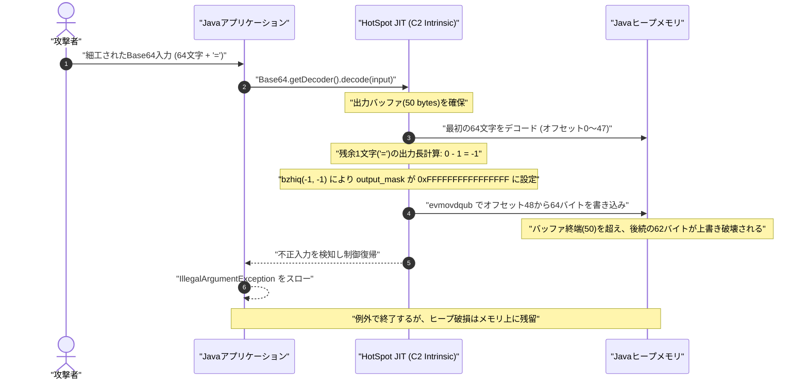
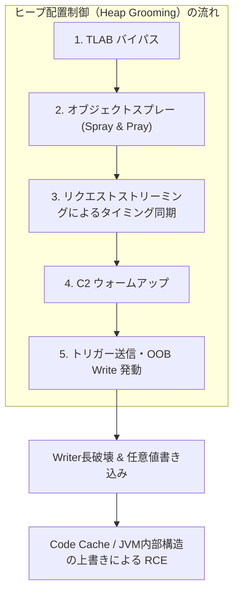

## 概要

2026年11月17日（米国太平洋時間）、OpenJDKのHotSpot仮想マシンにおけるBase64デコード処理に、ヒープ領域外書き込み（Heap Out-of-bounds Write）の脆弱性（CVE-2026-114938、通称：Java4Shell）が存在することが公表された[[1]][ref-1]。

本脆弱性は、x86-64環境向けにAVX-512 VBMI命令を用いて手書きされたBase64デコーダのアセンブリ最適化ルーチンにおいて、末尾のパディング文字（`=`）の処理時に出力長計算のアンダーフローが発生することに起因する。細工されたBase64文字列を処理させることで、Javaの例外送出前にヒープ上の後続オブジェクトへ最大62バイトの不正な書き込みが行われる[[6]][ref-6]。

悪用にはAVX-512 VBMIをサポートするプロセッサ環境が必要であるものの、ネットワーク経由でヒープ上のメモリ配置を意図的に誘導・制御（ヒープ領域へのオブジェクトの連続配置やパケット送信タイミングの調整）することで、単なるサービス停止（DoS）にとどまらず、ヒープメモリ漏洩（Heartbleed類似の情報漏洩）や認証前リモートコード実行（Pre-auth RCE）が可能であることが実証されている。

| 項目 | 内容 |
| :--- | :--- |
| **CVE ID** | CVE-2026-114938 |
| **通称** | Java4Shell[[1]][ref-1] |
| **対象ソフトウェア** | OpenJDK（HotSpot JITコンパイラ / x86-64 Base64 Intrinsic実装）[[2]][ref-2] |
| **深刻度**（CVSS） | ・**9.2 Critical** (`CVSS:4.0/AV:N/AC:L/AT:P/PR:N/UI:N/VC:H/VI:H/VA:H/SC:N/SI:N/SA:N` — Calif)[[1]][ref-1]<br>・**8.1 High** (`CVSS:3.1/AV:N/AC:H/PR:N/UI:N/S:U/C:H/I:H/A:H` — Oracle / OpenJDK / Red Hat)[[2]][ref-2] |
| **脆弱性種別** | CWE-122: ヒープベースのバッファオーバーフロー（CWE-787: 境界外書き込み）[[5]][ref-5] |
| **発見・報告者** | Quang Luong 氏（Calif.io）、Albert Yang 氏[[3]][ref-3] |
| **悪用・PoC状況** | 概念実証コード（PoC）公開済み。Keycloak、Jenkins、Atlassian Jira / Confluence、JFrog Artifactory、PingFederate等でのPre-auth RCE実証が報告されている。2026年11月18日時点で実際のサイバー攻撃での悪用は未確認[[4]][ref-4] |

---

## 影響を受けるバージョンと修正バージョン

### 1. OpenJDK Upstream の影響範囲と修正状況

OpenJDK公式アドバイザリ（2026-11-17公開）によると、HotSpotコンパイラコンポーネントにおける本脆弱性の影響バージョンおよび修正バージョンは以下の通りである[[2]][ref-2]。

| 系統 | 影響を受けるバージョン | 修正版 | 補足 |
| :--- | :--- | :--- | :--- |
| **Java 17** (LTS) | `>= 17.0.6, < 17.0.21.1` | **`17.0.21.1`** | `17.0.21.1+4` にて修正[[2]][ref-2] |
| **Java 21** (LTS) | `< 21.0.13.1` | **`21.0.13.1`** | `21.0.13.1+4` にて修正[[2]][ref-2] |
| **Java 25** (LTS) | `< 25.0.5.1` | **`25.0.5.1`** | `25.0.5.1+4` にて修正[[2]][ref-2] |
| **Java 27** | `< 27.0.1.1` | **`27.0.1.1`** | `27.0.1.1+4` にて修正[[2]][ref-2] |
| **Java 8 / 11** | 対象外 | **影響なし** | 脆弱なAVX-512 VBMI最適化コードを含まないため対象外[[2]][ref-2] |

### 2. 主要Javaディストリビューションの対応状況

OpenJDKのソースコードをベースにビルドされている主要ディストリビューション各社における影響および対応状況は以下の通りである。各提供元が発行した公式セキュリティアドバイザリ・リリースノートに基づき整理した。

| ディストリビューション | 影響状況 | 修正版 / 対策 | 補足 |
| :--- | :--- | :--- | :--- |
| **Oracle Java SE** | 影響あり | **`17.0.21.1` / `21.0.13.1` 等** | Oracle Critical Security Patch Update (CSPU) November 2026にて提供[[3]][ref-3] |
| **Oracle GraalVM** (JDK) | 影響あり | **`17.0.21.1` / `21.0.13.1` 等** | Oracle CSPU November 2026にて提供[[3]][ref-3] |
| **Amazon Corretto** | 影響あり | **`17.0.21.1` / `21.0.13.1`** | 各リポジトリ向けに順次アップデート提供[[8]][ref-8] |
| **Eclipse Temurin** | 影響あり | **`17.0.21.1+2` / `21.0.13.1+2` 等** | Eclipse Adoptium公式アナウンス（November 2026 CSPU）にて修正バイナリを順次公開[[11]][ref-11] |
| **Microsoft Build of OpenJDK** | 影響あり | **`17.0.21.1` / `21.0.13.1` / `25.0.5.1`** | Microsoft for Java Developers公式ブログ（November 2026 CPU）にて提供[[12]][ref-12] |
| **Azul Zulu** | 影響あり | **`17.0.21.1` / `21.0.13.1` 等** | Azul Zulu November 2026 Monthly Update Release Notesにて提供[[13]][ref-13] |
| **Red Hat OpenJDK** | 影響あり | **準備中** | Red Hat Customer Portalにて影響を認識し修正対応中[[7]][ref-7] |

### 3. 主要Linuxディストリビューションの対応状況

| ディストリビューション | 対象パッケージ | 修正版 | 補足 |
| :--- | :--- | :--- | :--- |
| **Amazon Linux 2023** | `java-17-amazon-corretto`<br>`java-21-amazon-corretto` | **`1:17.0.21.1.1-1.amzn2023`**<br>**`1:21.0.13.1.1-1.amzn2023`** | ALAS2023-2026-3478 / ALAS2023-2026-3479 にて修正済み[[8]][ref-8] |
| **Debian** (sid / unstable) | `openjdk-17`<br>`openjdk-21`<br>`openjdk-25`<br>`openjdk-27` | **`17.0.21.1+2-1`**<br>**`21.0.13.1+2-1`**<br>**`25.0.5.1+2-1`**<br>**`27.0.1.1+4-1`** | unstable向けに修正版アップロード済み[[9]][ref-9] |
| **Debian** (bookworm / trixie) | `openjdk-17`<br>`openjdk-21` | **準備中** | セキュリティアップデート準備中（vulnerable）[[9]][ref-9] |
| **Ubuntu** (24.04 LTS / 22.04 LTS) | `openjdk-17`<br>`openjdk-21` | **準備中** | Canonicalセキュリティチームにて検証中（Needs evaluation）[[10]][ref-10] |
| **Red Hat Enterprise Linux** | `java-17-openjdk`<br>`java-21-openjdk` | **準備中** | Red Hat Product Securityにて調査・パッチ準備中[[7]][ref-7] |

### 4. 主要クラウドプロバイダーの対応状況

主要クラウドプロバイダー各社による公式アナウンス・セキュリティアップデートの状況は以下の通りである。

| クラウド | 対象サービス | 対応状況 | 補足 |
| :--- | :--- | :--- | :--- |
| **Amazon Web Services** (AWS) | Amazon Linux 2023 / Corretto | **修正版提供済み** | `yum update` によるCorrettoパッケージ更新が可能[[8]][ref-8] |
| **Microsoft Azure** | Azure WAF / Azure App Service 等 | **対応ガイダンス公開** | Azure Network Security BlogにてAzure WAFによる検知・遮断ガイダンスおよびランタイム更新手順を公表[[14]][ref-14] |
| **Google Cloud** (GCP) | Apigee / JavaCallout 等 | **修正版提供済み** | Apigeeリリースノートにて脆弱性を緩和するパッチ提供およびハイブリッド環境向けガイダンスを公表[[15]][ref-15] |

---

## 影響を受ける条件

本脆弱性が実際に発現し悪用可能となるには、以下の3つの条件がすべて揃う必要がある[[1]][ref-1]。

1. **CPU命令セットの前提要件**:
   - 物理ホストまたは仮想マシンのCPUが、x86-64アーキテクチャであり、かつ **AVX-512 VBMI**（Vector Byte Manipulation Instructions）命令に対応していること。
   - **該当する主なCPUファミリー**:
     - Intel Xeon: Ice Lake、Sapphire Rapids、Emerald Rapids、Granite Rapids 等
     - AMD EPYC / Ryzen: Zen 4 以降
   - ※ARM64（AWS Graviton、Apple Silicon等）環境、およびAVX-512 VBMIを持たない旧世代のx86-64 CPUは本脆弱性の影響を受けない[[4]][ref-4]。
2. **実行時JITコンパイル条件**:
   - Base64デコード処理が一定回数以上呼び出され、HotSpotの最上位JITコンパイラ（C2）によって最適化アセンブリルーチン（Intrinsic）へとインライン展開・移行していること。
3. **入力データの形状**:
   - デコード対象の入力データとして、ブロック境界の直後に孤立したパディング文字（`=`）が配置されていること（OpenJDK 21以降では `64バイト + '='`、OpenJDK 17では `128バイト + '='`）。

### 自環境のCPU確認コマンド

Linux環境において、稼働中のシステムがAVX-512 VBMI命令セットの要件を満たしているか（影響を受ける可能性があるか）は、以下のコマンドで確認できる[[1]][ref-1]。

```bash
grep -m1 '^flags' /proc/cpuinfo | tr ' ' '\n' | grep -E '^(avx512f|avx512bw|avx512vbmi|bmi2)$'
```

出力結果に以下の4つのフラグが **すべて** 表示された場合、CPUハードウェアレベルで脆弱な実行パスが有効化される環境に該当する。

- `avx512f`
- `avx512bw`
- `avx512vbmi`
- `bmi2`

---

## 脆弱性の技術的メカニズム

### 1. HotSpot C2 Intrinsic による手書きアセンブリの最適化

Javaの標準APIである `java.util.Base64` は、JVM内部のHotSpot JITコンパイラにおいて、CPUアーキテクチャごとの専用高速化コード（Intrinsic）に置き換えられる[[1]][ref-1]。

x86-64環境でAVX-512 VBMIが使用可能な場合、デコーダは入力データを256バイトまたは64バイトのベクトル単位で一括デコードする。そして、64バイト未満の端数（tail）を処理する際、AVX-512のベクトル書き込み命令 `VMOVDQU8`（HotSpot内部名: `evmovdqub`）が用いられる。

この命令は、64ビットの書き込みマスクレジスタ（`k1`）を参照し、ビットが `1` の位置にのみデコード結果をメモリ書き込みする仕組みとなっている。

### 2. 出力長アンダーフローと全幅ストアマスク

脆弱性の根本原因は、末尾のフラグメント長およびパディング文字（`=`）を処理する際のアセンブリ生成ロジックにある[[6]][ref-6]。

HotSpotのコード生成器では、残余データに対するデコード後の出力バイト数（`output_size`）を以下の擬似コードに相当する演算で算出していた。

```x86asm
__ movl(output_size, length);
__ shrl(output_size, 2);   // 4で除算: (length / 4)
__ lea(output_size, Address(output_size, output_size, Address::times_2, 0)); // 3を乗算: (length / 4) * 3
```

ここで、入力の末尾に孤立したパディング文字（例: 64バイトの正規文字に続く1文字の `=`）が存在する場合、残余長 `length` は `1` となる。これを4で除算して3を乗算すると、計算結果は `0` になる。

続いて、パディング処理ブロックにおいて末尾の `=` を考慮した減算が行われる。

```python
# 擬似コードによる処理の流れ
if input[input_length - 1] == '=':
    output_len -= 1  # 0から1が減算され、-1 にアンダーフローする
    input_mask >>= 1
```

この結果、`output_len` は **`-1`**（負の値）へとアンダーフローする。

次に、この `output_len` を用いてBMI2命令 `bzhiq`（指定ビット以上の高位ビットをゼロクリアする命令）により書き込みマスク `output_mask` が生成される。

```python
output_mask = bzhiq(-1, output_len)
```

x86のハードウェア仕様上、インデックスとして渡された値が負または64以上の場合、`bzhiq` 命令は入力マスクを変更しない。その結果、`output_mask` はすべてのビットが `1` である **`0xFFFFFFFFFFFFFFFF`**（-1u64）となってしまう。

```cpp
evmovdqub(
    Address(dest, dp),          // 出力バッファの書き込み先アドレス
    k1,                         // output_mask (全ビットが1: 64バイトすべて書き込み)
    tmp,                        // ベクトルレジスタ内のデータ
    true,
    Assembler::AVX_512bit
);
```

### 3. バッファ境界を越える62バイトの書き込み

入力が65バイト（`64バイトの文字 + '='`）の場合、Java側の事前計算（`ceil(inp_len / 4) * 3 - padding`）によって確保される出力先バッファ長は **50バイト** である[[1]][ref-1]。

しかし、Intrinsic内部では最初の64文字をデコードして48バイトを書き込んだ後、オフセット48の地点からマスク `0xFFFFFFFFFFFFFFFF` を適用して **64バイトのベクトル書き込み** を実行する。

- **バッファの確保サイズ**: 50バイト
- **書き込み開始オフセット**: 48バイト目
- **実際の書き込みサイズ**: 64バイト（オフセット48〜111）
- **境界外書き込み**（OOB Write）: オフセット50から111までの **計62バイト** がバッファの終端を越えて書き込まれる。

Intrinsicルーチンは不正なパディングを検知して制御をJavaランタイムへ戻し、Java側は最終的に `IllegalArgumentException` をスローして処理を中断する。しかし、例外が発生した時点ですでにヒープメモリ上の隣接データは書き換えられており、メモリ破損が確定する[[6]][ref-6]。



---

## 攻撃手法と悪用の仕組み

### 1. 固定値書き込みから任意値書き込みへの昇格（Writer配列の破壊）

本脆弱性による境界外書き込みで書き込まれるバイト列のうち、後続の境界外領域（オフセット50〜111）に書き込まれる値は攻撃者が完全には任意に指定できず、末尾部分は固定値（`0x9a`）となる[[1]][ref-1]。

Califの研究チームは、JavaScriptエンジンのExploitで一般的に用いられるバッファ長上書き手法をJavaヒープに応用した。

1. デコード出力バッファの直後に、別の配列（`Writer` 配列）を隣接配置させる。
2. 境界外書き込みによって `Writer` 配列の配列長（lengthヘッダ）を肥大化させる。
3. 長さが不正に拡張された `Writer` 配列を経由して書き込みを行うことで、さらにその後続に存在するオブジェクトに対して「任意のバイト列」を書き込むプリミティブを構築する。

### 2. JavaBleed: ヒープメモリの情報漏洩

同様の手法で、レスポンスとしてクライアントに返送される配列（`Reader` 配列）の長さを境界外書き込みによって拡張する[[1]][ref-1]。

これにより、アプリケーションがレスポンスを返送する際、本来のデータサイズを超えてJavaヒープ上の後続メモリ（他のリクエストデータ、セッショントークン、暗号鍵、個人情報など）を読み出して返送させる「JavaBleed」（OpenSSLのHeartbleedと同様のヒープダンプ）が可能となる。

### 3. ネットワーク経由でのヒープ配置制御（Heap Grooming）

JavaのGC（主にG1 GC）環境下で安定したメモリ破壊を成立させるため、Califはネットワーク経由でヒープの確保順序や配置を意図的に誘導する手法（レポート内では「Remote Heap Feng Shui」と呼称）を適用した[[1]][ref-1]。



- **TLAB（Thread-Local Allocation Buffer）のバイパス**:
  HotSpotではスレッドごとに独立したTLAB内でメモリ確保が行われるため、別スレッド間でオブジェクトを隣接させることが難しい。攻撃者は特定のサイズ配分を用いることでTLAB外のアロケーションパス（Outside-TLAB Allocation）を選択させ、G1の共有Eden領域に直接オブジェクトを確保させる。
- **リクエストストリーミングとTCP ACK同期**:
  HTTPリクエストのボディを途中で分割して送信し、TCPレベルのACKを確認しながら少しずつデータを送り込むことで、サーバ側でのヒープ確保の順序とタイミングをミリ秒単位でコントロールする。

### 4. 影響が確認された主要エンタープライズ製品

Califの検証において、デフォルト設定でPre-auth RCE（認証なしリモートコード実行）が可能と報告された主な製品は以下の通りである[[1]][ref-1]。

- **Keycloak**（Pre-auth RCE）
- **Atlassian Jira**（Pre-auth RCE）
- **Atlassian Confluence**（Pre-auth RCE）
- **JFrog Artifactory**（Pre-auth RCE）
- **Jenkins**（Pre-auth RCE）
- **PingFederate**（Pre-auth RCE）

また、認証後（Post-auth）または特定条件下で悪用可能な製品として、Apache Kafka Broker、Apache Solr、Elasticsearch、Gerrit、Spinnakerが挙げられている。

---

## 脆弱性再現コード（PoC）の検証

Califによって公開された、安全にメモリ破損の発生を確認できる最小構成のスタンドアローンPoCコードは以下の通りである[[1]][ref-1]。

本コードは、Base64デコーダをC2 JITコンパイルされるまでウォームアップ（20万回実行）させた後、4096バイトの事前確保バッファに対して細工されたBase64入力（`"A" * 64 + "="`）をデコードさせる。

```java
import java.nio.charset.StandardCharsets;
import java.util.Arrays;
import java.util.Base64;

public final class Base64Trigger {
    private static volatile int sink;

    public static void main(String[] args) {
        Base64.Decoder decoder = Base64.getDecoder();
        byte[] valid = "A".repeat(64).getBytes(StandardCharsets.US_ASCII);
        byte[] malformed = ("A".repeat(64) + "=").getBytes(StandardCharsets.US_ASCII);
        byte[] target = new byte[4096];

        // 1. C2 JITのBase64 Intrinsicが有効になるまでウォームアップ
        for (int i = 0; i < 200_000; i++) {
            sink += decoder.decode(valid, target);
        }

        // バッファを特定の値(0x5a)で初期化
        Arrays.fill(target, (byte) 0x5a);
        boolean rejected = false;

        try {
            // 2. 脆弱なパディング入力をデコード
            decoder.decode(malformed, target);
        } catch (IllegalArgumentException expected) {
            rejected = true;
        }

        // 3. バッファ境界外(オフセット50以降)の書き換えを検査
        int changed = 0;
        int first = -1;
        int last = -1;
        for (int i = 50; i < target.length; i++) {
            if (target[i] != (byte) 0x5a) {
                changed++;
                if (first < 0) first = i;
                last = i;
            }
        }

        System.out.println("runtime=" + System.getProperty("java.runtime.version"));
        System.out.println("vm=" + System.getProperty("java.vm.name"));
        System.out.printf("rejected=%s changed=%d first=%d last=%d%n",
                          rejected, changed, first, last);

        // 例外で拒否されつつも、オフセット50〜111の計62バイトが書き換えられている場合に再現成功
        if (!rejected || changed != 62 || first != 50 || last != 111) {
            System.err.println("NOT REPRODUCED");
            System.exit(1);
        }
        System.out.println("REPRODUCED");
    }
}
```

脆弱な環境（OpenJDK 21かつAVX-512 VBMI有効環境）で実行すると、`IllegalArgumentException` がキャッチされて `rejected=true` となるにもかかわらず、`first=50, last=111, changed=62` が検出され、コンソールに `REPRODUCED` と出力される。

---

## 対策と緩和策

### 1. 恒久対策: 修正版JDKへのアップデート

根本的な解決策は、各ベンダーが提供する修正済みJavaランタイム（`17.0.21.1`、`21.0.13.1`、`25.0.5.1`、`27.0.1.1` 等）への速やかなアップデートである[[4]][ref-4]。

コンテナ環境やスタンドアローンでJavaアプリケーションを運用している場合は、ベースイメージのタグ更新およびリビルドを実施する。

### 2. 暫定緩和策（JVM起動オプションの適用）

修正版ランタイムを直ちに適用できない本番環境では、JVMの起動時オプションに以下のいずれかを指定することで、脆弱なコードパスの実行を回避できる[[1]][ref-1]。

#### オプション1: Base64 Intrinsicの無効化（推奨）

```bash
-XX:-UseBASE64Intrinsics
```

- **効果**: JVM内部のBase64エンコード／デコード高速化アセンブリルーチンを無効化し、メモリ安全なJava標準実装にフォールバックさせる。
- **影響**: Base64処理のスループットが低下する可能性があるが、大半のWebアプリケーションでは無視できる範囲にとどまる。アーキテクチャを問わず安全に適用可能である。

#### オプション2: AVX-512 命令の無効化（x86-64限定）

```bash
-XX:UseAVX=2
```

- **効果**: JVM全体でAVX-512の使用を抑止し、AVX2までの命令セットに制限することで、AVX-512 VBMIパスの実行を遮断する[[6]][ref-6]。
- **注意点**: **必ずx86-64ホストでのみ指定すること**。ARM64（aarch64）環境でこのフラグを指定すると、JVMがフラグを認識できず起動エラー（起動失敗）となる。

### 3. リバースプロキシでのリクエストバッファリングに関する留意点

Nginx等のリバースプロキシでリクエストボディのバッファリング（`proxy_request_buffering on;`）が有効になっている場合、攻撃者が狙う細かなパケット送信タイミングの制御（ネットワーク経由でのヒープ配置調整）が困難となり、攻撃の難易度は大幅に上昇する[[1]][ref-1]。

ただし、CalifおよびDatadogの指摘によると、1回のリクエストで完結するペイロード（例: Elasticsearch等の特定のJSONリクエスト）や、WebSocketアップグレード後の通信トンネルにはバッファリングが効かないため、プロキシ設定のみを過信せず、必ずJVMレベルの対策（パッチ適用または起動オプション）を実施する必要がある。

---

## 参考資料・出典一覧

1. [Java4Shell: Write once, RCE everywhere — Calif.io][ref-1]
2. [OpenJDK Vulnerability Advisory: 2026/11/17 — OpenJDK][ref-2]
3. [Oracle Critical Security Patch Update Advisory - November 2026 — Oracle][ref-3]
4. [OpenJDKにおけるリモートコード実行につながる脆弱性（CVE-2026-114938）について — JPCERT/CC][ref-4]
5. [JVNVU#99608534: OpenJDKにおけるヒープベースのバッファオーバーフローの脆弱性 — JVN][ref-5]
6. [Java4Shell: Remote Code Execution in OpenJDK (CVE-2026-114938) — Datadog Security Labs][ref-6]
7. [CVE-2026-114938 - Red Hat Customer Portal — Red Hat][ref-7]
8. [CVE-2026-114938 - Amazon Linux Security Center — AWS ALAS][ref-8]
9. [CVE-2026-114938 — Debian Security Tracker][ref-9]
10. [CVE-2026-114938 — Ubuntu Security][ref-10]
11. [Eclipse Temurin guidance for CVE-2026-114938 "java4shell" — Eclipse Adoptium][ref-11]
12. [Java OpenJDK November 2026 Critical Patch Update — Microsoft for Java Developers][ref-12]
13. [Azul Zulu builds of OpenJDK: November 2026 Monthly Update Release Notes — Azul Systems][ref-13]
14. [Addressing Java4Shell (CVE-2026-114938): Upgrade Guidance and Azure WAF Mitigations — Microsoft Community Hub][ref-14]
15. [Apigee release notes — Google Cloud][ref-15]

[ref-1]: https://calif.io/java4shell
[ref-2]: https://openjdk.org/groups/vulnerability/advisories/2026-11-17
[ref-3]: https://www.oracle.com/security-alerts/cspunov2026.html
[ref-4]: https://www.jpcert.or.jp/newsflash/2026111801.html
[ref-5]: https://jvn.jp/vu/JVNVU99608534/
[ref-6]: https://securitylabs.datadoghq.com/articles/java4shell-remote-code-execution-in-openjdk-cve-2026-114938/
[ref-7]: https://access.redhat.com/security/cve/cve-2026-114938
[ref-8]: https://explore.alas.aws.amazon.com/CVE-2026-114938.html
[ref-9]: https://security-tracker.debian.org/tracker/CVE-2026-114938
[ref-10]: https://ubuntu.com/security/CVE-2026-114938
[ref-11]: https://adoptium.net/news/2026/11/temurin-november-2026-cspu-java4shell
[ref-12]: https://devblogs.microsoft.com/java/java-openjdk-november-2026-critical-patch-update/
[ref-13]: https://docs.azul.com/core/pdfs/november-2026/azul-zulu-ca-release-notes-november-2026-rev1.0.pdf
[ref-14]: https://techcommunity.microsoft.com/blog/azurenetworksecurityblog/addressing-java4shell-cve-2026-114938-upgrade-guidance-and-azure-waf-mitigations/4574305
[ref-15]: https://cloud.google.com/apigee/docs/release-notes
