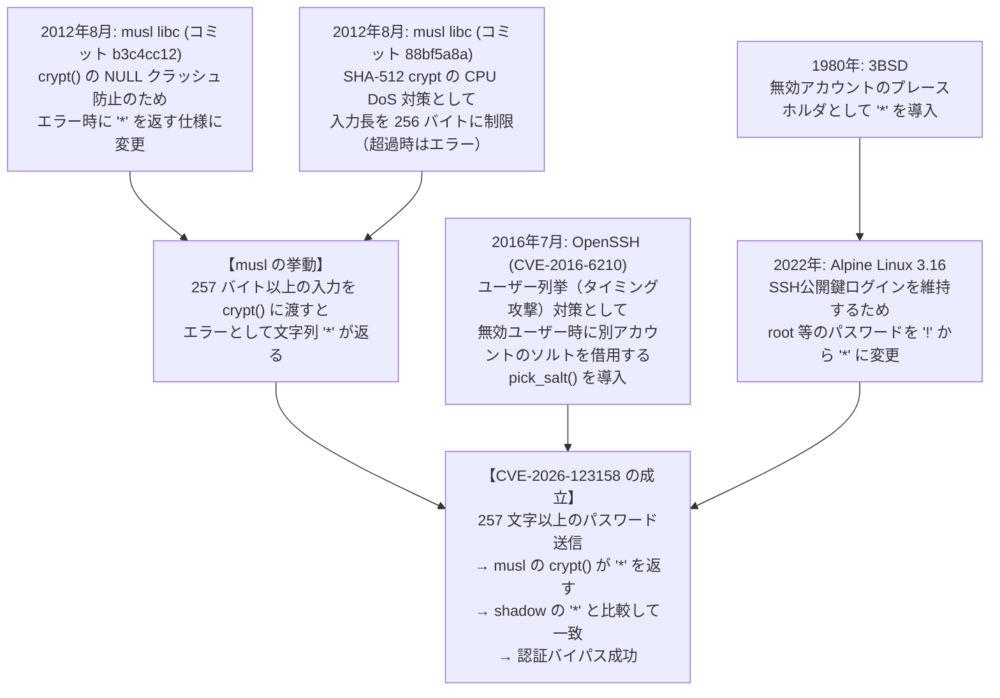
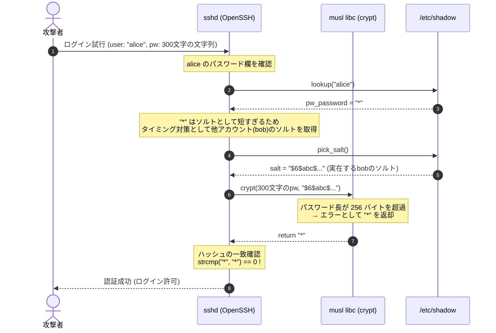

2026年11月5日、OpenSSHのポータブル版において、特定のLinux環境下でパスワード認証を完全にバイパス可能な脆弱性（CVE-2026-123158、通称「`*sshole`」）が公表され、修正版となるOpenSSH 10.6p2がリリースされた[[1]][ref-1][[2]][ref-2]。

本脆弱性は、musl libcを採用しPAM（Pluggable Authentication Modules）が無効化されたLinux環境（Alpine Linux標準構成など）において、パスワード欄が `*`（ログイン不可）に設定されたアカウントに対し、257文字以上のパスワードを入力すると認証が成功してしまうという論理バグである[[3]][ref-3]。


:::message alert
Alpine Linuxなどで標準の `openssh-server` を運用しており、パスワード認証を有効（`PasswordAuthentication yes`）にしているサーバーは脆弱である。速やかに `apk upgrade openssh` による更新を実施するか、設定ファイルで `PasswordAuthentication no` を指定してsshdを再起動する必要がある[[1]][ref-1][[3]][ref-3]。
:::

---

## 概要と成立条件

### 影響を受ける条件

本脆弱性はOpenSSH単体の不具合というよりも、OpenSSHとmusl libcの振る舞いが特定のビルド構成において噛み合った結果として生じる[[2]][ref-2]。悪用が成立するためには、以下の**5つの条件がすべて同時に満たされている**必要がある[[1]][ref-1][[3]][ref-3]。

| # | 条件 | 詳細・デフォルト値 |
|---|---|---|
| 1 | C標準ライブラリが **musl libc** である | Alpine Linux、OpenWrt、Buildroot、Yoctoなどが該当 |
| 2 | sshdが **PAM無効** で動作している | Alpine Linuxの標準パッケージ（`openssh-server`）はPAM無効でビルドされている（`openssh-server-pam` で `UsePAM yes` の場合は対象外） |
| 3 | **パスワード認証が有効** である | `PasswordAuthentication yes`（sshdのデフォルト値） |
| 4 | 標的アカウントのパスワード欄が **`*`** である | `/etc/shadow` のパスワードハッシュ欄が単一文字 `*`（SSH公開鍵専用アカウント、Alpineクラウドイメージの初期ユーザー、root等） |
| 5 | システム内に **有効なパスワードハッシュを持つ別アカウント** が存在する | `/etc/shadow` に `$5$`（SHA-256）や `$6$`（SHA-512）等のハッシュを持つアカウントが1つ以上存在する |

上記すべての条件が揃った場合、攻撃者は257文字以上1024文字以下の任意の文字列をパスワードとして入力することで、パスワードが設定されていないはずのアカウントへ認証を突破してログイン可能となる[[1]][ref-1][[3]][ref-3]。

#### パスワード欄が '*' になる典型例

初期ユーザー `alpine` 以外にも、Linux環境では以下のようなケースで日常的にパスワード欄が `*` のアカウントが作成される。

1. **`adduser -D` で作成したSSH公開鍵専用アカウント**:
   Alpine Linux等で「パスワード認証を禁止し公開鍵認証のみで運用する」方針に基づき、`-D`（`--disabled-password`）オプションでユーザーを作成して `passwd` を設定しなかった場合、パスワード欄は `*` になる。デプロイ用ワーカーや開発者個別アカウントで多用される。
2. **Alpine 3.16 以降の初期状態の `root` アカウント**:
   公式Dockerイメージやクラウドイメージにおいて、鍵認証を阻害しないようパスワード欄が `*` に設定されている。
3. **パッケージ導入時に生成されるサービスアカウント**（特にGit over SSH）:
   `apk add` 等で作成されるデーモンアカウントのうち、ログインシェルが `/bin/sh` や `/usr/bin/git-shell` などに設定されているアカウント（例: `git`）。
4. **LDAP / Active Directory / NSS 連携のローカルアカウント**:
   外部認証を前提とし、ローカルパスワードを持たせない設定のアカウント。

特に「安全のためにパスワードログインを無効化し、公開鍵認証のみで運用していたつもりの環境」ほど、標的となる `*` アカウントが存在しやすくなる点に注意が必要である。

### 影響を受けない環境

以下の環境では本脆弱性の悪用条件が成立しないため、影響を受けない[[1]][ref-1][[3]][ref-3]。

- **glibcを採用しているディストリビューション**: Debian、Ubuntu、RHEL、AlmaLinux、Rocky Linux、Amazon Linux、Fedora、Arch Linuxなど
- **PAM経由で認証している環境**: `UsePAM yes` で動作しているOpenSSH（PAMモジュールが `*` を早期に拒否するため）
- **パスワード認証を無効化している環境**: `PasswordAuthentication no`（公開鍵認証のみ許可）
- **OpenBSD / FreeBSD / macOS**: musl libcを使用していないため対象外
- **Dropbear**: OpenSSH特有のソルト借用ロジックを持たないため対象外

---

## 関連仕様の変遷と時系列

本脆弱性は、UNIXの初期仕様から近年のセキュリティ対策に至るまで、それぞれ異なる目的で行われた仕様変更が複合的に組み合わさった結果として発生した[[1]][ref-1]。



### 1. 1980年: ログイン無効を表すマーカーとしての `*`

UNIX初期の3BSD（1980年）において、Bill Joyが `daemon` アカウントのパスワード欄に `*` を設定した[[1]][ref-1][[4]][ref-4]。

暗号学的ハッシュ関数が生成する文字列の中に単一の `*` は存在し得ないため、「パスワード欄が `*` であれば誰もパスワードではログインできない（ログイン無効）」という慣例が成立し、現代の `/etc/shadow` に至るまで受け継がれてきた[[1]][ref-1]。

### 2. 2012年: musl libcにおけるクラッシュ防止とエラー値 `*`

Single UNIX Specificationなどの規格において、`crypt()` 関数は処理に失敗した場合（未対応のアルゴリズムが指定された場合など）に `NULL` を返すことと定められている[[1]][ref-1]。

しかし、世の中に存在する多くのソフトウェアは `crypt()` の戻り値が `NULL` であることをチェックせずに `strcmp()` などの文字列比較関数に渡しており、NULLポインタデリファレンスによるクラッシュ（SEGV）を引き起こす問題が存在した。

これに対し、musl libcは2012年8月のコミットにおいて、「`crypt()` は失敗時に `NULL` を返さず、どのような正当なパスワードハッシュとも一致しない安全なダミー文字列を返す」方針を採用した[[1]][ref-1]。その際に選ばれたダミー文字が、UNIXの伝統的な無効値である `"*"` であった。

```c
/* musl libc の crypt 実装概念 */
char *crypt(const char *key, const char *setting)
{
    /* 処理に失敗した場合は NULL ではなく "*" を返す */
    if (failure)
        return "*";
    ...
}
```

### 3. 2012年: SHA-512 cryptにおける256バイト長制限

musl libcにSHA-512 cryptアルゴリズムが追加された際、長大なパスワードハッシュ計算に伴うCPUリソース枯渇（DoS攻撃）を防ぐ目的で、入力キーの長さに上限（`KEY_MAX = 256` バイト）が設定された[[1]][ref-1]。

256バイトを超えるパスワードが `crypt()` に渡されると、musl libcはハッシュ計算を中断してエラー処理を行い、前述の仕様に従って文字列 `"*"` を返す。

### 4. 2016年: OpenSSHのタイミング攻撃対策（CVE-2016-6210）

2016年、OpenSSHにおいてユーザー名の列挙を可能にするタイミング攻撃の脆弱性（CVE-2016-6210）が報告された。存在しないユーザー名に対して認証を試みた際、ハッシュ計算を行わずに即座に認証拒否を返すと、実在するユーザー名との応答時間の差からユーザーの存在有無が推測できてしまう問題である[[5]][ref-5]。

OpenSSHはこの対策として、対象アカウントに有効なハッシュが存在しない場合（無効なユーザー名、またはパスワード欄が `*` のアカウント）であっても、システム内の他の実在アカウントからソルトを借用（`pick_salt()`）し、ダミーのハッシュ計算を実行して応答時間を均一化する仕組みを導入した[[1]][ref-1][[5]][ref-5]。

### 5. 2022年: Alpine Linuxにおける `*` の採用

2019年、Alpine LinuxのDocker公式イメージにおいてrootアカウントにパスワードが設定されていなかった問題（CVE-2019-5021）の対策として、rootアカウントを `!`（アカウントロック）に設定する変更が行われた。

しかし、PAMを使用しないAlpine環境において `!` を設定すると、パスワードログインだけでなくSSH公開鍵認証まで拒否されてしまう問題が発生した。そのため、2022年リリースのAlpine 3.16において、公開鍵認証を許可しつつパスワードログインを無効化する目的で、rootやデフォルトユーザーのパスワード欄が `*` に変更された[[1]][ref-1]。

---

## 脆弱性の発現メカニズム

これらの仕様が重なり合うことで、以下のような認証バイパスのシーケンスが発生する。



1. **攻撃の入力**:
   攻撃者は、パスワードが無効化されているアカウント（例: `alice`、shadow上の値は `*`）に対し、257文字以上（例: `A` を300文字）のパスワードを送信する。
2. **ソルトの借用**:
   sshdは `alice` のパスワード欄が `*` であることを確認する。有効なソルトが含まれていないため、CVE-2016-6210のタイミング対策ロジック（`pick_salt()`）が発動し、システム内の別アカウント（例: `bob`）のソルト（`$6$abc$...`）を借用する[[1]][ref-1][[3]][ref-3]。
3. **muslの `crypt()` 呼び出し**:
   sshdは `crypt("AAA... (300文字)", "$6$abc$...")` を実行する。
4. **muslのエラー返却**:
   musl libcのSHA-512 crypt実装は、入力が256バイトを超えているため処理を打ち切り、エラーマーカーである文字列 `"*"` を返す[[1]][ref-1]。
5. **文字列比較の成立**:
   sshdは `crypt()` の返却値（`"*"`）と、shadowファイルに保存されている値（`"*"`）を `strcmp()` で比較する。
   両者が完全に一致（`"*" == "*"`）するため、sshdは「**正しいパスワードが入力された**」と判断し、認証を許可する[[1]][ref-1][[3]][ref-3]。

---

## 修正パッチの技術的解説

OpenSSH開発チーム（Damien Miller氏）は、2026年11月5日に修正パッチをコミットし、OpenSSH 10.6p2をリリースした[[2]][ref-2][[6]][ref-6]。

### コミット差分（`auth-passwd.c`）

修正は非常に簡潔であり、比較対象となる保存パスワード文字列の最小長（`MIN_PASSWORD_HASH_LEN`）を検査するガード節が追加された[[6]][ref-6]。

```diff
--- a/auth-passwd.c
+++ b/auth-passwd.c
@@ -67,6 +67,7 @@ extern login_cap_t *lc;
 #define DAY		(24L * 60 * 60) /* 1 day in seconds */
 #define TWO_WEEKS	(2L * 7 * DAY)	/* 2 weeks in seconds */
 
+#define MIN_PASSWORD_HASH_LEN	4
 #define MAX_PASSWORD_LEN	1024
 
 /*
@@ -198,16 +200,20 @@ sys_auth_passwd(struct ssh *ssh, const char *password)
 	Authctxt *authctxt = ssh->authctxt;
 	struct passwd *pw = authctxt->pw;
 	char *encrypted_password, *salt = NULL;
+	int ret;
 
 	/* Just use the supplied fake password if authctxt is invalid */
-	char *pw_password = authctxt->valid ? shadow_pw(pw) : pw->pw_passwd;
+	char *pw_password = authctxt->valid ?
+	    shadow_pw(pw) : xstrdup(pw->pw_passwd);
 
 	if (pw_password == NULL)
 		return 0;
 
 	/* Check for users with no password. */
-	if (strcmp(pw_password, "") == 0 && strcmp(password, "") == 0)
-		return (1);
+	if (strcmp(pw_password, "") == 0 && strcmp(password, "") == 0) {
+		free(pw_password);
+		return 1;
+	}
 
 	/*
 	 * Encrypt the candidate password using the proper salt, or pass a
@@ -221,7 +227,10 @@ sys_auth_passwd(struct ssh *ssh, const char *password)
 	 * Authentication is accepted if the encrypted passwords
 	 * are identical.
 	 */
-	return encrypted_password != NULL &&
+	ret = encrypted_password != NULL &&
+	    strlen(pw_password) >= MIN_PASSWORD_HASH_LEN &&
 	    strcmp(encrypted_password, pw_password) == 0;
+	freezero(pw_password, strlen(pw_password));
+	return ret;
 }
 #endif
```

### 修正の要点

1. **`MIN_PASSWORD_HASH_LEN` の導入**:
   有効なパスワードハッシュは暗号化アルゴリズム識別子やソルトを含むため、通常数十文字以上の長さを持つ。定数として `4` バイト以上の長さを要求することで、`"*"` や `"!"` などの1文字で構成されるプレースホルダとの一致判定を根本的に除外した[[6]][ref-6]。
2. **メモリ管理の安全性向上**:
   `shadow_pw()` の返却値が従来は静的バッファへのポインタだった箇所を `xstrdup()` で明示的に動的確保し、比較終了後に `freezero()` で安全にメモリをゼロクリア・解放するようリファクタリングされた[[6]][ref-6]。

---

## ディストリビューション別の影響と対応状況

| ディストリビューション | 影響有無 | 修正版バージョン | 補足 |
|---|---|---|---|
| **Alpine Linux** | **あり** | `10.6p2` 相当パッケージ | v3.20〜v3.24およびedge向けに修正版パッケージが緊急リリース[[1]][ref-1][[3]][ref-3] |
| **OpenWrt** | **あり** | 更新パッケージ準備中 | musl採用かつOpenSSH使用環境で影響あり（Dropbear環境は対象外） |
| **Buildroot / Yocto** | **あり** | 各自パッチ適用 | muslベースでビルドしたイメージにおいてパッチの適用が必要[[3]][ref-3] |
| **Debian / Ubuntu** | **なし** | - | glibcを採用しているため影響を受けない[[1]][ref-1] |
| **RHEL / Rocky / Alma** | **なし** | - | glibcを採用しているため影響を受けない[[1]][ref-1] |
| **Amazon Linux** | **なし** | - | glibcを採用しているため影響を受けない[[1]][ref-1] |

---

## 自環境の確認方法と対策

### 1. 影響診断スクリプトによる確認

脆弱性の発見者であるÖzgün Kültekin氏が公開した診断スクリプト（`check.sh`）を用いて、自環境が影響を受けるか確認できる[[3]][ref-3]。

:::message
**スクリプトの安全性について**:
`check.sh` のコードは全86行のシンプルなシェルスクリプトであり、外部への通信やシステムファイルの改変処理は一切含まれていない（`/etc/shadow` や `sshd -T` の読み取り判定のみを実行する）。ただし、root権限で外部スクリプトを実行するリスクを避けるため、内容を一度確認してから実行するか、後述の手動確認コマンドの利用を推奨する。
:::

```bash
# スクリプトをダウンロードして内容を確認
curl -sO https://raw.githubusercontent.com/oz9un/sshole/main/check.sh
less check.sh

# 安全性を確認した上で実行
sudo sh check.sh
```

**出力例**（脆弱な環境の場合）:
```text
libc                         musl
sshd                         OpenSSH_10.3p1, OpenSSL 3.5.9 29 Sep 2026
pam                          off (not built in)
PasswordAuthentication       yes
accounts with '*'            root alice deploy
sha-crypt hash present       yes (bob)

EXPOSED. anyone can log in as: root alice deploy
fix: apk upgrade openssh (10.6p2), or set PasswordAuthentication no until you can.
```

### 2. 手動での設定確認（推奨）

外部スクリプトを実行せずに確認する場合、以下の4項目を順に確認する。

1. **C標準ライブラリの確認**:
   ```bash
   ldd --version 2>&1 | head -n 1
   ```
   出力に `musl` が含まれるかを確認する（`glibc` の場合は対象外）。
2. **sshdの設定確認**:
   ```bash
   sshd -T | grep -E '^(passwordauthentication|usepam)'
   ```
   `passwordauthentication yes` かつ `usepam no`（またはPAM非対応）となっているかを確認する。
3. **パスワード欄が `*` のアカウントの有無**:
   ```bash
   sudo awk -F: '$2 == "*" {print $1}' /etc/shadow
   ```
   `adduser -D` で作成したSSH鍵専用ユーザー、`git` などのサービスアカウント、初期状態の `root` や `alpine` ユーザーが存在するかを確認する。
4. **ソルト借用元となる別アカウントのハッシュの有無**:
   ```bash
   sudo awk -F: '$2 ~ /^\$[56]\$/ {print $1; exit}' /etc/shadow
   ```
   システム内に `$5$`（SHA-256）や `$6$`（SHA-512）のパスワードハッシュを持つ実在アカウントが1つでも存在するかを確認する。

### 3. 対策手順

#### 恒久対策: パッケージの更新
Alpine Linux環境では、パッケージインデックスを更新してOpenSSHを最新版にアップグレードし、sshdを再起動する[[1]][ref-1][[3]][ref-3]。

```bash
apk update
apk upgrade openssh
rc-service sshd restart
```

#### 即時緩和策: パスワード認証の無効化
直ちにパッケージの更新やサーバー再起動が行えない環境では、sshdの設定でパスワード認証を無効化（公開鍵認証専用）とすることで、本脆弱性を完全に防ぐことができる[[1]][ref-1][[3]][ref-3]。

```bash
# パスワード認証を無効化する設定を追加
echo "PasswordAuthentication no" > /etc/ssh/sshd_config.d/00-no-passwords.conf

# sshd の設定を再読み込みまたは再起動
rc-service sshd restart
```

:::message
設定変更後に現在の接続を切断する前に、必ず別の端末からSSH公開鍵によるログインが正常に行えることを確認すること。
:::

---

## AIエージェントを活用した脆弱性発見とエコシステムの反応

本脆弱性の発見経緯において、発見者のÖzgün Kültekin氏は、**並列動作する多数のAIエージェントを活用した差分テスト**（差分ファジング）によって本バグを検出したと述べている[[1]][ref-1]。

OpenSSHとlibc（glibc / musl）、PAMの有無、shadow構成などの組み合わせに対し、17,000通り以上のエッジケースログインを自動生成して検証した結果、musl環境のみが異常な挙動を示したことで発見に至った[[1]][ref-1]。

また、OpenSSH公式チームも10.6p2のリリースノートにおいて、昨今AIを活用した脆弱性報告が急増している点に言及している[[2]][ref-2]。「AIによって発見された脆弱性が、直後に別の研究者によって独自に再発見されるケースが増加している。これは攻撃者側も同様の手法で未報告の脆弱性を発見可能であることを示唆している」として、OpenSSHプロジェクトは従来の計画的リリース間隔にとらわれず、修正パッチをより迅速にリリースする方針への転換を表明している[[2]][ref-2]。

---

## 参考資料・出典一覧

1. [sshhole.com (*sshole 解説サイト)][ref-1]
2. [OpenSSH 10.6p2 リリースノート (2026-11-05)][ref-2]
3. [GitHub リポジトリ (oz9un/sshole)][ref-3]
4. [3BSD /etc/passwd (dspinellis/unix-history-repo)][ref-4]
5. [OpenSSH commits: Timing attack mitigation for invalid users (CVE-2016-6210)][ref-5]
6. [OpenSSH upstream patch: avoid password authn bypass][ref-6]

[ref-1]: https://sshhole.com/
[ref-2]: https://www.openssh.com/txt/release-10.6p2
[ref-3]: https://github.com/oz9un/sshole
[ref-4]: https://github.com/dspinellis/unix-history-repo/blob/BSD-3/etc/passwd
[ref-5]: https://lists.mindrot.org/pipermail/openssh-commits/2016-July/005428.html
[ref-6]: https://raw.githubusercontent.com/oz9un/sshole/main/patch/4353fdc43-avoid-password-authn-bypass.patch
