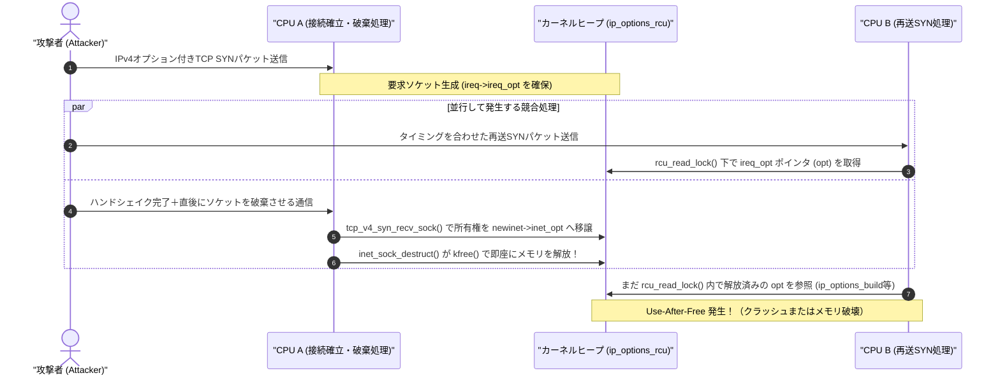

## 概要

- **何が起きたか**: LinuxカーネルのIPv4 TCP接続処理において、解放済みメモリを参照してしまう **Use-After-Free（UAF）脆弱性（CVE-2026-98432）** が発見・公開された[[1]][ref-1]。
- **深刻度**: Linux Kernel CNA（CVE.org）およびRed Hat、UbuntuにおけるCVSS v3.1スコアは **9.8 (Critical)**[[2]][ref-2]（Red Hatも当初の8.1 Importantから **9.8 Critical** へ引き上げ[[3]][ref-3]、AWSも7.0から **8.1 Important**[[4]][ref-4] へ更新）。ネットワーク経由で認証なしにトリガー可能であり、通常のTCPリスナー環境ではDoS（カーネルパニック・システムクラッシュ）を引き起こす可能性がある。また、発見者であるAnthropic社は、**Multipath TCP（MPTCP）リスナー** に対してリモートコード実行（RCE）が可能であると報告した[[15]][ref-15]。
- **対策**: 各Linuxディストリビューションおよびクラウドプロバイダーから提供されている修正済みカーネルパッケージ・ノードイメージへ速やかにアップデートし、システムを再起動する必要がある。

## 影響を受けるバージョンと修正バージョン

| 項目 | 内容 |
| :--- | :--- |
| **CVE ID** | CVE-2026-98432 [[2]][ref-2] |
| **対象ソフトウェア** | Linux Kernel（IPv4 TCPサブシステム）[[1]][ref-1] |
| **CVSSスコア** | ・**9.8 Critical** (`CVSS:3.1/AV:N/AC:L/PR:N/UI:N/S:U/C:H/I:H/A:H` — Linux Kernel CNA / Red Hat / Ubuntu評価)[[2]][ref-2][[3]][ref-3][[10]][ref-10]<br>・**8.1 Important** (`CVSS:3.1/AV:N/AC:H/PR:N/UI:N/S:U/C:H/I:H/A:H` — AWS評価)[[4]][ref-4] |

### 1. Upstream Linux Kernel のバージョン

本脆弱性は、要求ソケットのロックレス処理を導入したコミット `079096f103fa` を含む **Linux Kernel 4.4 以降**のすべての系統に影響し、修正コミット `e3f33b0a1d89` にて解消された[[12]][ref-12]。各安定版（Stable / LTS）ブランチにおける影響範囲と修正版は以下の通りである。

| カーネル系統 | 影響を受けるバージョン | 修正版 | 補足 |
| :--- | :--- | :--- | :--- |
| **4.4 以降のEOL系統** | `4.4〜5.9`, `5.11〜5.14`, `5.16〜6.0`, `6.2〜6.5`, `6.7〜6.11`, `6.13〜6.17`, `6.19〜7.1` [[12]][ref-12] | 対応しない | Upstreamサポート終了（EOL）。各ディストリビューションのバックポートに依存 |
| **5.10 系 (LTS)** | `>= 5.10, < 5.10.272` | **`5.10.272`** [[12]][ref-12] | - |
| **5.15 系 (LTS)** | `>= 5.15, < 5.15.223` | **`5.15.223`** [[12]][ref-12] | - |
| **6.1 系 (LTS)** | `>= 6.1, < 6.1.190` | **`6.1.190`** [[12]][ref-12] | - |
| **6.6 系 (LTS)** | `>= 6.6, < 6.6.159` | **`6.6.159`** [[12]][ref-12] | - |
| **6.12 系 (LTS)** | `>= 6.12, < 6.12.113` | **`6.12.113`** [[12]][ref-12] | - |
| **6.18 系** | `>= 6.18, < 6.18.56` | **`6.18.56`** [[12]][ref-12] | - |
| **7.2 系 / Mainline** | `>= 7.2, < 7.2.10` | **`7.2.10`** [[12]][ref-12] | Mainlineは **`7.3`** [[12]][ref-12] |

### 2. 主要Linuxディストリビューションのバージョン

ディストリビューションが提供するカーネルでは独自にパッチがバックポートされるため、ディストリビューションごとのパッケージバージョンおよびアドバイザリを確認する必要がある（2026年10月31日時点）。

| ディストリビューション | 対象リリース / パッケージ | 修正版 | 補足 |
| :--- | :--- | :--- | :--- |
| **Amazon Linux 2023** | `kernel` (6.1系) | **`6.1.190` 系** [[7]][ref-7] | アドバイザリ: `ALAS2023-2026-3365` |
| **Amazon Linux 2023** | `kernel6.12` | **`6.12.113-138.209.amzn2023`** [[5]][ref-5] | アドバイザリ: `ALAS2023-2026-3335` |
| **Amazon Linux 2023** | `kernel6.18` | **`6.18.56-125.164.amzn2023`** [[6]][ref-6] | アドバイザリ: `ALAS2023-2026-3251` |
| **Amazon Linux 2** | `kernel` (Core 4.14 / Extras 5.4, 5.10, 5.15) | **`ALAS2-2026-4065` 等** [[4]][ref-4][[8]][ref-8] | Extrasは `ALAS2KERNEL-5.4-2026-135` / `5.10-2026-137` / `5.15-2026-120` [[4]][ref-4] |
| **Debian** | Debian 13 (Trixie) / `linux` | **`6.12.113-1`** [[9]][ref-9] | Stableリリース（`DSA-6568-1`） |
| **Debian** | Debian 12 (Bookworm) / `linux` | **`6.1.190-1`** [[9]][ref-9] | Oldstableリリース（`linux-6.12` は `6.12.113-1~deb12u1`）[[9]][ref-9] |
| **RHEL (Red Hat)** | RHEL 8, RHEL 9, RHEL 10 | **準備中** [[3]][ref-3][[13]][ref-13] | 深刻度 Critical (CVSS 9.8 / `RHSB-2026-016`)。RHEL 6, 7 は影響なし [[3]][ref-3] |
| **Ubuntu** | Ubuntu 16.04 LTS 〜 26.10 | **準備中** [[10]][ref-10] | 優先度 High (CVSS 9.8)。各 `linux-image-*` パッケージへバックポート作業中 |
| **SUSE / openSUSE** | SLES 15 / 16, openSUSE Leap 16.0 等 | **`SUSE-SU-2026:24386-1` 等** [[11]][ref-11] | `24422-1` / `24437-1` 等で順次リリース（一部SPは準備中）[[11]][ref-11] |

### 3. 主要クラウドプロバイダー（AWS / Azure / Google Cloud）の対応状況

本脆弱性はホストOSのLinuxカーネルに存在するため、クラウド上の仮想マシン（VM）だけでなく、**ホストカーネルを共有するコンテナ実行環境（Kubernetesのワーカーノード等）も影響を受ける**。コンテナイメージ単体の更新では解消されず、ホストOS（ノード）側のカーネル更新と再起動（またはノード置換）が必須となる。

| クラウド | 対象サービス / OS | 修正版 | 補足 |
| :--- | :--- | :--- | :--- |
| **AWS** | EC2 / EKS (`AL2023 kernel 6.1 / 6.12 / 6.18`) | **`6.1.190` / `6.12.113` / `6.18.56`** [[5]][ref-5][[6]][ref-6][[7]][ref-7] | すべての系統で修正版を提供済み。`dnf update` と再起動（EKSはノード置換）が必要 |
| **AWS** | EC2 / EKS (`Amazon Linux 2`) | **`ALAS2-2026-4065` 等** [[4]][ref-4][[8]][ref-8] | Core (4.14) および Extras (5.4 / 5.10 / 5.15) の全系統で修正版を提供済み |
| **Microsoft Azure** | Azure VM / AKS | **準備中** [[3]][ref-3][[10]][ref-10] | Ubuntu (`linux-azure`)、RHEL、Azure Linux等の修正版提供後に更新・ノード再起動が必要 |
| **Google Cloud (GCP)** | Compute Engine (Debian 12 / 13) | **`6.1.190-1` / `6.12.113-1`** [[9]][ref-9] | パッケージ更新とVM再起動が必要 |
| **Google Cloud (GCP)** | GKE (Container-Optimized OS / Ubuntu) | **順次提供（準備中）** [[10]][ref-10][[14]][ref-14] | COS各マイルストーン（`COS-133 LTS` 等）の修正版提供に合わせノードプールの更新が必要 |

## 影響を受ける条件

本脆弱性の影響を受けるかどうか、また影響の度合い（DoSか、RCEの条件にも該当するか）は、**①ネットワーク構成（前段のリバースプロキシ等の有無）**、**②IPv4オプション付きパケットの到達性**、**③Multipath TCP（MPTCP）リスナーの有無**の3点によって決まる。

### 1. 前提となるネットワーク構成（リバースプロキシ・ロードバランサーの有無）

本脆弱性をトリガーするには、攻撃者が送信した細工済みのTCP SYNパケット（IPv4オプション付き）が、対象Linuxサーバーのカーネルまで直接到達する必要がある[[1]][ref-1]。

- **外部から直接攻撃可能な構成（リスク大）**:
  - LinuxサーバーがグローバルIPを持ち、インターネットへ直接TCPポートを公開している場合。
  - 前段にL4ロードバランサー（AWS NLBなど、TCP接続を終端せずパケットをそのままバックエンドへ転送するもの）を配置している場合。
- **外部から直接攻撃できない構成（リスク小）**:
  - 前段に **クラウドのマネージドL7ロードバランサー／CDN（AWS ALB、CloudFront、Cloudflare、Google Cloud Load Balancing等）や、非Linux製アプライアンスのリバースプロキシ** が配置されており、バックエンドのLinuxサーバーへはプロキシからの通信のみを許可している場合。
  - L7リバースプロキシはクライアントとのTCP接続を一度終端し、バックエンドサーバーとの間で新たに標準的なTCP接続（IPv4オプションを含まないパケット）を確立するため、外部の攻撃者が付与したIPv4オプションは背後のLinuxサーバーには到達しない（※ただし、前段のリバースプロキシ自体が未修正のLinuxサーバー上で直接外部公開されている場合は、そのプロキシサーバー自身が攻撃対象となり得る）。

### 2. IPv4オプション付きパケットの受信

- **IPv4オプションとは**:
  IPv4オプションは、**IPv4プロトコル（ネットワーク層 / L3、RFC 791）のヘッダ仕様** である。IPv4ヘッダの基本長（20バイト）の末尾に最大40バイトまで追加できる拡張領域であり、経路上のルーターを記録する「Record Route (RR)」や通過時刻を記録する「Timestamp (TS)」、経路を指定する「Source Routing」などが定義されている。主にネットワーク診断（`ping -R` など）やデバッグ用途で作られたレガシーな機能であり、通常のWeb/API通信やSSH等で利用されることはほぼない。
- **なぜIPv4（L3）のオプションがTCP（L4）で処理されるのか**:
  RFC 1122等において、クライアントからIPv4オプション付きのTCP `SYN` パケットを受信したサーバーは、返信する `SYN-ACK` パケットや確立後のTCP通信のIPv4ヘッダにもそのIPv4オプションを引き継いで（反映して）送り返す必要がある。そのため、LinuxカーネルはRFC準拠の挙動として、**デフォルトで受信したTCP `SYN` パケット内のIPv4オプションを解析し、TCPのソケット構造体（`ireq->ireq_opt` / `newinet->inet_opt`）に保持する仕様**になっている。
  結果として、外部からTCPパケットが直接到達する構成にあるすべての未修正Linuxサーバーは、通常のTCPリスナーであっても、このIPv4オプション構造体の引き渡し・解放処理におけるUse-After-Freeによってシステムクラッシュ（DoS）の影響を受ける[[3]][ref-3]。

### 3. Multipath TCP（MPTCP）リスナーの利用

発見者であるAnthropic社の研究チームは、**Multipath TCP（MPTCP）のリスナーソケットを公開している環境** に対してリモートrootコード実行（RCE）を実証した[[15]][ref-15]。他の環境でもRCEが実行可能かは不明であるが、MPTCPリスナーを公開している場合、RCEを実行されるリスクが大きい。

- **Multipath TCP（MPTCP）とは**:
  1つのTCP接続を複数のネットワーク経路（例：スマートフォンのWi-Fiとモバイル通信、あるいはサーバーの複数NIC）に束ねて同時に通信することで、帯域幅の合算や回線断時のシームレスなフェイルオーバーを実現するTCP拡張仕様（RFC 8684）である。
- **デフォルトの有効化状況と該当ケース**:
  Linux Kernel 5.6以降で標準統合されており、Ubuntu、RHEL、Debian等の主要ディストリビューションではカーネルパラメータ `net.mptcp.enabled` が **デフォルトで `1`（有効）** になっていることが多い。
  ただし、`net.mptcp.enabled = 1` になっているだけでは、C言語等で実装された従来のTCPサーバー（NginxやOpenSSHなど、通常の `IPPROTO_TCP` ソケット）はMPTCPリスナーとしては動作しない。以下のいずれかに該当する場合にMPTCPリスナーとして動作する。
  1. **Go 1.24 以降でビルドされたプログラムを稼働させている場合**:
     Go言語は **Go 1.24 以降、Linux上のリスニングソケット（`net.Listen` 等）においてデフォルトでMPTCPを有効化する仕様** に変更されている[[16]][ref-16]。そのため、開発者がMPTCPを意識してコードを書いていなくても、Go 1.24以降でビルドされたWebサーバー、APIサーバー、リバースプロキシ等をLinux上で稼働させている場合は自動的にMPTCPリスナーとなる。
  2. **アプリケーションやツールで明示的にMPTCPを有効化している場合**:
     システムコールで `IPPROTO_MPTCP` を指定してソケットを生成している場合や、`mptcpize` コマンド等で既存のTCPサービスをMPTCPソケットに置き換えて起動している場合。

### 4. 自環境の確認コマンド

稼働中のLinuxサーバーにおけるカーネルバージョン、MPTCPの有効化状態、および現在MPTCPで待ち受けているリスナーソケットの有無は以下のコマンドで確認できる。

```bash
# 1. 稼働中のカーネルバージョンの確認
uname -r

# 2. カーネルのMPTCP機能が有効（1）かどうかの確認
sysctl net.mptcp.enabled

# 3. 現在MPTCPとして待ち受けているリスナーソケットの確認
# （※ -t を併用すると通常のTCPソケットも表示されるため、-M のみを指定する）
sudo ss -Mlnp
```

## 脆弱性の技術的な仕組み

### 前提となるアーキテクチャ・仕様

LinuxカーネルがTCPの3ウェイ・ハンドシェイクを処理する際、最初にクライアントから `SYN` パケットを受信すると、軽量な「要求ソケット（`struct request_sock` / `inet_request_sock`）」を生成して接続状態を保持する。このとき、クライアントからのパケットにIPv4オプション（Record RouteやTimestampなど）が含まれていると、そのオプション情報は `ireq->ireq_opt`（`struct ip_options_rcu`）に格納される。

その後、ハンドシェイクが完了して通信用の完全な「子ソケット（full socket）」が生成される際、`tcp_v4_syn_recv_sock()` 関数が呼び出される。この関数内ではパフォーマンス最適化のため、`ireq->ireq_opt` のメモリを新しく複製（ディープコピー）せず、**ポインタの所有権をそのまま子ソケット側の `newinet->inet_opt` へ引き渡す（ムーブする）**という実装になっていた[[12]][ref-12]。

```c
// tcp_v4_syn_recv_sock() におけるポインタ引き渡しの概念
newinet->inet_opt = rcu_dereference(ireq->ireq_opt);
RCU_INIT_POINTER(ireq->ireq_opt, NULL);
```

### 原因

かつてのLinuxカーネルでは、要求ソケットの処理中にリスナーソケットのロックを保持していたため、複数のCPUスレッドが同じ要求ソケットを同時に操作することはなかった。しかし、スケーラビリティ向上のための過去の変更（コミット `079096f103fa`）により、ロックレスで要求ソケットを処理できるようになったことで、以下の**競合状態（Race Condition）**が発生し得るようになった[[12]][ref-12]。

1. **CPU B（再送SYNパケットによるポインタ取得）**:
   再送された `SYN` パケットをCPU Bが受信すると、`tcp_check_req()` から `tcp_v4_send_synack()` が呼び出される。この処理は `rcu_read_lock()` の保護下で `opt = rcu_dereference(ireq->ireq_opt)` を実行し、オプション構造体へのポインタを取得する。
2. **CPU A（ハンドシェイク完了とソケット破棄による即時解放）**:
   CPU Bがまだ `rcu_read_lock()` のクリティカルセクション内で処理を行っている最中に、CPU Aでハンドシェイク完了に伴う `tcp_v4_syn_recv_sock()` が実行され、`ireq->ireq_opt` の所有権が子ソケット `newinet->inet_opt` に移される（同時に `ireq->ireq_opt` は `NULL` になる）。直後にエラーやリセット等によってこの子ソケットが破棄されると、`inet_sock_destruct()` が呼び出され、**`kfree()` によって即座に `inet_opt`（＝CPU Bが参照中の `opt`）のメモリが解放される**。
3. **CPU B（解放済みメモリの参照）**:
   直後にCPU Bが `ip_options_build()` 等で取得済みのポインタ `opt` を読み取ることで、解放済みメモリへのアクセス（**Use-After-Free**）が発生する。

つまり、CPU BはRCU（Read-Copy Update）の読み取りクリティカルセクション内でポインタを参照しているにもかかわらず、CPU A側がRCUの猶予期間（Grace Period）を待たずに通常の `kfree()` でメモリを即時解放してしまうことが根本原因である。

また、`net.ipv4.tcp_migrate_req=1` や eBPF の `BPF_SK_REUSEPORT_SELECT_OR_MIGRATE` によるソケットマイグレーション処理における `tcp_v4_reqsk_destructor()` でも、同様に `kfree()` による即時解放の問題が存在していた。

### 攻撃フロー



## 修正パッチ

Upstreamカーネルにおける修正コミット `e3f33b0a1d89`（`ipv4: free inet_opt and ireq_opt after an RCU grace period`）は非常にシンプルである[[12]][ref-12]。

ソケット破棄時のデストラクタである `inet_sock_destruct()` と `tcp_v4_reqsk_destructor()` において、即時解放を行う `kfree()` の代わりに、すべてのCPUがRCU読み取りクリティカルセクションを抜けるまで解放を遅延させる **`kfree_rcu()`** を使用するように修正された。

```diff c:net/ipv4/af_inet.c
 void inet_sock_destruct(struct sock *sk)
 {
 	struct inet_sock *inet = inet_sk(sk);
 ...
-	kfree(rcu_dereference_protected(inet->inet_opt, 1));
+	kfree_rcu(rcu_dereference_protected(inet->inet_opt, 1), rcu);
 	dst_release(rcu_dereference_check(sk->sk_rx_dst, 1));
```

```diff c:net/ipv4/tcp_ipv4.c
 static void tcp_v4_reqsk_destructor(struct request_sock *req)
 {
-	kfree(rcu_dereference_protected(inet_rsk(req)->ireq_opt, 1));
+	kfree_rcu(rcu_dereference_protected(inet_rsk(req)->ireq_opt, 1), rcu);
 }
```

`struct ip_options_rcu` 構造体には元々 `struct rcu_head rcu` メンバが含まれていたため、`kfree_rcu(..., rcu)` に置き換えるだけで、他スレッドが `rcu_read_lock()` 下でオプションを参照している最中にメモリが回収されることを確実に防げるようになっている。

## 対策と緩和策

### 1. 恒久対策：修正バージョンへのアップデートと再起動

最も確実な対策は、各ディストリビューションおよびクラウドベンダーが提供する修正パッチ適用済みのカーネルパッケージへ更新し、OSを再起動することである。

:::details 主要ディストリビューションでの更新コマンド例
```bash
# Amazon Linux 2023 (標準 kernel 6.1系 の場合)
sudo dnf update kernel --releasever latest -y
sudo reboot

# Amazon Linux 2023 (kernel6.12 の場合)
sudo dnf update kernel6.12 --releasever 2023.12.20261028 -y
sudo reboot

# Amazon Linux 2023 (kernel6.18 の場合)
sudo dnf update kernel6.18 --releasever 2023.12.20261026 -y
sudo reboot

# Amazon Linux 2 の場合
sudo yum update kernel -y
sudo reboot

# RHEL / AlmaLinux / Rocky Linux 系
sudo dnf upgrade --refresh kernel -y
sudo reboot

# Ubuntu / Debian 系
sudo apt update && sudo apt upgrade -y
sudo reboot
```
:::

### 2. 一時的な緩和策

システムの都合上、直ちにカーネルアップデートと再起動を行えない場合は、以下の緩和策を組み合わせることでリスクを低減できる。

1. **IPオプション付きパケットの遮断**:
   境界ファイアウォールや `nftables` / `iptables` 等で、不要なIPオプション付きパケット（IPv4ヘッダ長が20バイト＝5ワードを超えるTCPパケット）をドロップする。Red Hatのセキュリティアドバイザリでは以下の `nftables` ルールが案内されている[[3]][ref-3][[13]][ref-13]。
   ```nft
   table inet cve_2026_98432 {
       chain input {
           type filter hook input priority -310; policy accept;
           ip protocol tcp ip hdrlength > 5 counter drop
       }
   }
   ```
2. **MPTCPの無効化および不要な公開ポートの制限**:
   - **OSレベルでのMPTCP無効化**: MPTCPを使用していない場合は、`sysctl -w net.mptcp.enabled=0`（永続化する場合は `/etc/sysctl.d/` に設定追加）で無効化する[[15]][ref-15]。`net.mptcp.enabled=0` にすると、Go 1.24以降のプログラムも起動時に自動的に通常のTCPソケットへフォールバックする。ただし、設定変更前から起動していたプロセスの既存MPTCPリスナーソケットはそのまま残るため、**設定変更後に該当プロセスを再起動し、`sudo ss -Mlnp` でMPTCPリスナーが存在しないことを確認する**必要がある。
   - **前段へのL7プロキシ配置・ポート制限**: パブリックIPへの直接アクセスを避け、TCP接続を終端するマネージドL7ロードバランサー（ALB等）を経由させるか、セキュリティグループで信頼できる送信元のみに制限する。

## 参考資料・出典一覧

1. [NVD - CVE-2026-98432 Detail][ref-1]
2. [CVE.org - CVE-2026-98432][ref-2]
3. [Red Hat Customer Portal - CVE-2026-98432][ref-3]
4. [AWS Linux Security Center - CVE-2026-98432][ref-4]
5. [Amazon Linux 2023 Security Advisory: ALAS2023-2026-3335][ref-5]
6. [Amazon Linux 2023 Security Advisory: ALAS2023-2026-3251][ref-6]
7. [Amazon Linux 2023 Security Advisory: ALAS2023-2026-3365][ref-7]
8. [Amazon Linux 2 Security Advisory: ALAS2-2026-4065][ref-8]
9. [Debian Security Tracker - CVE-2026-98432][ref-9]
10. [Ubuntu Security - CVE-2026-98432][ref-10]
11. [SUSE Security CVE - CVE-2026-98432][ref-11]
12. [Linux Kernel Security - CVE-2026-98432.mbox][ref-12]
13. [Red Hat Security Bulletin: RHSB-2026-016][ref-13]
14. [Google Cloud Container-Optimized OS Release Notes][ref-14]
15. [Anthropic Research - Discovering and exploiting vulnerabilities in critical, real-world software with Claude][ref-15]
16. [Go 1.24 Release Notes - Minor changes to the library (net)][ref-16]

[ref-1]: https://nvd.nist.gov/vuln/detail/CVE-2026-98432
[ref-2]: https://www.cve.org/CVERecord?id=CVE-2026-98432
[ref-3]: https://access.redhat.com/security/cve/CVE-2026-98432
[ref-4]: https://explore.alas.aws.amazon.com/CVE-2026-98432.html
[ref-5]: https://alas.aws.amazon.com/AL2023/ALAS-2026-3335.html
[ref-6]: https://alas.aws.amazon.com/AL2023/ALAS-2026-3251.html
[ref-7]: https://alas.aws.amazon.com/AL2023/ALAS-2026-3365.html
[ref-8]: https://alas.aws.amazon.com/AL2/ALAS-2026-4065.html
[ref-9]: https://security-tracker.debian.org/tracker/CVE-2026-98432
[ref-10]: https://ubuntu.com/security/CVE-2026-98432
[ref-11]: https://www.suse.com/security/cve/CVE-2026-98432.html
[ref-12]: https://git.kernel.org/pub/scm/linux/security/vulns.git/plain/cve/published/2026/CVE-2026-98432.mbox
[ref-13]: https://access.redhat.com/security/vulnerabilities/RHSB-2026-016
[ref-14]: https://cloud.google.com/container-optimized-os/docs/release-notes
[ref-15]: https://www.anthropic.com/research/discovering-vulnerabilities-with-claude
[ref-16]: https://go.dev/doc/go1.24
