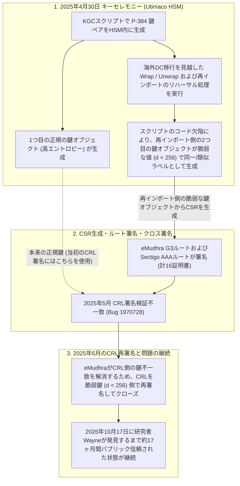
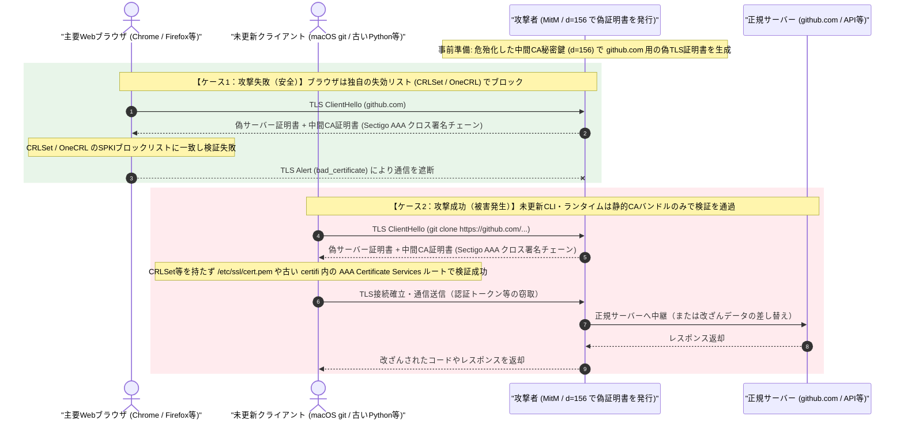

## 概要

- **何が起きたか**: 2026年10月、インドの認証局（CA）である **eMudhra** が発行した **8つの中間CA証明書（TLS用6つ、コード署名用2つ）** において、秘密鍵 $d$ が1バイト以下の整数で生成されており、公開された証明書から誰でも秘密鍵を算出・復元できる状態であったことが発覚した[[1]][ref-1][[5]][ref-5][[16]][ref-16]。
- **主な影響**: パブリックトラストされた中間CAの秘密鍵が事実上公開された状態となったため、攻撃者は任意のドメインに対する偽のTLSサーバー証明書、TLSクライアント証明書、およびコード署名証明書を独力で偽造でき、通信の盗聴・改ざん（中間者攻撃：MitM）、パブリックCAを信頼するmTLS（クライアント証明書認証）の突破、不正バイナリへの署名が可能な状態となった。さらに、これら8つの中間CAはeMudhra自身のルートCA（`emSign ECC Root CA - G3`）だけでなく、Sectigo（旧Comodo）のルートCA（`AAA Certificate Services`）からもクロス署名されていたため、計8鍵ペア・16枚の中間CA証明書が影響を受けた[[1]][ref-1][[4]][ref-4][[15]][ref-15]。
- **対策**: 主要Webブラウザ（Chrome、Firefox、Safari、Edge）には緊急のブロックリスト（CRLSet / OneCRL等）が自動配信済みである[[5]][ref-5][[11]][ref-11][[12]][ref-12][[13]][ref-13]。しかし、**ブラウザ以外のCLIツール（`curl`、`git`）、Linuxの `ca-certificates`、コンテナイメージ、および独自のトラストストアを内蔵する言語ランタイム（Python `certifi`、Node.js、Go、Rust `webpki-roots` 等）・開発ツール（JetBrains IDE等）・Electron製アプリ（VS Code、Obsidian、Slack等）は自動保護されない**ため、システム管理者および開発者による個別のパッケージ更新・再ビルドが必須である[[1]][ref-1][[2]][ref-2][[29]][ref-29]。

:::message
本記事は 2026年10月31日 時点の公式発表および一次情報に基づいている。最新のパッチ提供状況や緩和策については各ベンダーの公式アドバイザリを確認してほしい。
:::

## 被害・影響範囲と各環境の対応状況

| 項目 | 公表されている内容 |
| :--- | :--- |
| **関連識別子** | Mozilla Bugzilla **Bug 2083449** [[5]][ref-5] / **CVE-2026-111943**（Go）[[26]][ref-26] / **CVE-2026-113470**（AWS）[[20]][ref-20] / **CVE-2026-114406**（Red Hat）[[19]][ref-19] / **CVE-2026-115570**（Electron）[[29]][ref-29] |
| **危殆化した中間CA** | eMudhraの中間CA 8鍵ペア・計16証明書（TLS用6鍵ペア、コード署名用2鍵ペア）[[1]][ref-1][[4]][ref-4] |
| **親ルートCA** | ・`emSign ECC Root CA - G3`（配下の `emSign Root TLS CA - G3` / `emSign Root CS CA - G3` を含む）[[5]][ref-5][[12]][ref-12]<br>・`AAA Certificate Services`（Sectigo / 旧Comodo によるクロス署名ルート）[[1]][ref-1][[4]][ref-4] |
| **影響を受けた期間** | 2025年4月30日（鍵生成・証明書発行）〜 2026年10月17日（発覚・緊急遮断開始）[[5]][ref-5] |
| **eMudhraの事業対応** | 2026年10月21日、グローバルなパブリックSSL/TLS証明書事業からの撤退を表明[[5]][ref-5] |

### 1. 危殆化した8つの中間CA証明書と秘密鍵 $d$

今回危殆化が確認された8つの中間CA（P-384 / `secp384r1`）と、Cloudflareの解析レポート等で公表された実際の秘密鍵 $d$ は以下の通りである。`G3B` シリーズはオランダ法人（`O=eMudhra BV, C=NL`）、`G3C` シリーズは米国法人（`O=eMudhra Inc, C=US`）名義で発行されており、TLS用の6つの中間CA（#1〜#6）の拡張鍵用途（`X509v3 Extended Key Usage`）には **`TLS Web Server Authentication`（サーバー証明書）と `TLS Web Client Authentication`（クライアント証明書）の両方が含まれている**[[1]][ref-1][[4]][ref-4][[16]][ref-16]。

| # | 中間CA名 (Common Name) | 用途 (EKU) | 発行対象 | 秘密鍵 $d$ | SPKI SHA-256 ハッシュ |
| :--- | :--- | :--- | :--- | :--- | :--- |
| 1 | **`EM DV TLS CA - G3B`** | TLS サーバー / クライアント (DV) | eMudhra BV (`NL`) | **`156`** (`0x9c`) | `EBED6475C2C2D80FCB...6F5B5105` |
| 2 | **`EM DV TLS CA - G3C`** | TLS サーバー / クライアント (DV) | eMudhra Inc (`US`) | **`230`** (`0xe6`) | `49DD353DC2B919A377...A434FE5F` |
| 3 | **`EM OV TLS CA - G3B`** | TLS サーバー / クライアント (OV) | eMudhra BV (`NL`) | **`155`** (`0x9b`) | `43BFFA19D6EF651451...6DE2717B` |
| 4 | **`EM OV TLS CA - G3C`** | TLS サーバー / クライアント (OV) | eMudhra Inc (`US`) | **`4`** (`0x04`) | `63ECEFEE431D49523B...6C109CF8` |
| 5 | **`EM EV TLS CA - G3B`** | TLS サーバー / クライアント (EV) | eMudhra BV (`NL`) | **`115`** (`0x73`) | `E0254C7FCDC265E2F0...7D5A8A41` |
| 6 | **`EM EV TLS CA - G3C`** | TLS サーバー / クライアント (EV) | eMudhra Inc (`US`) | **`56`** (`0x38`) | `5C0660A2B164910D8F...811F81A0` |
| 7 | **`EM OV CS CA - G3B`** | Code Signing | eMudhra BV (`NL`) | **`66`** (`0x42`) | `EC4FFA1AD0AC880813...5EB4F6B6` |
| 8 | **`EM OV CS CA - G3C`** | Code Signing | eMudhra Inc (`US`) | **`237`** (`0xed`) | `92C063D67E8F14DB71...D25E0E30` |

:::details 全16証明書（eMudhra発行版8枚＋Sectigoクロス署名版8枚）および親ルートCAの完全なSHA-256ハッシュ一覧
```text
【親ルートCA（計4証明書）】
- emSign ECC Root CA - G3 (eMudhra最上位ECCルート)
  SHA-256: 86A1ECBA089C4A8D3BBE2734C612BA341D813E043CF9E8A862CD5C57A36BBE6B
- AAA Certificate Services (Sectigo / 旧Comodo クロス署名元ルート)
  SHA-256: D7A7A0FB5D7E2731D771E9484EBCDEF71D5F0C3E0A2948782BC83EE0EA699EF4
- emSign Root TLS CA - G3 (emSign ECC Root CA - G3 配下)
  SHA-256: 7DD78D5F4F13459A83DFF9ABBBA62EDBAF6F2D102BF257FD712F4D9F2746ED8D
- emSign Root CS CA - G3 (emSign ECC Root CA - G3 配下)
  SHA-256: F2EDAAFF3D9B701FB4D14C9F285F8C0BAD90FC3BCC1FA07D47F4718EDABA34A5

【危殆化した中間CA（計8鍵ペア・16証明書）】
1. EM DV TLS CA - G3B (d = 156)
   - SPKI SHA-256 : EBED6475C2C2D80FCB199F3FE8DD6E6B3CE60B77EB15D4E42C3DEC0C6F5B5105
   - eMudhra発行版 : 42C4ACCD12C4F59597925E1A08A7A90102608543809308D50EC427E118BA1493
   - Sectigo署名版 : 45A883F349AEDFD5F3A649B5498FFB121712BA8B448F3F2A91DBC5A766FCDDBE

2. EM DV TLS CA - G3C (d = 230)
   - SPKI SHA-256 : 49DD353DC2B919A3770645117D0E60C16115E7D1BC259EEFE734B00EA434FE5F
   - eMudhra発行版 : 0164D7CEAE5BB909C272AF151FF44B1177AE9B47D9424B94F1D9558C30934D19
   - Sectigo署名版 : 62B7F9868263F72F6911FC78CEAF72C1979158B7368BF648683BB2AA39B02E72

3. EM OV TLS CA - G3B (d = 155)
   - SPKI SHA-256 : 43BFFA19D6EF651451F6841E019931E96F6F2EAEFF28AB4B6F1CE4576DE2717B
   - eMudhra発行版 : 98B896625C0C230ADEEC3EB2CF6AAD5001ECF9156A68644E82374CE5833BC25B
   - Sectigo署名版 : 5F1DED4DD590AF74631290CF073B122A2AAC6A1FA479778A0BD43579BD832699

4. EM OV TLS CA - G3C (d = 4)
   - SPKI SHA-256 : 63ECEFEE431D49523BC1136C4E72D0206A477086CAF606CD5CF025686C109CF8
   - eMudhra発行版 : CB6E15165AC802E9B3F993F16C25D41F4E81C21EBDE71AE1B012AC00BF9C7C3F
   - Sectigo署名版 : 7485B51C0ED192878FA1D2F948FB529AE1842CC5086C4B67F7BE5B2039DE9489

5. EM EV TLS CA - G3B (d = 115)
   - SPKI SHA-256 : E0254C7FCDC265E2F0F8A428DABB75AB4AE039B4872D62F5EE57F0877D5A8A41
   - eMudhra発行版 : E7568FE6E12331F4FD7DE61DA4C7559D0F8EB192A218D4741A3BA75184333838
   - Sectigo署名版 : 579480AEA166290BD3C643589E795FC0D0E54E86505D180F1DFF99EFD3199512

6. EM EV TLS CA - G3C (d = 56)
   - SPKI SHA-256 : 5C0660A2B164910D8FF589C18E14552E9E0EC237DCEFE2CB736D41A4811F81A0
   - eMudhra発行版 : 432EC25F0D28DE9006D97BF752F17BBB2CD41F669933FCB072D9A1148D0261F3
   - Sectigo署名版 : FD9D5C2DBBD4995AB69B8D50C439D9527B00529199C2FD01B2174EB58F07021F

7. EM OV CS CA - G3B (d = 66)
   - SPKI SHA-256 : EC4FFA1AD0AC88081314B7AAFFEF6A91F97CD57291BB5BA686C5415F5EB4F6B6
   - eMudhra発行版 : 9E39DE2881273ACC225A149C72BA3E0F51424963669AB633EE1DC7DF5DB067B4
   - Sectigo署名版 : A496E23AC0CAB8155FC9B117B97EAE368EFCBB9041AEC8804D5A308D2D01C2D8

8. EM OV CS CA - G3C (d = 237)
   - SPKI SHA-256 : 92C063D67E8F14DB71D288E11266FFDAF69CBF115F7BAB14F3BC2F68D25E0E30
   - eMudhra発行版 : 4B2460A466F95FD40113BCDCCA2CEB29B3B093921DE45474DA7DF48874C630B1
   - Sectigo署名版 : 84112972B8E59D14560AE7E7119654474AAD119990CF3722BFC1E3B91615E1FD
```
:::

### 2. Webブラウザ・OS・NSSの対応状況

| 対象 | 修正版 | 補足 |
| :--- | :--- | :--- |
| **Google Chrome / Chromium** | **自動適用済** | 2026-10-17にCRLSetで8鍵のSPKIハッシュを遮断。10月27日にChrome Root Store（v43）から `emSign ECC Root CA - G3` を削除[[11]][ref-11] |
| **Mozilla Firefox** | **`158.0.1`** / **`ESR 153.5.1`** / **`115.43.1`** | 2026-10-17にOneCRL（Bug 2083382）で自動遮断。Remote Settings無効環境向けに10月20日に修正版をリリース[[5]][ref-5][[6]][ref-6] |
| **Mozilla NSS** | **`3.131.1`** | `emSign ECC Root CA - G3`、`emSign Root CA - C1`、`emSign ECC Root CA - C3` を削除（Bug 2084101 / Bug 2083709）[[7]][ref-7][[8]][ref-8][[10]][ref-10] |
| **Apple Safari / macOS / iOS** | **自動適用済** / CLIは **準備中** | Safari等のネイティブフレームワーク利用アプリは10月19日のセキュリティ設定更新で保護済み。ただしmacOS付属の `git` / `curl` / `python3` 等は静的な `/etc/ssl/cert.pem` を参照するため手動削除が必要（HT2149555）[[2]][ref-2][[12]][ref-12] |
| **Microsoft Edge / Windows** | **`KB5134133`** | 10月20日にWindows Disallowed CTLおよびEdge CRLSetで自動遮断。閉域網向けに10月26日に定例外更新 `KB5134133` を配信[[13]][ref-13][[14]][ref-14] |
| **Android** | **自動適用済** | Google Play開発者サービスおよびChrome Root Storeアップデートにより遮断済み[[11]][ref-11] |

### 3. 主要Linuxディストリビューションの対応状況

Linux環境では `ca-certificates` パッケージおよび `nss` パッケージの更新が必要である（コンテナ環境ではベースイメージの再ビルドも必須）[[1]][ref-1]。

| ディストリビューション | 対象リリース / パッケージ | 修正版 | 補足 |
| :--- | :--- | :--- | :--- |
| **Ubuntu** | Ubuntu 26.10 / 26.04 LTS / 24.04 LTS / 22.04 LTS (`ca-certificates`) | **`20260816ubuntu0.26.10.1`** / **`0.26.04.1`** / **`0.24.04.1`** / **`0.22.04.1`** | アドバイザリ: `USN-8944-1`[[17]][ref-17] |
| **Debian** | Debian 13 Trixie / Debian 12 Bookworm (`ca-certificates`) | **`20250419+deb13u1`** / **`20250419~deb12u2`** | アドバイザリ: `DSA-6572-1`（`emSign ECC Root CA - G3` と `Comodo AAA Services root` の両方を削除）[[18]][ref-18] |
| **RHEL (Red Hat)** | RHEL 8, RHEL 9, RHEL 10, RHEL 7 ELS (`ca-certificates`) | **`2026.2.92_v9.0.319-90.3.el9_8`** 等[[1]][ref-1] | アドバイザリ: `RHSB-2026-012` / `CVE-2026-114406`（RHEL 8は `-81.3.el8_10`、RHEL 10は `-100.3.el10_2`）[[19]][ref-19] |
| **Amazon Linux** | AL2023 / AL2 (`ca-certificates`) | **`2025.2.76-1.0.amzn2023.0.4`** / **`2025.2.76-1.amzn2.0.3`**[[1]][ref-1] | アドバイザリ: `ALAS2023-2026-3306` / `CVE-2026-113470`（パッケージリポジトリリリースは `2023.12.20261026`）[[20]][ref-20] |
| **Alpine Linux** | Edge / v3.20以降 (`ca-certificates`) | **`20261020-r0`** | コンテナベースイメージで多用されるため `apk upgrade` と再ビルドが必要[[1]][ref-1] |

### 4. 主要クラウド（AWS / Azure / GCP）の対応状況

| クラウド | 対象サービス / OS | 修正版 | 補足 |
| :--- | :--- | :--- | :--- |
| **AWS** | 共有トラストストア / CloudFront / EC2 / Python SDK (`botocore`) | **適用済** / `botocore` **`1.43.117`** | アドバイザリ: `2026-150-AWS`。マネージドサービス側は2026-10-21に適用済み。EC2上のOSパッケージおよび `botocore` / `boto3` の更新が必要[[21]][ref-21] |
| **Microsoft Azure** | Azure マネージド基盤 / Azure VM | **適用済** / **`KB5134133`** | マネージド基盤および自動CTL更新有効VMは適用済み。閉域網VM等は `KB5134133` またはLinux `ca-certificates` の適用が必要[[13]][ref-13][[14]][ref-14] |
| **Google Cloud (GCP)** | マネージド基盤 / GCE / GKE (COS) / `gcloud` CLI | **適用済**（COS / `gcloud` は要更新） | アドバイザリ: `GCP-2026-071`。GKE / GCEのContainer-Optimized OSはノード更新または緩和スクリプト `cos_ca_cert_mitigation` の実行、`gcloud` CLIは最新版への更新が必要[[22]][ref-22] |

### 5. 言語ランタイム・パッケージマネージャ・開発ツールの対応状況

| ソフトウェア | 対象パッケージ / コンポーネント | 修正版 | 補足 |
| :--- | :--- | :--- | :--- |
| **Python (CPython)** | Python 3.11〜3.15 | **`3.15.2`** / **`3.14.10`** / **`3.13.18`** / **`3.12.16`** / **`3.11.18`** | Windows / macOS 公式インストーラ同梱の証明書バンドル等を更新[[1]][ref-1] |
| **Python (`certifi`)** | `certifi` | **`2026.10.19`** | `GHSA-6q48-6c7w-9gw2`。同梱CAバンドルから該当ルートを削除[[23]][ref-23] |
| **Python (`pip` / `uv`)** | `pip` / Astral `uv` | `pip` **`26.2.2`**[[1]][ref-1] / `uv` **`0.13.5`**[[24]][ref-24] | `pip` は `certifi`、`uv` は `webpki-roots` を内部に同梱（`uv` は `0.13.4` 以降で修正[[24]][ref-24]、`pip` は `26.2.2` で更新[[1]][ref-1]）。`UV_SYSTEM_CERTS=1` でOSストア参照への切り替えも可能 |
| **Node.js** | Node.js 22.x / 24.x / 26.x | **`26.12.1`** / **`24.22.1`** / **`22.23.4`**[[25]][ref-25] | コンパイル時にMozilla NSSのルートストアを内蔵（NSS 3.131.1を取り込んだ修正版）。起動オプション `--use-openssl-ca` / `--use-system-ca` によるOS証明書ストア参照も可能 |
| **Bun / Deno** | Bun / Deno | Bun **`1.4.4`** / Deno **`2.9.8`** | 内蔵CAバンドルから該当ルートを削除[[1]][ref-1] |
| **Go (`golang`)** | 標準ライブラリ `crypto/x509` | **`1.27.3`** / **`1.26.10`** | `CVE-2026-111943`（Issue `#82345`）。`crypto/x509` 内に8鍵のSPKIブロックリストを直接実装。バイナリの再ビルドが必要[[26]][ref-26] |
| **Rust (`rustls` / `rustup`)** | `webpki-roots` / `rustls-webpki` / `rustup` | **`1.0.10`** / **`0.103.16`**[[27]][ref-27] / `rustup` **`1.29.2`**[[1]][ref-1] | 静的にルート証明書を埋め込むクレート。依存関係の更新とバイナリの再コンパイルが必要[[27]][ref-27] |
| **Java (Oracle JDK / JBR)** | Oracle JDK / JetBrains Runtime | Oracle JDK **`25.0.5.0.3`** / **`21.0.13.0.3`** / **`17.0.21.0.3`** 等 | OpenJDKはディストリビューションの `ca-certificates-java` 更新と `/etc/ssl/certs/java/cacerts` の再生成が必要[[1]][ref-1] |
| **JetBrains製品** | JetBrains IDEs / Toolbox App | IDE **`2026.3`** 等 / Toolbox **`3.9.1`** / **`3.8.2`** | 独自のJava Runtime（JBR）とトラストストアを同梱するため、各IDE（`2025.3`〜`2026.3` の各最新マイナー更新）およびToolbox Appの更新が必須[[28]][ref-28] |
| **Docker / Git / Claude Code** | Docker Desktop / Git for Windows / GitHub CLI / Claude Code | Docker **`4.96.2`** / Git **`2.56.0.3`** / `gh` **`2.102.1`** / Claude Code **`2.1.303`** | 各ツールが内包するCAバンドルまたはランタイムを更新[[1]][ref-1] |
| **Cloudflare** | `cloudflared` / WARP Client | **2026-10-20以降の最新版** | Cloudflareエッジは対策済み。クライアント側のWARPおよび `cloudflared` の更新が必要[[15]][ref-15] |

### 6. Electronフレームワークおよび主要Electron製アプリの対応状況

ElectronはChromiumとNode.jsの両方のネットワークスタックおよび証明書ストアを独自に内包しており、OSやブラウザを更新してもElectron製デスクトップアプリは保護されない（**CVE-2026-115570** / `GHSA-jr5w-w6x2-84p9`）[[1]][ref-1][[29]][ref-29]。各アプリケーションが修正版Electron（`44.9.1` / `43.8.1` / `42.11.16` 以降）を取り込んでビルドしたバージョンへ更新する必要がある。

| アプリケーション / フレームワーク | 修正版 | 補足 |
| :--- | :--- | :--- |
| **Electron（フレームワーク本体）** | **`45.0.0-beta.6`** / **`44.9.1`** / **`43.8.1`** / **`42.11.16`** | `CVE-2026-115570`（`GHSA-jr5w-w6x2-84p9`）。Chromiumのネットワーク層およびNode.jsの `tls` / `https` / `fetch` モジュールの双方で危殆化した中間CAをブロック[[29]][ref-29] |
| **Visual Studio Code** | **`1.143.1`** | 上流のElectron公式修正版（`43.8.1`）へバージョンを上げるのではなく、Microsoft独自のカスタムElectron **`43.7.7` にパッチをバックポートしたビルド（`ElectronBuildId: 15743441`）** を適用して対策を実施（`1.143.1` ではRemote用Node.jsも `24.22.1` へ更新）[[1]][ref-1][[30]][ref-30][[32]][ref-32] |
| **Obsidian (Desktop)** | **`1.14.5`**[[1]][ref-1] | 内蔵Electronを `43.7.5` から修正済みの `43.8.3` へ更新。アプリ内の自動更新機能だけではElectron本体が更新されないため、公式サイトから最新インストーラを再ダウンロードして上書きインストールが必要[[31]][ref-31] |
| **Slack (Desktop)** | **`4.52.182`** | macOS / Windows 向けに、内蔵するElectron Frameworkを修正済みの `44.9.1` へ更新[[1]][ref-1] |
| **Discord / その他のElectron製アプリ** | **各アプリの最新版** | `emudhra.we-have-a-problem.com` でも注意喚起されている通り、修正版Electron（`44.9.1` / `43.8.1` / `42.11.16` 以降）を採用したビルドへの更新が必要[[1]][ref-1] |

なお、macOS環境にインストールされている一般的なElectron製アプリ（SlackやObsidian等）が修正済みのElectronバージョン（`44.9.1` / `43.8.1` / `42.11.16` 以降）を取り込んでいるかどうかは、アプリバンドル内の `Electron Framework.framework/Resources/Info.plist` の `CFBundleVersion` で確認できる。
ただし、**Visual Studio Code はカスタムビルドの Electron `43.7.7`（`ms_build_id="15743441"`）に独自パッチを当てて対応しているため、修正済みの VS Code `1.143.1` であっても `Electron Framework.framework` の `CFBundleVersion` は `43.7.7` のまま変化しない**。そのため、VS CodeについてはElectronのバージョン番号ではなく、VS Code本体のバージョン（`1.143.1` 以降）または「Visual Studio Code について（About）」に表示される `ElectronBuildId: 15743441` を確認する必要がある[[30]][ref-30][[32]][ref-32]。

```bash
# 一般的なElectron製アプリ（Slack等）が内包するElectronバージョンの確認例（44.9.1 / 43.8.1 / 42.11.16 以降であれば対策済）
defaults read "/Applications/Slack.app/Contents/Frameworks/Electron Framework.framework/Resources/Info.plist" CFBundleVersion

# VS Codeは独自パッチ版 Electron (43.7.7 / ElectronBuildId: 15743441) を使用しているため、アプリ本体のバージョン (1.143.1以降) を確認する
defaults read "/Applications/Visual Studio Code.app/Contents/Info.plist" CFBundleShortVersionString
```

## 影響を受ける条件

本インシデントの影響は、危殆化した中間CAの親ルート（`emSign ECC Root CA - G3` またはクロス署名元の `AAA Certificate Services`）を信頼し、かつ失効確認やブロックリストが機能しないソフトウェアを使用している環境で発生する。具体的には、証明書の用途に応じて以下の条件に該当する場合に影響を受ける。

### 1. TLSクライアント通信（サーバー証明書の検証）を行う環境

TLSにおける証明書失効確認（CRLおよびOCSP）は、プライバシーや可用性（Soft-fail挙動）の観点から、多くのクライアント実装でデフォルト無効またはバイパス可能となっている。また、多くの非ブラウザクライアントはCertificate Transparency（CT）の強制チェックも行わない[[1]][ref-1][[15]][ref-15]。

- **未更新の非ブラウザソフトウェアを使用している場合（影響あり）**:
  OpenSSL、GnuTLS、Go、Rust（`rustls`）、Python、Node.js、Electronなどを用いるバックエンドのAPI通信やCLIツール（`curl`、`git`、`wget` 等）は、ブラウザのような中央集権型の失効リストを持たず、かつデフォルトでOCSP/CRLチェックやCT検証を行わない。そのため、**参照しているルート証明書ストア（CAバンドル）から親ルートCAを削除するか、TLSライブラリ自体に中間CAのブロックリストを組み込まない限り、危殆化した中間CAから偽造されたサーバー証明書を常に「有効」として受け入れてしまう**[[1]][ref-1][[26]][ref-26]。
  なお、この状態から実際に通信の盗聴・改ざん（中間者攻撃：MitM）が成立するには、攻撃者がクライアントと接続先サーバーの通信経路上（同一ネットワーク内でのARPスプーフィング、不正Wi-Fiアクセスポイント、BGPハイジャック、DNSキャッシュポイズニング／改ざん等）に介在できることが前提条件となる。
- **主要Webブラウザを使用している場合（自動保護済み）**:
  Google Chrome（CRLSet）、Mozilla Firefox（OneCRL / CRLite）、Microsoft Edge、Apple Safariは、CAが発行するCRL/OCSPとは独立して、ブラウザベンダー自身が失効リスト（SPKIハッシュや発行者・シリアル番号のブロックリスト）を全端末へプッシュ配信する仕組みを備えているため、発覚当日に保護が完了している[[5]][ref-5][[11]][ref-11]。

### 2. クライアント証明書認証（mTLS）でパブリックCAバンドルを信頼しているサーバー環境

TLS用の6つの中間CA証明書には、拡張鍵用途（EKU）としてサーバー認証（`TLS Web Server Authentication`）だけでなく **クライアント認証（`TLS Web Client Authentication`）** も付与されている[[4]][ref-4]。
通常、mTLS（相互TLS認証）では自社専用のプライベートCAのみを信頼する設定とするのが一般的だが、もしWebサーバーやAPIゲートウェイのクライアント証明書検証用ストアに未更新のパブリックCAバンドル（`/etc/ssl/certs/ca-certificates.crt` 等）を指定している場合、攻撃者は通信経路上に介在することなく、危殆化した中間CAの秘密鍵で任意のSubject / SANを持つクライアント証明書を偽造して直接提示するだけでクライアント認証を突破できる。

### 3. コード署名証明書を検証する環境

危殆化した8つの中間CAのうち2つ（`EM OV CS CA - G3B` / `G3C`）はコード署名（Code Signing）用途である[[1]][ref-1][[4]][ref-4]。インターネットから隔離された閉域網などで失効リスト（Windows Disallowed CTL等）が反映されていない環境において、攻撃者がこれらの中間CAで署名した不正バイナリやインストーラを検証・実行する場合に影響を受ける[[13]][ref-13][[14]][ref-14]。

## インシデントの時系列（タイムライン）

Mozilla Bugzilla（Bug 2083449 / Bug 1970728）および各ベンダーの公式発表から判明している時系列は以下の通りである[[5]][ref-5][[9]][ref-9]。

| 日時 (UTC) | 出来事 |
| :--- | :--- |
| **2025/04/30** | eMudhraがHSMキーセレモニーを実施。KGCスクリプトのラップ/アンラップ・再インポート処理の欠陥により、8つの中間CA証明書（P-384）が $1 \le d \le 255$ の秘密鍵で生成・署名される[[5]][ref-5]。 |
| **2025/05/14** | Sectigo（`AAA Certificate Services`）が8つの中間CAすべてに対してクロス署名を実施し、計16枚の中間CA証明書が有効化される[[4]][ref-4][[5]][ref-5]。 |
| **2025/05/23** | 該当中間CAが発行したCRL（証明書失効リスト）のECDSA署名が公開鍵と一致しない問題が発覚し、Mozilla Bugzilla **Bug 1970728** が起票される[[9]][ref-9]。 |
| **2025/06/06** | eMudhraがCRLを証明書側の脆弱な鍵で再署名して不一致を解消したことで、秘密鍵の脆弱性が見逃されたまま Bug 1970728 がクローズされる[[5]][ref-5][[9]][ref-9]。 |
| **2026/10/17 18:05** | セキュリティ研究者 **Wayne** がChrome Root Program等へ脆弱性を報告。8つすべての秘密鍵を復元した証拠として、各秘密鍵で `"We have a problem here - Wayne."` に署名したデータを提出[[1]][ref-1][[5]][ref-5]。 |
| **2026/10/17 19:45** | **Google Chrome** が **CRLSet** 更新を配信し、8つのSPKI SHA-256ハッシュ（全16証明書）を遮断[[5]][ref-5][[11]][ref-11]。 |
| **2026/10/17 20:06** | Mozillaが転送された報告を受領。独自に8つすべての秘密鍵が復元可能であることを確認し、22:59 UTCに **Firefox OneCRL**（Bug 2083382）の配信を完了[[5]][ref-5][[6]][ref-6]。 |
| **2026/10/18** | Mozilla Bugzilla **Bug 2083449** が起票される。eMudhraおよびSectigoが該当する中間CA証明書を `caCompromise` 理由で失効（Revoke）[[5]][ref-5]。 |
| **2026/10/19** | **Apple** がmacOS / iOS向けに自動セキュリティ設定アップデートによる中間CA遮断を開始[[12]][ref-12]。 |
| **2026/10/20** | Bug 2083449の一般公開。Mozilla **NSS 3.131.1** および **Firefox 158.0.1**、**Microsoft** Disallowed CTL配信、**Cloudflare** 第1報公開、検証サイト **`emudhra.we-have-a-problem.com`**、**Electron**（`44.9.1` 等）、Python `certifi 2026.10.19`、Debian `DSA-6572-1` 等が公開[[1]][ref-1][[5]][ref-5][[10]][ref-10][[13]][ref-13][[15]][ref-15][[18]][ref-18][[23]][ref-23][[29]][ref-29]。 |
| **2026/10/21** | **eMudhra** がインシデント調査報告を公表するとともに、**グローバルなパブリックSSL/TLS証明書事業からの撤退**を正式表明[[5]][ref-5]。同日、Node.jsセキュリティリリースおよびAWSアドバイザリ（`2026-150-AWS`）が公開[[21]][ref-21][[25]][ref-25]。 |
| **2026/10/26** | **Microsoft** がWindows定例外（OOB）更新プログラム **KB5134133** をリリース[[14]][ref-14]。 |
| **2026/10/27** | **Google Chrome** が Chrome Root Store から `emSign ECC Root CA - G3` を完全削除[[11]][ref-11]。 |
| **2026/10/28** | `emudhra.we-have-a-problem.com/apple.html` が公開され、macOS付属の `git` / `curl` / `python3` が `/etc/ssl/cert.pem` の影響で依然脆弱であり、OS更新によって手動緩和策が上書きされた問題が公表される[[2]][ref-2]。 |
| **2026/10/29** | **Apple** がサポート文書（`149555`）を公開・更新し、CLIツール向けに `/etc/ssl/cert.pem` から該当ルートCAを手動削除する公式手順を案内[[12]][ref-12]。 |
| **2026/10/30** | **Cloudflare** が第2報ブログを公開し、8つの秘密鍵 $d$ の具体的な値（`4, 56, 66, 115, 155, 156, 230, 237`）とインターネット上のパッチ適用率・悪用観測データを発表[[16]][ref-16]。 |

## 技術的な仕組みと原因の分析

### 1. 暗号学的な異常：「384ビット」のはずが「1バイト（$d < 256$）」だった秘密鍵

問題となった8つの中間CA証明書は、いずれもNIST標準の楕円曲線 **P-384（`secp384r1`）** を使用していた。
楕円曲線暗号（ECC）において、曲線のベースポイント（生成元）を $G$、位数を $n$（P-384では約 $3.94 \times 10^{115}$、384ビット＝48バイトの素数）とすると、秘密鍵 $d$ は区間 $[1, n-1]$ から一様ランダムに選ばれた整数であり、対応する公開鍵 $Q$ は曲線上のスカラー倍算によって以下のように計算される[[15]][ref-15]。

$$
Q = d \cdot G = \underbrace{G + G + \dots + G}_{d\text{ 回}}
$$

通常、384ビットの乱数で生成された秘密鍵 $d$ を公開鍵 $Q$ から逆算すること（楕円曲線離散対数問題：ECDLP）は、現代の計算機では事実上不可能である。しかし、今回eMudhraの中間CAに設定されていた秘密鍵 $d$ を48バイト（ビッグエンディアン）のバイト列として表現すると、**上位47バイトがすべて `0x00` であり、最下位の1バイト（8ビット）のみに非ゼロの値が入っている状態（すなわち $1 \le d \le 255$）** であった。

たとえば `EM OV TLS CA - G3C` の秘密鍵は **$d = 4$** であり、公開鍵 $Q$ はベースポイント $G$ を4回足し合わせた $Q = 4G$ であった。そのため、公開された証明書から公開鍵 $Q$ を取り出し、$1G, 2G, 3G, \dots, 255G$ を順番に計算して $Q$ と一致するかを調べることで、一般的なPCでも **1ミリ秒未満（最大255回のループ）で8つすべての秘密鍵を特定できる状態** になっていた[[5]][ref-5][[16]][ref-16]。

:::details 暗号学的証拠（Proof of Key Control）の検証方法
発見者のWayne氏は、復元した8つの秘密鍵を用いて `"We have a problem here - Wayne."` というテキスト（`message.txt`）に対するECDSA署名を作成し、証拠として提出した。公開リポジトリ（`proof.zip`）に含まれるファイルを用い、`openssl` コマンドで公開証明書の公開鍵と完全一致すること、および署名が数学的に正当であることを以下のように確認できる[[1]][ref-1][[4]][ref-4]。

```bash
# 1. 中間CA証明書から抽出した公開鍵と、署名検証用の公開鍵が完全に一致することを確認
openssl x509 -in EM-DV-TLS-CA-G3B.crt.pem -noout -pubkey | diff - EM-DV-TLS-CA-G3B.pub.pem

# 2. 公開された中間CAの公開鍵で、Wayne氏の署名 (EM-DV-TLS-CA-G3B.sig) が検証成功することを確認
openssl dgst -sha384 -verify EM-DV-TLS-CA-G3B.pub.pem -signature EM-DV-TLS-CA-G3B.sig message.txt
# 出力: Verified OK
```
:::

### 2. なぜ1バイトの鍵が生成・署名されたのか（2025年4月30日のHSMキーセレモニー）

パブリック認証局がルートCAや中間CAの鍵ペアを生成する際は、通常、物理的に隔離されたセキュアルーム内で複数の鍵管理者・立会人・監査人の監視およびビデオ記録のもと、事前承認された手順書に従ってHSMを操作する **キーセレモニー（Key Generation Ceremony）** が実施される。

eMudhraがMozilla Bugzilla（Bug 2083449のComment #10・#11およびComment #62の添付文書 `eMudhra_Response_to_Google.pdf`）に提出した説明によると、今回危殆化した鍵はHSM（Hardware Security Module）自体の故障ではなく、**2025年4月30日に実施されたキーセレモニーにおける鍵生成スクリプト（KGCスクリプト）の欠陥と、再インポートされた脆弱な鍵オブジェクトからCSRを生成してしまったことが連鎖した結果**とされている[[5]][ref-5]。



1. **KGCスクリプトにおけるラップ／アンラップ（Wrap/Unwrap）処理の欠陥**:
   eMudhraは2025年4月30日、FIPS 140-2 Level 3準拠のUtimaco製HSMを使用して計24個の中間CAを生成した（Comment #5, #10, #11）。このうち米国（`G3C`）および欧州（`G3B`）向けの8つのP-384中間CAについては、データ主権要件に対応するため米国・欧州データセンターへ鍵をエクスポートする用途であったことから、通常のキーセレモニー手順から逸脱（approved deviation）し、KGCスクリプト内で鍵のラップ／アンラップおよび再インポート（wrap/unwrap and re-import）のリハーサル処理を導入していた（Comment #11, #62）。
   eMudhraの説明によれば、最初の正規のECC鍵ペア自体はHSM上で正常に生成されたものの、このスクリプトのコード欠陥により、ラップ／アンラップを経てHSM上に作られた**2つ目の（再インポートされた）鍵オブジェクトが脆弱な鍵（上位47バイトがゼロで $d < 256$）となり、同一または類似したラベルでHSM内に存在する状態**になったとされる[[5]][ref-5]。
2. **再インポートされた脆弱な鍵オブジェクトからのCSR生成**:
   続く証明書署名要求（CSR）の作成工程において、本来の1つ目の鍵ではなく、2つ目の（再インポートされた）脆弱な鍵オブジェクトを使ってCSRが生成された（Comment #11では「ラベルが似ていたため誤って使用された」、Comment #62のGoogle向け回答書では「スクリプトが再インポート側の鍵からCSRを生成する指定になっていた」と説明されている）。このCSRに対してeMudhra自身のG3ルートCAが署名を行い、さらにSectigoの `AAA Certificate Services` にも同じCSRが送られてクロス署名されたことで、脆弱な公開鍵を持つ16枚の中間CA証明書が成立した。
   なお、「ラップ／アンラップおよび再インポートの過程で、具体的にスクリプトやHSMのどの処理・パラメータによって48バイト中先頭47バイトがゼロ（$d < 256$）という鍵データに劣化したのか」というコードレベルのメカニズムについては、MozillaやChrome Root Program、コミュニティ研究者からスクリプト全文の開示と技術的説明が求められているものの、本稿執筆時点ではeMudhraからまだ開示されていない（Comment #30, #33, #65, #66）[[4]][ref-4][[5]][ref-5]。
3. **2025年5〜6月の「CRL署名不一致（Bug 1970728）」における対応**:
   証明書発行直後の2025年5月23日、これらの中間CA（TLS用の6つ）が発行したCRL（証明書失効リスト）の署名が中間CA証明書の公開鍵で検証できないという問題が外部から指摘され、Mozilla Bugzilla **Bug 1970728** として起票されていた（Comment #5）。
   eMudhraの回答（Comment #11）によると、当時CRLは**最初に生成された本来の強い秘密鍵**で署名されていたため、脆弱な鍵の公開鍵を持つ中間CA証明書との間で署名不一致が発生していた。しかし当時のeMudhraは鍵自体の脆弱性に気づかず、**CRLを脆弱な鍵（$d < 256$）側で再署名する**ことで不一致を解消し、2025年6月6日にBug 1970728をクローズしていた。この対応により鍵の脆弱性が検知されないまま、約1年5ヶ月にわたり問題が継続することとなった[[5]][ref-5][[9]][ref-9]。

### 3. 攻撃成立の仕組み（未更新のCLI・ランタイムに対する中間者攻撃）

攻撃者が復元した中間CA秘密鍵（例：`EM DV TLS CA - G3B` の $d = 156$）を悪用した場合、**攻撃が失敗（遮断）する主要Webブラウザ環境（緑枠）** と、**攻撃が成功（中間者攻撃が成立）してしまう未更新のCLI・ランタイム環境（赤枠）** で挙動がどのように分かれるかを図解する[[1]][ref-1][[2]][ref-2]。



### 4. 対応が複雑化している原因（Sectigoクロス署名による二重チェーンと独自CAバンドル）

本インシデントへの対処が単純なルートCAの1件削除やOS更新だけで完結せず、広範な対応を要する原因は以下の2点にある。

1. **Sectigo（旧Comodo）`AAA Certificate Services` によるクロス署名（二重チェーン構造）**:
   危殆化した8つの中間CA秘密鍵（SPKI）に対しては、eMudhra自身のG3ルート階層（`emSign ECC Root CA - G3`）から発行された8枚の証明書だけでなく、レガシー環境との互換性を確保するために **SectigoのルートCA `AAA Certificate Services` から直接署名された8枚のクロス署名証明書** が存在する[[1]][ref-1][[4]][ref-4]。
   そのため、クライアント側で中間CA自体（またはSPKI）を個別にブロックする機構がない環境（OpenSSLの `/etc/ssl/certs` 等）では、**`emSign ECC Root CA - G3` だけを削除しても、トラストストア内に `AAA Certificate Services` が残っていれば、クロス署名側の中間CA証明書を使ったチェーンによって検証を通過してしまう**。実際にDebianの `DSA-6572-1` やAppleの緩和手順では、`emSign ECC Root CA - G3` と `AAA Certificate Services`（`Comodo AAA Services root`）の**両方**を削除する措置が取られている[[12]][ref-12][[18]][ref-18]。
2. **OSとは独立した静的CAバンドル（macOS `/etc/ssl/cert.pem`・言語ランタイム・Electron）**:
   - **macOSの `/etc/ssl/cert.pem`**: Appleは10月19日にmacOSのシステムキーチェーン（Security.framework）向けにブロックリストを配信したが、macOSに標準付属する `/usr/bin/git`、`/usr/bin/curl`、`/usr/bin/python3`、`ruby`、`perl`、`openssl`（Xcode Command Line Toolsを含む）はシステムキーチェーンではなく、ディスク上の静的ファイル **`/etc/ssl/cert.pem`** を参照して証明書検証を行う仕様になっていた。このファイルはバックグラウンド更新では書き換わらないうえ、10月26日にリリースされたmacOSアップデートでも未修正のまま上書きされたため、手動で `/etc/ssl/cert.pem` を編集しない限り、`git clone` 等が影響を受ける状態が残る[[2]][ref-2][[12]][ref-12]。
   - **言語ランタイム・Electronの静的バンドル**: Pythonの `certifi`、Node.js（内蔵NSSデータ）、Rustの `webpki-roots`、Electron、Javaの `cacerts` などは、OSの `ca-certificates` を更新しても自動的に更新されないため、アプリケーションやライブラリの個別アップデートが必須となる[[1]][ref-1][[23]][ref-23][[25]][ref-25]。

## 対策と緩和策

### 1. 自環境の影響確認コマンド（`emudhra.we-have-a-problem.com` 検証エンドポイント）

MozillaのDennis Jackson氏らが運営する情報集約・検証サイト **`emudhra.we-have-a-problem.com`**（日本語版ページも公開されている）では、実際に危殆化した中間CA（`EM DV TLS CA - G3B`）の秘密鍵を用いて署名したテスト用エンドポイントが公開されている。対策の適用前後において以下のコマンドを実行し、**TLSハンドシェイクが失敗（証明書エラー）すれば対策済み（安全）**、**接続が成功（HTTP 200等）すれば未対策** と判別できる[[1]][ref-1][[2]][ref-2][[3]][ref-3]。

```bash
# 1. curl の確認（eMudhraネイティブルート経由 / Sectigo AAA クロス署名ルート経由 / CT未記録チェーンをテスト）
# → すべて「curl: (60) SSL certificate problem」（HTTP 000）となれば安全。「HTTP 200」が表示された場合は未対策
curl -sS -o /dev/null -w "HTTP %{http_code}\n" https://dv-g3b-emudhra.we-have-a-problem.com/
curl -sS -o /dev/null -w "HTTP %{http_code}\n" https://dv-g3b-aaa-emudhra.we-have-a-problem.com/
curl -sS -o /dev/null -w "HTTP %{http_code}\n" https://dv-g3b-noct-emudhra.we-have-a-problem.com/
curl -sS -o /dev/null -w "HTTP %{http_code}\n" https://dv-g3b-aaa-noct-emudhra.we-have-a-problem.com/

# 2. git の確認
# → 「fatal: unable to access ... SSL certificate problem」になれば安全。コミットハッシュが表示された場合は未対策
git ls-remote https://git-emudhra.we-have-a-problem.com/check.git

# 3. Python (標準ライブラリ urllib および requests/certifi) の確認
# → SSLError (CERTIFICATE_VERIFY_FAILED) が発生すれば安全。「VULNERABLE」と出力された場合は未対策
python3 -c "import urllib.request; urllib.request.urlopen('https://dv-g3b-emudhra.we-have-a-problem.com/'); print('VULNERABLE')"
python3 -c "import requests; requests.get('https://dv-g3b-emudhra.we-have-a-problem.com/'); print('VULNERABLE')"

# 4. Node.js の確認
# → 「SAFE」と出力されれば安全。「VULNERABLE 200」と出力された場合は未対策
node -e "fetch('https://dv-g3b-emudhra.we-have-a-problem.com/').then(r => console.log('VULNERABLE', r.status)).catch(e => console.log('SAFE', e.cause?.code || e.message))"
```

### 2. Linuxサーバー・コンテナイメージの更新

Linuxディストリビューションのパッケージマネージャを通じて `ca-certificates`（および `nss`）を最新バージョンへアップデートする。DockerやKubernetes等のコンテナ環境では、ホストOSだけでなく **すべてのコンテナイメージを再ビルド・再デプロイする必要がある**[[1]][ref-1]。

```bash
# Ubuntu / Debian 系
sudo apt update && sudo apt install --only-upgrade -y ca-certificates libnss3
sudo update-ca-certificates --fresh

# Ubuntu / Debian 系で OpenJDK (ca-certificates-java) を使用している場合は cacerts の再生成も実行
sudo rm -f /etc/ssl/certs/java/cacerts && sudo update-ca-certificates --fresh

# RHEL / AlmaLinux / Rocky Linux / Amazon Linux 2023 系
sudo dnf upgrade --refresh -y ca-certificates nss
sudo update-ca-trust

# Alpine Linux (Dockerfile 等)
apk update && apk upgrade ca-certificates
```

### 3. macOS における `/etc/ssl/cert.pem` の公式手動緩和策（Apple 149555）

macOSではシステムの自動セキュリティ更新が適用されていても、macOSまたはXcode Command Line Toolsに付属する `curl`、`git`、`python3`、`ruby`、`perl`、`openssl` などのCLIツールは `/etc/ssl/cert.pem` を参照するため、将来のmacOSアップデートで同ファイルが修正されるまで影響を受け続ける。Appleは公式サポート文書（`149555`）にて、以下の4ステップで `/etc/ssl/cert.pem` から **`emSign ECC Root CA - G3`** および **`AAA Certificate Services`** を削除する手順を案内している[[12]][ref-12]。

```bash
# 1. バックアップの作成（すでに .orig が存在する場合は保持）
[ -e /etc/ssl/cert.pem.orig ] || sudo cp -p /etc/ssl/cert.pem /etc/ssl/cert.pem.orig

# 2. emSign ECC Root CA - G3 の削除（成功時は何も出力されない）
t=$(mktemp) && awk -v s='=== /C=IN/OU=emSign PKI/O=eMudhra Technologies Limited/CN=emSign ECC Root CA - G3' '/^(===|###) /{skip=0} $0==s{skip=1} !skip' /etc/ssl/cert.pem > "$t" && [ -s "$t" ] && sudo install -m 0644 -o root -g wheel "$t" /etc/ssl/cert.pem; rm -f "$t"

# 3. Sectigo クロス署名チェーンも遮断するため AAA Certificate Services も削除（成功時は何も出力されない）
t=$(mktemp) && awk -v s='=== /C=GB/ST=Greater Manchester/L=Salford/O=Comodo CA Limited/CN=AAA Certificate Services' '/^(===|###) /{skip=0} $0==s{skip=1} !skip' /etc/ssl/cert.pem > "$t" && [ -s "$t" ] && sudo install -m 0644 -o root -g wheel "$t" /etc/ssl/cert.pem; rm -f "$t"

# 4. 削除結果の確認（両方とも削除されていれば何も出力されない）
openssl crl2pkcs7 -nocrl -certfile /etc/ssl/cert.pem | openssl pkcs7 -print_certs -noout | grep -E 'emSign ECC Root CA - G3|AAA Certificate Services'
```

:::message alert
**macOSアップデート時の注意点**: Appleの公式案内にある通り、恒久修正を含まないmacOSのソフトウェアアップデートを適用すると、`/etc/ssl/cert.pem` がAppleの元のファイルで上書きされ、緩和策が元に戻ってしまう場合がある。OSアップデート後には必ず上記ステップ4の確認コマンドを実行し、もし証明書が再出現していた場合は `sudo rm /etc/ssl/cert.pem.orig` で古いバックアップを削除した上で再度ステップ1〜4を実行する必要がある[[2]][ref-2][[12]][ref-12]。
:::

また、macOS標準付属の `/usr/bin/pip3`（およびそこから作成された仮想環境の `pip`）は独自の古い証明書バンドルを内部に保持しているため、上記で修正した `/etc/ssl/cert.pem` を参照させるには以下の設定を追加する[[1]][ref-1]。

```bash
# macOS標準の python3 / pip3 に修正済みの /etc/ssl/cert.pem を参照させる設定
F="$(/usr/bin/python3 -c 'import sysconfig; print(sysconfig.get_path("stdlib"))')/sitecustomize.py" &&
echo 'import os; os.environ.setdefault("PIP_CERT", "/etc/ssl/cert.pem")' | sudo tee -a "$F" > /dev/null &&
sudo chmod 644 "$F"
```

### 4. 言語ランタイム・開発ツール・Electronアプリのアップデートと緩和策

- **Python (`certifi` / `pip` / `uv` / `botocore`)**:
  すべての仮想環境（`venv`）、Poetry / Pipenv / `uv` のロックファイル、およびCI/CD環境内の `certifi` を **`2026.10.19`** 以降へ更新する[[23]][ref-23]。
  ```bash
  pip install --upgrade "pip>=26.2.2" "certifi>=2026.10.19" "botocore>=1.43.117"
  ```
  また、Astral `uv` を利用している場合は **`0.13.5`**（`0.13.4` 以降）へ更新する[[24]][ref-24]。環境変数 `UV_SYSTEM_CERTS=1` を設定して更新済みのOSトラストストアを参照させる回避策も有効である。
- **Node.js / Electron**:
  Node.jsは修正版（**`26.12.1`**、**`24.22.1`**、**`22.23.4`）へ更新する[[25]][ref-25]。直ちにランタイム自体の更新が難しい場合は、OS側の `ca-certificates` を更新した上で、起動オプション `--use-openssl-ca` または `--use-system-ca`（環境変数 `NODE_OPTIONS="--use-openssl-ca"`）を指定することでOSの証明書ストアを使用できる。また、VS Code（`1.143.1`）[[30]][ref-30]、Obsidian（`1.14.5`、要最新インストーラ再実行）[[31]][ref-31]、Slack等のElectron製アプリは各ベンダーの修正版へ更新する[[29]][ref-29]。
- **Go / Rust**:
  Goは **`1.27.3`** または **`1.26.10`** 以降[[26]][ref-26]、Rustは `webpki-roots` **`1.0.10`** / `rustls-webpki` **`0.103.16`** 以降[[27]][ref-27]を用いて**バイナリを再ビルドし、本番環境へ再デプロイする**。
- **Windows（閉域網・自動更新無効環境）**:
  インターネットに接続されており自動ルート証明書更新（CTL）が有効なWindows環境は保護済みだが、閉域網や自動CTL更新を無効化しているサーバーでは、定例外更新プログラム **`KB5134133`** を適用するか、`emudhra.we-have-a-problem.com` リポジトリで提供されているPowerShellスクリプト（`Block-EmudhraCompromisedCA.ps1`）を用いて16枚の証明書を「信頼されない証明書（`LocalMachine\Disallowed`）」ストアへ登録する[[1]][ref-1][[13]][ref-13][[14]][ref-14]。


## 参考資料・出典一覧

1. [eMudhra Intermediate CA Compromise (emudhra.we-have-a-problem.com)][ref-1]
2. [Apple's git still trusts the compromised eMudhra certificates (emudhra.we-have-a-problem.com/apple.html)][ref-2]
3. [eMudhra 中間CA証明書の秘密鍵危殆化について (emudhra.we-have-a-problem.com/ja.html)][ref-3]
4. [GitHub - galadran/we-have-a-problem.com (Proof artifacts, impacted-intermediates.json, roots.json)][ref-4]
5. [Mozilla Bugzilla - Bug 2083449: eMudhra: Private key compromise of Intermediate Certificates][ref-5]
6. [Mozilla Security Blog - Protecting Firefox users following the compromise of eMudhra intermediate certificates][ref-6]
7. [Mozilla Bugzilla - Bug 2084101: Remove emSign ECC Root CA - G3 from NSS][ref-7]
8. [Mozilla Bugzilla - Bug 2083709: Remove emSign Root CA - C1 and emSign ECC Root CA - C3 from NSS][ref-8]
9. [Mozilla Bugzilla - Bug 1970728: eMudhra: CRL signature verification failure][ref-9]
10. [Mozilla NSS 3.131.1 Release Notes][ref-10]
11. [Google Security Blog - Protecting Chrome and Android Users from Compromised eMudhra Intermediate CA Certificates][ref-11]
12. [Apple Support - About the compromised eMudhra intermediate CAs (149555)][ref-12]
13. [Microsoft Security Response Center (MSRC) - Microsoft's response to compromised eMudhra certificate authority keys][ref-13]
14. [Microsoft Support - KB5134133: Out-of-band update for Windows to distrust compromised eMudhra CA certificates][ref-14]
15. [Cloudflare Blog - 8 eMudhra certificates are compromised. Here's what you need to know][ref-15]
16. [Cloudflare Blog - 4 real? Tracking exploitation and patching of eMudhra's weak keys][ref-16]
17. [Ubuntu Security Notice - USN-8944-1: ca-certificates update][ref-17]
18. [Debian Security Advisory - DSA-6572-1: ca-certificates security update][ref-18]
19. [Red Hat Security Bulletin - RHSB-2026-012: Distrust of eMudhra certificates (CVE-2026-114406)][ref-19]
20. [AWS Linux Security Center - CVE-2026-113470 (ALAS2023-2026-3306)][ref-20]
21. [AWS Security Bulletin - 2026-150-AWS: Compromised eMudhra Intermediate CA Certificates][ref-21]
22. [Google Cloud Security Bulletin - GCP-2026-071][ref-22]
23. [GitHub Security Advisory - GHSA-6q48-6c7w-9gw2 (certifi)][ref-23]
24. [GitHub Security Advisory - GHSA-hq85-5cpj-mr62 (astral-sh/uv)][ref-24]
25. [Node.js - October 2026 Security Releases][ref-25]
26. [Go Issue #82345 - crypto/x509: distrust compromised eMudhra intermediate CAs (CVE-2026-111943)][ref-26]
27. [GitHub - rustls/webpki-roots Releases][ref-27]
28. [JetBrains Security Blog - Compromised eMudhra Certificates: Update Your JetBrains IDEs, ReSharper, .NET Tools, Toolbox App, and Gateway Now][ref-28]
29. [GitHub Security Advisory - GHSA-jr5w-w6x2-84p9 / CVE-2026-115570 (electron/electron)][ref-29]
30. [Visual Studio Code October 2026 (v1.143.1 Recovery Release Notes)][ref-30]
31. [Obsidian Changelog - Obsidian 1.14.5 Desktop (Public)][ref-31]
32. [GitHub - microsoft/vscode PR #342838: chore: bump electron@43.7.7-15743441][ref-32]

[ref-1]: https://emudhra.we-have-a-problem.com/
[ref-2]: https://emudhra.we-have-a-problem.com/apple.html
[ref-3]: https://emudhra.we-have-a-problem.com/ja.html
[ref-4]: https://github.com/galadran/we-have-a-problem.com
[ref-5]: https://bugzilla.mozilla.org/show_bug.cgi?id=2083449
[ref-6]: https://blog.mozilla.org/security/2026/10/20/protecting-firefox-users-following-the-compromise-of-emudhra-intermediate-certificates/
[ref-7]: https://bugzilla.mozilla.org/show_bug.cgi?id=2084101
[ref-8]: https://bugzilla.mozilla.org/show_bug.cgi?id=2083709
[ref-9]: https://bugzilla.mozilla.org/show_bug.cgi?id=1970728
[ref-10]: https://firefox-source-docs.mozilla.org/security/nss/releases/nss_3_131_1.html
[ref-11]: https://blog.google/security/protecting-chrome-and-android-users-from-compromised-emudhra-intermediate-ca-certificates/
[ref-12]: https://support.apple.com/en-us/149555
[ref-13]: https://www.microsoft.com/en-us/msrc/blog/2026/10/microsoft-response-to-compromised-emudhra-certificate-authority-keys
[ref-14]: https://support.microsoft.com/en-us/servicing/os/windows-11/2026/10/kb5134133-windows-11-24h2-25h2-26h2-update
[ref-15]: https://blog.cloudflare.com/emudhra-certificate-compromise/
[ref-16]: https://blog.cloudflare.com/emudhra-patching/
[ref-17]: https://ubuntu.com/security/notices/USN-8944-1
[ref-18]: https://www.debian.org/security/2026/dsa-6572-1
[ref-19]: https://access.redhat.com/security/vulnerabilities/RHSB-2026-012
[ref-20]: https://explore.alas.aws.amazon.com/CVE-2026-113470.html
[ref-21]: https://aws.amazon.com/security/security-bulletins/2026-150-aws/
[ref-22]: https://docs.cloud.google.com/support/bulletins
[ref-23]: https://github.com/certifi/python-certifi/security/advisories/GHSA-6q48-6c7w-9gw2
[ref-24]: https://github.com/astral-sh/uv/security/advisories/GHSA-hq85-5cpj-mr62
[ref-25]: https://nodejs.org/en/blog/vulnerability/october-2026-security-releases
[ref-26]: https://github.com/golang/go/issues/82345
[ref-27]: https://github.com/rustls/webpki-roots/releases
[ref-28]: https://blog.jetbrains.com/security/2026/10/compromised-emudhra-certificates-ides/
[ref-29]: https://github.com/electron/electron/security/advisories/GHSA-jr5w-w6x2-84p9
[ref-30]: https://code.visualstudio.com/updates/v1_143
[ref-31]: https://obsidian.md/changelog/2026-10-22-desktop-v1.14.5/
[ref-32]: https://github.com/microsoft/vscode/pull/342838
