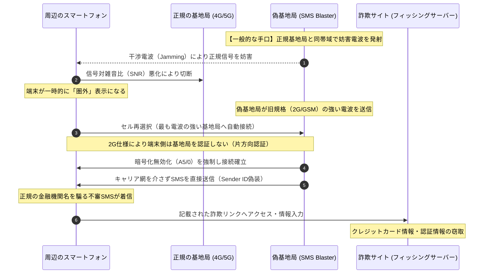

## 概要

- **事案の概要**: 2026年11月7日午後3時半頃、東京都中央区銀座の路上に停めた乗用車内に違法な無線機（偽基地局）を設置して電波を発射し、無線局を運用したとして、中国籍で無職の男（31歳）が電波法違反（無線局の運用）の疑いで警視庁に現行犯逮捕された（11月9日発表）。男は調べに対し容疑を否認している[[1]][ref-1][[2]][ref-2]。
- **被害の規模と影響**: 容疑者が車載機器から発信した妨害電波により、周辺にあった1万台以上のスマートフォンが約1時間にわたり強制的に「圏外」になる通信障害が発生した。
- **攻撃の目的と手口**: 周辺のスマートフォンを正規の基地局から強制的に切断させて旧式の「2G（GSM）」回線などに接続させ、クレジットカード会社等を装った中国語のフィッシング詐欺ショートメッセージ（SMS）を一斉送信していたとみられている。警視庁には2025年1月〜2026年10月の間に中国人観光客ら18人から同様の相談が寄せられており、被害総額は約400万円に上る。

## タイムライン

報道および捜査機関の発表から判明している主要な経緯は以下の通りである[[1]][ref-1][[2]][ref-2]。

| 日時 | 出来事 |
| :--- | :--- |
| **2024年12月** | 銀座や新宿などの路上において、NTTドコモのスマートフォン利用者から「突然圏外になった」との相談が同社に寄せられ始める。 |
| **2025年1月** | NTTドコモと総務省（関東総合通信局）が現地調査を実施し、妨害電波の影響であると判明。警視庁が捜査を開始。 |
| **2025年1月〜2026年10月** | 東京の繁華街（銀座・新宿・渋谷等）において、中国人観光客ら18人から「買い物中に不審なSMSが届き、クレジットカード番号を入力したところ身に覚えのない請求があった」との相談が警察に相次ぐ（被害総額は約400万円）。 |
| **2026年11月7日 15:30頃** | 東京都中央区銀座の路上に停車中の乗用車内で、無許可で無線機を設置して正規基地局と同じ周波数帯の電波を発射していた中国籍の男を、警戒中の警視庁捜査員が電波法違反（無線局の運用）の容疑で現行犯逮捕。 |
| **2026年11月9日** | 警視庁が男の現行犯逮捕を発表。 |

---

## 偽基地局（SMS Blaster）の一般的な技術的仕組み（Google等の解説）

本事件では、乗用車内に無線機を設置し、正規基地局と同じ周波数帯で電波を発信して通信を妨害し、周辺の端末を圏外にさせたり不審なSMSが届いたりしていた、と警察や報道により公表されている[[2]][ref-2]。

一方で、Googleのセキュリティチーム（Android Security & Privacy Team）等は、同種の車載型偽基地局（「SMS Blaster」と呼ばれるセルサイトシミュレータ）が成立する技術的メカニズムについて、以下のように解説している[[4]][ref-4]。

### 1. セル再選択（Cell Reselection）の基本仕様の悪用

携帯電話端末（スマートフォン）は、移動中でも常に安定した通信を維持するために、「**受信信号強度が最も強い基地局を自律的に探索し、自動的に接続を切り替える（セル再選択）**」 という標準プロトコル仕様（3GPP規格）に従って動作する。

Googleの解説によると、SMS Blasterは車載や可搬型の無線送信機から周囲に向けて強力な電波を発射することで、周辺の端末に対して自機を最も通信条件の良い基地局であると誤認させる仕組みを利用しているとされる[[4]][ref-4]。

### 2. 強制ダウングレード攻撃（Downgrade Attack）

現代の第4世代（4G/LTE）および第5世代（5G）通信規格では、端末と基地局が互いに正当性を検証する相互認証と通信暗号化が必須化されている。そのため、4G/5Gの通信を外部から直接改ざん・傍受することは技術的に困難である。

そこでSMS Blasterは、以下の手順を用いて端末を旧世代の規格へ引きずり下ろすダウングレード攻撃を仕掛けると解説されている[[4]][ref-4]：
1. **電波干渉（Jamming）**: 正規の4G/5G周波数帯に向けて大出力の妨害電波を発射する。
2. **圏外化の誘発**: 正規基地局との信号対雑音比（SNR）を極端に悪化させ、端末を一度「圏外」に追い込む（今回の銀座の事案でも、妨害電波によって1万台超が一時圏外になった事実が報じられている）[[2]][ref-2]。
3. **2G（GSM）への誘導**: 端末が圏外から復帰しようと電波を再スキャンする隙を突き、高出力で待機している偽基地局の2G（GSM）ビーコン信号を捕捉させる。

### 3. 第2世代移動通信システム（2G/GSM）プロトコルの根本的脆弱性

ダウングレードの標的となる2G（GSM）規格には、1990年代に設計された仕様に起因する以下のセキュリティ脆弱性が存在する[[4]][ref-4][[5]][ref-5]：

- **片方向認証（Mutual Authenticationの欠如）**:
  ネットワーク（基地局）側が端末（SIMカード）の正当性を認証する仕組みはあるが、**端末側が接続先基地局の正当性を検証・認証する仕組みが存在しない**。そのため、端末は強力な電波を発する偽基地局を無条件に信用して接続してしまう。
- **暗号化の任意性と平文通信（A5/0）**:
  セルラー通信における暗号化は「端末と基地局の間の無線区間（Air Interface）」を保護するものである。通常、暗号鍵（$K_c$）はSIMカード内の秘密鍵と正規キャリアの認証センター（AuC）間で生成されるため、**偽基地局は正規の暗号鍵を持つことができず、暗号化通信を自力で復号できない**[[12]][ref-12]。しかし2Gプロトコルでは「基地局側が暗号化アルゴリズムを決定できる」仕様になっており、さらに選択肢として「暗号化なし（A5/0 / Null-ciphering）」が許容されている。偽基地局はこの仕様を悪用し、端末に対してA5/0（平文通信）の使用を指示することで、暗号鍵を持たずに通信の傍受やSMSの注入を可能にする[[4]][ref-4][[13]][ref-13]。

### 4. キャリア網を完全バイパスする「SMS Blaster」機能

偽基地局に接続させたスマートフォンに対し、攻撃機材は直接ショートメッセージ（SMS）のパケットを無線フレームに載せて注入（インジェクション）する手法をとる。

Googleの解説によると、この手口にはサイバー犯罪において以下の特徴があるとされる[[4]][ref-4]：
- **電話番号の事前取得が不要**:
  通常のSMS配信サービスを利用する場合は標的の電話番号リストが必要だが、偽基地局は電波圏内に接続された端末に対して直接無線パケットを送出するため、電話番号を知る必要がない。
- **送信者ID（Sender ID）の完全な偽装**:
  メッセージのヘッダーに含まれる送信元電話番号や英字表示（金融機関等の名称）を送信側が自由に指定できるため、実在する公式スレッドの中にフィッシングメッセージを割り込ませることができる。
- **通信キャリアのセキュリティフィルタの完全な無力化**:
  メッセージは通信キャリアのコアネットワークやSMSセンター（SMSC）を一切通過しない。そのため、通信各社が提供している迷惑SMS遮断フィルターや検知システムは機能しない。

---

## どのような犯罪に利用されるのか

今回の銀座の事件では、中国人観光客らのクレジットカード情報を狙ったフィッシング詐欺や通信妨害が確認されているが[[2]][ref-2]、Googleの報告によるものを含めると、偽基地局やSMS Blasterは一般的に以下のような犯罪・攻撃手口に悪用されることが知られている[[4]][ref-4]。

### 1. スミッシング（Smishing：SMSフィッシング詐欺）
最も典型的な悪用形態である。「カードの利用停止」などを装ったメッセージを送りつけ、あらかじめ用意した偽のWebサイト（フィッシングサイト）にアクセスさせて認証情報やカード番号を入力させる手口である[[2]][ref-2][[4]][ref-4]。

### 2. クレジットカード情報の不正利用
フィッシングサイトで入力されたクレジットカード情報やセキュリティコードを悪用し、不正決済を行って金銭的被害を生じさせる。今回の事件でも中国人観光客ら18人から相談があり、約400万円の被害が確認されている[[2]][ref-2]。

### 3. マルウェアの強制配布
Googleの解説によると、過去には悪意あるプログラム（ペイロード）をダウンロードさせるURLを含むフィッシングメッセージを注入し、利用者の端末にマルウェアをインストールさせる手口の先例が報告されている[[4]][ref-4]。

### 4. 通信の傍受
2G接続において暗号化を無効化（A5/0）させることで、端末と基地局間でやり取りされる通信データを攻撃者が傍受することが技術的に可能となる[[4]][ref-4]。

### 5. 通信インフラに対するサービス妨害（DoS攻撃）
大出力の妨害電波を発射することで、周辺のスマートフォンを正規基地局から強制切断し、通信サービスを一帯で途絶させる（今回の事件でも1万台超が圏外になる通信障害が発生した）[[2]][ref-2]。

---

## 日本と海外における犯罪事例の比較

偽基地局を用いた犯罪は海外でも相次いで摘発されている。主な事例は以下の通りである。

| 地域 / 国 | 発生時期 | 主な手口と実態 | 法執行機関の対応・摘発事例 |
| :--- | :--- | :--- | :--- |
| **日本** （東京・銀座等） | **2024年〜2026年** | 乗用車内に偽基地局を設置して走行・停車。NTTドコモ等の通信を妨害して1万台超を圏外化させ、中国人観光客へ中国語のフィッシングSMSを送信。 | 2026年11月、警視庁が車内にいた中国籍の男を電波法違反（無線局の運用）容疑で現行犯逮捕[[1]][ref-1][[2]][ref-2]。 |
| **中国** | **2010年代前半〜現在** | 「偽基站（Fake Base Station）」による詐欺・迷惑SMS送信が多発。ワゴン車や電動バイクに機材を積んで街中を移動しながら電波を発射。 | 2014年に最高法・最高検・公安部等が共同意見を通達し、全国規模の集中取り締まりを展開。公安部指揮のもとで多数の容疑者拘束や偽基地局機材の押収が相次ぎ、2G停波や電波監視の強化へつながった[[9]][ref-9][[10]][ref-10]。 |
| **東南アジア** （タイ、ベトナム等） | **2023年〜2025年** | バンコクやハノイ等の大都市で、車や大型バックパックで商業エリアを巡回し、銀行や通信会社を装うSMSを一斉配信。 | タイサイバー犯罪捜査局（CCIB）やベトナム警察が相次いで車載SMS Blasterを摘発。指示を受けて車両を運転していた実行犯が逮捕されている[[7]][ref-7]。 |
| **英国** （ロンドン等） | **2024年〜2026年** | 車両に偽基地局（SMS Blaster）を隠装して走行。HMRC（税務署）等を装い数万通規模のフィッシングSMSを市民へ送信。 | ロンドン市警察DCPCU等が追跡・摘発。車両を運転していた中国人留学生や指示役らに対し裁判所で実刑判決が下された[[8]][ref-8]。 |
| **フランス** （パリ等） | **2022年〜2023年** | パリ郊外を走行する乗用車等に偽基地局（IMSI-catcher）を搭載して走行。国民健康保険（Ameli）を装い40万人超を標的にフィッシングSMSを一斉送信。 | フランス憲兵隊サイバー部隊（ComCybergend）や司法当局（Junalco）が捜査し、車内の不審機材を押収。関係者を摘発・訴追[[11]][ref-11]。 |

---

## 利用者ができる対策

偽基地局による攻撃は、通信キャリアのネットワークを介さずに端末と直接電波を交信するため、**通常の迷惑SMSやスミッシングに対して通信キャリアが提供しているネットワーク側の迷惑SMS遮断フィルターなどの防御策が通用しない**。

利用者が身を守るためには、**スマートフォン端末（OS）の設定** と **怪しい電波・メッセージに対する運用上の警戒** が不可欠である。

| 対策項目 | 対象OS / 機器 | 具体的な設定手順・行動指針 | 防御できる攻撃・効果 |
| :--- | :--- | :--- | :--- |
| **2G通信の完全無効化**  | **Android** （Android 12以降） | **「設定」>「ネットワークとインターネット」>「SIM」>「2Gの許可」をOFFにする** | 偽基地局への接続（ダウングレード）をモデムレベルで完全に遮断[[4]][ref-4][[5]][ref-5]。 |
| **ロックダウンモードの利用** （**日常利用に強い制約あり**） | **iOS / iPhone** （iOS 17以降） | **「設定」>「プライバシーとセキュリティ」>「ロックダウンモード」をオンにする** | 2G/3G接続の完全ブロック。ただしWebやメッセージ等に多くの制限が発生（後述）[[6]][ref-6]。 |
| **セルラー暗号化の要求** | **Android** （Android 14以降） | **「設定」>「セキュリティとプライバシー」>「詳細設定」等で暗号化されていないセルラー接続を拒否する設定を確認** | 偽基地局による平文通信（A5/0）の強制を拒絶[[4]][ref-4][[13]][ref-13]。 |
| **突然の「圏外」直後のSMSを警戒** | 全スマートフォン | 繁華街や商業施設で、**直前まで良好だった電波が突然「圏外」になり、復帰した直後に届いたSMSは詐欺と疑う**。 | 不審SMSの開封・フィッシングサイトへの誘導阻止。 |
| **SMS内リンクをタップしない** | 全スマートフォン | 銀行、カード会社、通信キャリアからのSMSであっても、**本文中のURLリンクはタップしない**。 | 送信者名（Sender ID）偽装による騙しを無力化。 |
| **公式アプリ・ブックマークからのアクセス** | 全スマートフォン | アカウントの警告や請求確認は、事前に保存した公式Webサイトのブックマークや公式スマホアプリから行う。 | フィッシングサイトへのアクセス回避。 |

### OS別の注意点とロックダウンモードの制約

- **Android（日常利用を損なわずに防御可能）**:
  Googleは2022年リリースのAndroid 12以降、モデムハードウェアレベルで2G接続をオフにするトグルスイッチを導入した[[4]][ref-4][[5]][ref-5]。この設定をオフにしても、通常の4G/5G通信やWebブラウズ等の日常機能は維持される。また、Android 14以降では未暗号化ネットワークへの接続拒否機能が追加されている[[4]][ref-4][[13]][ref-13]。
- **iOS（iPhone：2G単独OFFスイッチがなく、多大な副作用を伴う）**:
  通常モードのiOSには「2Gのみを個別にオフにする」専用スイッチが用意されていない。iOS 17以降の「ロックダウンモード（Lockdown Mode）」を有効化することで2G/3G通信をOS全体で遮断できるが、これは金銭目的の高度な標的型スパイウェアに対抗するための保護機能であり、有効化するとWebサイトの表示崩れや遅延、メッセージ添付ファイルの制限、FaceTime着信の制限、写真の共有アルバムの停止など、日常利用に多大な機能制限が発生する[[6]][ref-6]。そのため、iPhone利用者が偽基地局対策のためだけにロックダウンモードを常時オンにすることは現実的ではなく、不審なSMSのリンクを踏まない運用が当面の主たる防衛策となる。

---

## 日本の法律上の位置づけと法的論点

本事件において、警視庁が被疑者を現行犯逮捕した容疑として報道されているのは「**電波法違反（無線局の運用）**」である[[1]][ref-1][[2]][ref-2]。

### 1. 逮捕容疑の条文（電波法）

- **電波法第4条（無線局の開設）・第110条第1号（罰則）**:
  総務大臣の免許を受けずに無線局を開設・運用した場合、**1年以下の懲役又は100万円以下の罰金**に処される[[3]][ref-3]。
  報道によると、被疑者は総務大臣の許可なく車内に無線機器を設置して電波を発信・運用した疑いで現行犯逮捕されている。

### 2. 通信妨害に関する電波法上の論点

現時点で報道されている容疑は無線局の無免許運用であるが、電波法には重要インフラに対する通信妨害を重罰化する規定が存在する[[3]][ref-3]：

- **電波法第108条の2（重要無線通信妨害罪）**:
  「電気通信業務の用に供する無線設備の無線通信…を妨害した者は、**5年以下の懲役又は250万円以下の罰金**に処する」と規定されている。
  今回の事案では、大手携帯キャリアの正規基地局と同じ周波数の電波を発射し、周辺のスマートフォン約1万台を約1時間にわたり圏外に追い込む通信障害が発生している[[2]][ref-2]。単なる不法無線局の運用にとどまらず、公衆電気通信業務に対する大規模な通信妨害を引き起こしている点について、今後どのような容疑で捜査・追送検が進められるかが法的な論点となる。

---

## 海外における主な判例・司法基準

海外における偽基地局（SMS Blaster）を用いた犯罪に対しては、以下の司法判断および基準が示されている。

### 1. 英国：車載SMS Blaster運用者に対する実刑判決（2025年〜2026年）
英国ロンドン市警察（DCPCU）が摘発した事件において、ロンドンの刑事裁判所は車載偽基地局を用いて数万通規模のHMRC（税務署）詐欺SMSを送信していた中国人留学生や指示役に対し、詐欺罪（fraud by false representation）等により懲役刑の実刑判決を言い渡した。通信インフラを悪用した無差別な詐欺電波発信に対して実刑をもって臨む司法判断が下されている[[8]][ref-8]。

### 2. 中国：最高人民法院・最高人民検察院・公安部等の共同意見と司法基準（2014年）
中国では2014年3月、最高人民法院、最高人民検察院、公安部、国家安全部が共同で『关于依法办理非法生产销售使用“伪基站”设备案件的意见（偽基地局設備の不法生産・販売・使用案件の法適用に関する意見）』を施行した[[9]][ref-9]。
- 偽基地局を使用して公共通信ネットワークを麻痺させた場合：刑法第124条 「**破壊公用電信設施罪（公共通信設備破壊罪）**」 を適用（3年以上7年以下の有期懲役、深刻な被害を生じさせた場合は7年以上）
- フィッシング詐欺や金銭窃取を行った場合：刑法第266条 「**詐欺罪**」 を併合罪または重い罪を選択して適用
- 機材の不法製造・販売：刑法第225条 「**不法経営罪**」 を適用

これにより、偽基地局の運用や製造・販売に対して厳しい刑事罰を科す法適用基準が確立されている。

---

## 参考資料・出典一覧

1. [銀座で強力な電波発し周辺スマホ圏外に 電波法違反の疑い逮捕 | NHKニュース][ref-1]
2. [銀座の路上で「偽基地局」から妨害電波、スマホ1万台超が1時間「圏外」に…中国籍の男を容疑で逮捕 : 読売新聞][ref-2]
3. [電波法（昭和25年法律第131号） | e-Gov法令検索][ref-3]
4. [Google Online Security Blog: Keeping your Android device safe from text message fraud][ref-4]
5. [Android Open Source Project: Disable 2G][ref-5]
6. [Apple サポート: Apple デバイスのロックダウンモードについて][ref-6]
7. [Thai PBS World: 2 Chinese arrested and mobile cellular base station seized in Bangkok][ref-7]
8. [The Standard: Chinese student who used a phone mast ‘blaster’ in car to send HMRC scam texts to thousands is jailed][ref-8]
9. [北京市市場監督管理局: 禁止非法生产销售使用窃听窃照专用器材和“伪基站”设备的规定][ref-9]
10. [新華網: 公安部指挥破获一非法生产销售使用“伪基站”专案][ref-10]
11. [The Connexion: Thousands targeted after phone numbers hacked in health scam in France][ref-11]
12. [ETSI TS 143 020 / 3GPP TS 43.020: Security related network functions (Release 16)][ref-12]
13. [Google Online Security Blog: Android 14 introduces first-of-its-kind cellular connectivity security features][ref-13]

[ref-1]: https://news.web.nhk/newsweb/na/nd-20261109de72718
[ref-2]: https://www.yomiuri.co.jp/national/20261109-GYT1T00081/
[ref-3]: https://laws.e-gov.go.jp/law/325AC0000000131
[ref-4]: https://security.googleblog.com/2024/08/keeping-your-android-device-safe-from.html
[ref-5]: https://source.android.com/docs/security/features/cellular-security/disable-2g
[ref-6]: https://support.apple.com/ja-jp/105120
[ref-7]: https://www.thaipbsworld.com/crime/2-chinese-arrested-and-mobile-cellular-base-station-seized-in-bangkok
[ref-8]: https://www.standard.co.uk/news/crime/met-city-police-phone-mast-blaster-car-hmrc-scam-texts-bow-b1235124.html
[ref-9]: https://scjgj.beijing.gov.cn/cxfw/flfgcxfw/qt/202006/t20200620_1929314.html
[ref-10]: http://www.xinhuanet.com/politics/2017-03/30/c_1120726814.htm
[ref-11]: https://www.connexionfrance.com/news/thousands-targeted-after-phone-numbers-hacked-in-health-scam-in-france/284869
[ref-12]: https://www.etsi.org/deliver/etsi_ts/143000_143099/143020/16.00.00_60/ts_143020v160000p.pdf
[ref-13]: https://security.googleblog.com/2023/08/android-14-introduces-first-of-its-kind.html
