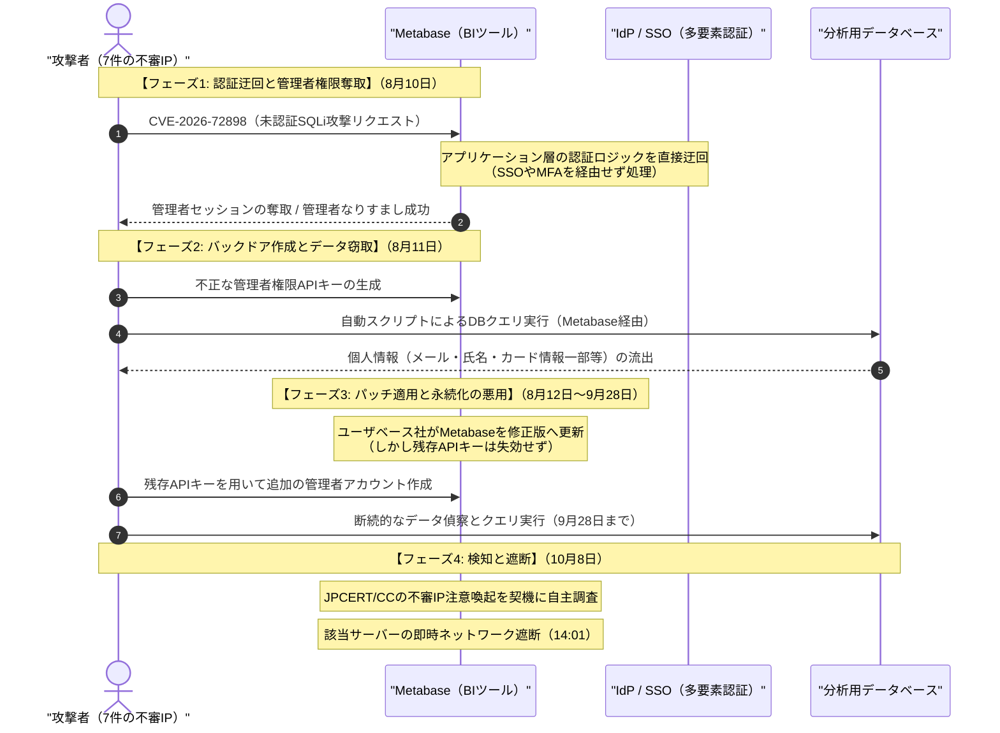

## 概要

- **事案の概要**: 2026年10月8日、ソーシャル経済メディア「NewsPicks」を運営する株式会社ユーザベースは、同社が業務で利用するオープンソースのBIツール「Metabase」が第三者による不正アクセスを受け、顧客の個人情報が漏洩したことを公表した。同年11月18日に公表された最終調査報告により、未認証のSQLインジェクション脆弱性（CVE-2026-72898）が悪用されたことが判明した[[3]][ref-3]。
- **主な被害・影響**: ウェブ決済に関わるクレジットカード情報の一部（名義、有効期限、カード番号下3桁または下4桁）361,598件、メールアドレス322,531件、氏名58,754件、生年月日27,194件、配送先住所・宛名30,906件など、計数十万件規模の個人情報が流出した。なお、クレジットカード番号の全体やセキュリティコード、ログインパスワード（ハッシュ化含む）は漏洩対象に含まれておらず、二次被害は確認されていない[[3]][ref-3]。
- **運営会社の対応状況**: 2026年10月8日の検知当日にMetabaseサーバーのネットワーク遮断を実施した。攻撃者が不正に作成した管理者アカウントおよび残存APIキーの削除、対象顧客への個別メール連絡、所轄警察署への相談および個人情報保護委員会への報告を完了し、2026年内を目処に管理ツールへのアクセス制限や保持データの見直しなどの多層的な再発防止策を進めている[[3]][ref-3]。

:::message
本記事は 2026年11月18日 時点の株式会社ユーザベースおよびNewsPicksの公式発表、ITmedia等の取材報道、ならびにJPCERT/CCの公式アドバイザリに基づいている。今後の調査・捜査の進展により内容が更新される可能性がある。
:::

## 被害・影響範囲と運営会社の対応施策

公式発表により確定した被害・影響範囲は以下の通りである。2026年10月9日の第2報時点では最大想定件数として報告されていたが、外部専門機関を交えた精査により確定件数が公表された[[2]][ref-2][[3]][ref-3]。

### 確定した流出情報と件数

| 項目 | 確定件数 | 備考 |
| :--- | :--- | :--- |
| **クレジットカード情報の一部** | 361,598件 | 名義・有効期限・番号下3桁または下4桁。番号全体およびセキュリティコードは決済代行会社管理のため社内に保存されておらず漏洩なし [[3]][ref-3] |
| **メールアドレス** | 322,531件 | - |
| **所属先の役職**（7分類） | 272,392件 | 会員登録時に選択された役職区分 |
| **所属**（勤務先など） | 64,572件 | - |
| **氏名** | 58,754件 | - |
| **配送先住所・宛名** | 30,906件 | 書籍やグッズ等の配送先情報 |
| **所属先の電話番号** | 28,013件 | - |
| **生年月日** | 27,194件 | - |
| **取引先等の運営担当窓口情報** | 122件 | NewsPicks Enterprise および NewsPicks Education の窓口名・メールアドレス |
| **ログインパスワード** | 0件（対象外） | ハッシュ化されたものを含め、取得データに含まれていないことを確認 |

なお、不正アクセスの範囲はMetabaseおよび接続されていた一部のデータベースにとどまり、NewsPicks本体のサービス（本番環境）を含む他システムへの侵入は確認されていない[[3]][ref-3]。また、本件に起因する情報の不正利用等の二次被害も現時点で確認されていない[[3]][ref-3]。

### 運営会社が実施した緊急対応施策

事案の検知から調査完了までに実施された対応は以下の通りである[[1]][ref-1][[3]][ref-3]。

| 施策項目 | 実施内容 |
| :--- | :--- |
| **侵入経路の即時遮断** | 2026年10月8日14:01、不正アクセスと判断した直後にMetabaseサーバーをネットワークから遮断 [[1]][ref-1] |
| **認証情報の無効化** | 攻撃者が脆弱性を悪用して不正作成した管理者アカウントおよびAPIキーを特定し、無効化・削除 |
| **影響範囲の特定調査** | 外部のセキュリティ専門機関による助言・検証を受け、Metabaseの操作ログやデータベースアクセス履歴のフォレンジック調査を実施 |
| **関係機関への報告** | 2026年10月8日21:44に個人情報保護委員会へ速報を提出し、所轄警察署へ被害相談を実施 |
| **対象ユーザーへの個別通知** | 2026年10月9日以降、漏洩の可能性があるユーザーに対してサポート窓口より個別にメール通知を実施 |
| **全社システムのログ総点検** | NewsPicksの本番環境を含む同社の各システムログを点検し、本件に関連する異常や他システムへの水平展開（ラテラルムーブメント）がないことを確認 |

## インシデントの時系列

公式発表および報道により判明している事象の推移は以下の通りである（時刻は日本時間：JST）[[3]][ref-3][[4]][ref-4]。

| 日時 (JST) | 出来事 |
| :--- | :--- |
| **2026年8月6日** | Metabase開発元より、未認証SQLインジェクション脆弱性（後のCVE-2026-72898）に関するセキュリティ情報が公表される [[4]][ref-4] |
| **2026年8月10日** | 国外を含む7件のIPアドレスより、NewsPicksが運用するMetabase環境への不正アクセスが開始される（CVE番号付与前） |
| **2026年8月11日** | 攻撃者が自動スクリプトを実行し、Metabase経由でデータベースから個人情報を含むデータを窃取する |
| **2026年8月12日** | ユーザベース社がMetabaseを脆弱性修正版へアップデート（公表から6日後・3営業日後）。しかし前日にデータ窃取が完了していた |
| **2026年8月14日** | JPCERT/CCが「MetabaseのSQLインジェクションの脆弱性（CVE-2026-72898）に関する注意喚起」を公表 [[5]][ref-5] |
| **2026年8月20日〜9月28日** | アップデート前に攻撃者が作成・残存させていたAPIキー等を悪用し、管理者アカウントの追加作成や最新データの断続的な偵察が行われる [[3]][ref-3] |
| **2026年10月8日** | JPCERT/CCが「直近で相次いでいる国内組織における不正アクセスに関する注意喚起」を公表し、不審なIPアドレスリストを提示 [[6]][ref-6] |
| **2026年10月8日 12:48** | JPCERT/CCの公表情報に基づきユーザベース社が自主調査を実施したところ、Metabase環境における不審なアクセスを検知。対策本部を設置 [[1]][ref-1] |
| **2026年10月8日 14:01** | 第三者による不正アクセスと判断し、該当サーバーの通信を即座に遮断 |
| **2026年10月8日 21:44** | 個人情報保護委員会への速報提出、所轄警察署への被害相談を実施 |
| **2026年10月8日 夜** | NewsPicks公式より「個人情報漏洩の可能性に関するお詫びとお知らせ（第1報）」を公表 |
| **2026年10月9日** | 第2報を公表し、漏洩の可能性がある情報の項目と最大想定件数を公表。対象ユーザーへの個別連絡を開始 [[2]][ref-2] |
| **2026年11月18日** | 外部専門機関の助言を受けた調査が完了し、最終調査結果報告を公表。原因、確定件数、再発防止策を報告 [[3]][ref-3] |

## 攻撃の手口と被害構造の分析

### 1. 侵入経路と被害波及の全体像

今回の事案における攻撃の流れと被害構造は、以下のシーケンスに整理される。

### 2. 被害が発生・拡大した要因

公式発表では、直接的な原因および被害が拡大した要因として以下の点が挙げられている[[3]][ref-3]。

#### 直接的な原因：アプリケーション認証の迂回による多要素認証と権限制御の無効化

同社はMetabaseへのログインに多要素認証を設定して運用し、個人情報の一部を参照できる権限を管理者権限を持つ限られた従業員にのみ付与していた。しかし、今回の脆弱性はアプリケーションの認証そのものを迂回できるものであったため、多要素認証と権限制御の両方が同時に無効化される結果となった[[3]][ref-3]。

#### 要因1：管理者権限で参照できる個人情報の範囲と保持期間

通常の業務利用者が個人情報を参照できないよう権限制御されていた一方、分析環境の整備に必要な範囲として、管理者権限では一部の個人情報が参照可能となっていた。その中には、一時的な業務に用いた情報や、問い合わせ対応等に備えて保持していた退会済みユーザーの情報の一部も含まれていたため、被害の範囲が広がる要因となった[[3]][ref-3]。

#### 要因2：不正アクセスを早期に検知する仕組みの不足

脆弱性の公表から6日後（3営業日後）に修正版への更新を実施したものの、その時点で攻撃者による個人情報の取得はすでに行われていた。さらに、攻撃者が作成したAPIキー等が残存していたため、9月28日まで断続的なアクセスが継続した。また、Metabaseの操作記録自体は保存していたが、大量のデータ取得などの異常を常時監視する対象としておらず、侵入や異常を早期に検知できる体制を十分に整えられていなかった[[3]][ref-3]。

## 再発防止策と今後の対策

同社は外部専門機関の分析を踏まえ、多要素認証・権限制御・脆弱性への迅速な対応といった侵入防止策を引き続き強化したうえで、「防御が突破されうる」という前提に立った多層的な再発防止策を進めている。これらの管理策の整備は2026年中に完了する見込みである[[3]][ref-3]。

1. **侵入を防ぐ対策**（実施済み）:
   - Metabaseを含む社内管理ツールへのネットワークアクセス制限を実施し、外部からの到達経路を制限した[[3]][ref-3]。
2. **保持データのルール整備**:
   - 分析環境において管理者権限で参照できる個人情報の範囲をさらに絞り込み、不要なデータの保持を制限する[[3]][ref-3]。
   - 退会済み顧客の情報や一時的な業務データについて、保持期間のルールを厳格化・短縮化する。
3. **不正アクセスを早期に検知する仕組みの強化**:
   - 操作記録の保存にとどまらず、大量のデータ取得などの異常な操作を常時監視・アラート検知できる体制を整える[[3]][ref-3]。
   - 不正な認証情報やAPIキーの作成・残存がないかを含め、不審な挙動を早期に把握・遮断できる仕組みを構築する。
4. **グループ全体でのセキュリティ体制の見直し**:
   - NewsPicksにとどまらず、ユーザベースグループ全体の情報セキュリティ体制そのものの見直しを進める[[3]][ref-3]。

## 参考資料・出典一覧

1. [NewsPicks公式発表（第1報 - 2026年10月8日）][ref-1]
2. [NewsPicks公式発表（第2報 - 2026年10月9日）][ref-2]
3. [NewsPicks公式発表（調査結果のご報告 - 2026年11月18日）][ref-3]
4. [ITmedia NEWS取材記事（2026年11月18日）][ref-4]
5. [JPCERT/CC 注意喚起「MetabaseのSQLインジェクションの脆弱性（CVE-2026-72898）に関する注意喚起」（2026年8月14日）][ref-5]
6. [JPCERT/CC 注意喚起「直近で相次いでいる国内組織における不正アクセスに関する注意喚起」（2026年10月8日）][ref-6]

[ref-1]: https://corp.newspicks.com/info/20261008
[ref-2]: https://corp.newspicks.com/info/20261009
[ref-3]: https://corp.newspicks.com/info/20261118
[ref-4]: https://www.itmedia.co.jp/news/article/2611/18/2000003300/
[ref-5]: https://www.jpcert.or.jp/at/2026/at260023.html
[ref-6]: https://www.jpcert.or.jp/at/2026/at260030.html
