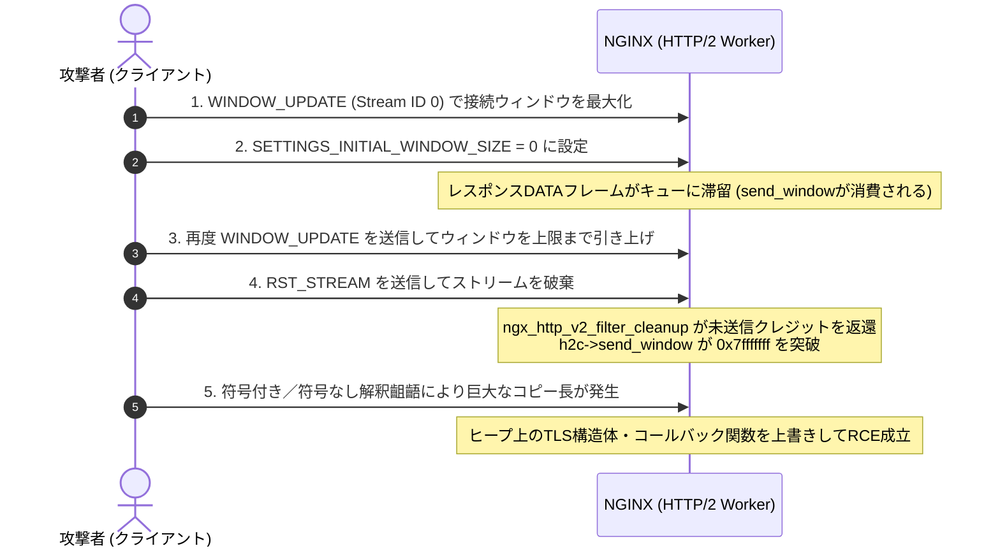

## 概要

2026年11月18日、Offensive SecurityリサーチチームのXintにより、Webサーバー／リバースプロキシとして広く普及しているNGINXにおける5件の深刻な脆弱性と、Linuxカーネルのゼロデイ脆弱性を組み合わせたエクスプロイトチェーン「**nginx2root**」が公表された[[1]][ref-1]。

本事案の中核となる脆弱性 **CVE-2026-123007** は、NGINXのHTTP/2フロー制御処理に存在する整数オーバーフローの欠陥である。悪用されると、リモートの第三者から細工されたリクエストを送信されることで、認証を経ることなくNGINXのワーカープロセス権限で任意のコードを実行される可能性がある[[1]][ref-1]。

さらに、ワーカープロセスが奪取された後、LinuxカーネルのSCTPサブシステムに存在するUse-After-Free脆弱性を連鎖させることで、Dockerなどのコンテナ環境をエスケープし、ホストOSの最高権限（root権限）を掌握される実証結果が報告されている[[1]][ref-1]。

- **対象ソフトウェア**: NGINX Open Source、NGINX Plus、およびLinuxカーネル
- **脆弱性識別子**: CVE-2026-123007、CVE-2026-123634、CVE-2026-123633、CVE-2026-121810、CVE-2026-113425、LinuxカーネルSCTP LPE（Zero-day）
- **深刻度（NGINX脆弱性）**: CVSS v4.0 スコア **9.2 (Critical)** / CVSS v3.1 スコア **8.1 (High)** [[2]][ref-2]
- **結論（対策）**: NGINX Open Source **`1.30.7`**（Stable）または **`1.31.9`**（Mainline）以降へ直ちに更新し、プロセスを完全に再起動（`systemctl restart nginx` 等）する必要がある[[3]][ref-3]。即座のパッチ適用が困難な場合は、設定変更によるHTTP/2無効化やSCTPモジュールの無効化といった緩和策の適用が求められる[[1]][ref-1]。

---

## nginx2rootの全体像と影響範囲

nginx2rootは、単一の脆弱性ではなく、NGINXの異なる機能構成に影響を与える5つの独立したリモートコード実行（RCE）脆弱性と、Linuxカーネルのローカル権限昇格（LPE）脆弱性で構成されている[[1]][ref-1]。

### 1. 脆弱性一覧サマリー

| 識別子 | 影響を受ける主な構成 | 初回混入バージョン | 修正版 | HTTP/2無効化で阻止可能か |
| :--- | :--- | :--- | :--- | :--- |
| **CVE-2026-123007** | HTTP/2が有効な構成 | 1.9.5 | **`1.30.7`** / **`1.31.9`** [[3]][ref-3] | **可能** [[1]][ref-1] |
| **CVE-2026-123634** | `resolver` + 動的 `proxy_pass` + `mirror` | 1.13.4 | **`1.30.7`** / **`1.31.9`** | **不可**（HTTP/2非依存） |
| **CVE-2026-123633** | HTTP/2 + バックエンド（Upstream）転送 | 1.19.7 | **`1.30.7`** / **`1.31.9`** | **可能** |
| **CVE-2026-121810** | HTTP/3 (QUIC) + Upstream転送 | 1.25.0 | **`1.30.7`** / **`1.31.9`** | **不可**（HTTP/3無効化が必要） |
| **CVE-2026-113425** | メールプロキシ（`mail`）+ `proxy on` + `auth_http` | 0.5.15 | **`1.30.7`** / **`1.31.9`** | **不可**（メールポート制限が必要） |
| **Linux Kernel LPE** | LinuxカーネルのSCTPサブシステム | Linux v4.15 | **未提供**（Zero-day） | **不可**（SCTP無効化が必要） |

最も影響範囲が広い **CVE-2026-123007** は、2015年にNGINXへHTTP/2機能が導入されたバージョン `1.9.5` 以来、10年以上にわたってコードベースに存在していた[[1]][ref-1]。

### 2. インターネット上の露出規模

Xintの調査レポートによると、2026年11月10日時点でインターネット検索エンジンShodanにおいてNGINXとして検出されたホスト約5,670万台のうち、バージョンが特定可能であった約1,194万台の **98.9%** が、CVE-2026-123007の影響を受けるバージョン範囲（1.9.5〜1.31.8）に該当していた[[1]][ref-1]。

### 3. 主要Linuxディストリビューションの対応状況

Linuxディストリビューションでは、アップストリームの新バージョンに置き換えるのではなく、既存バージョンに対して修正パッチをバックポートして提供されることが多い。そのため、`nginx -v` で表示されるバージョン番号だけではパッチ適用の有無を判断できず、パッケージのリビジョン番号を確認する必要がある[[1]][ref-1]。

| ディストリビューション | 対象パッケージ / リリース | 修正ステータス | 補足 |
| :--- | :--- | :--- | :--- |
| **Ubuntu** | Ubuntu 24.04 LTS (`1.24.0`), 22.04 LTS (`1.18.0`) 等 | **対応中 / 配布開始** | セキュリティトラッカーにてCritical/Highとして追跡 [[4]][ref-4] |
| **Debian** | Debian 12 (Bookworm / `1.22.1`), Debian 13 (Trixie) | **対応中 / 配布開始** | Debian Security Trackerにて追跡 [[5]][ref-5] |
| **RHEL (Red Hat)** | RHEL 8, RHEL 9 (`nginx` モジュールストリーム) | **対応中** | Red Hat Customer PortalにてCritical評価で追跡 [[6]][ref-6] |
| **Amazon Linux** | Amazon Linux 2023 (`nginx`) | **`1.30.7-1`** | アドバイザリ: ALAS2023-2026-3494 [[7]][ref-7] |
| | Amazon Linux 2 (`nginx`) | **未提供** | 対応保留中（ALAS追跡中） |

### 4. クラウド環境における影響の整理（マネージド基盤と自前運用の違い）

AWS、Microsoft Azure、Google Cloud などの主要クラウドプロバイダー自身が提供・運用するマネージドロードバランサー（AWS ALB/NLB、Azure Load Balancer、Cloud Load Balancing等）やマネージドWAF/CDN（CloudFront、Cloudflare等）について、本件に起因するベンダー公式のセキュリティアドバイザリは発出されていない。これらはクラウド事業者側でインフラが管理されており、直接的な影響は確認されていない。

一方、ユーザーがEC2、Azure VM、Google Compute Engine上で自前構築したNGINXインスタンスや、EKS、AKS、GKE上で独自にデプロイしたNGINX Ingress Controllerなどは、OSおよびコンテナイメージのパッチ適用をユーザー自身で実施する必要がある。

---

## 影響を受ける条件と自環境の確認方法

単にバージョン番号が該当しているだけでなく、各脆弱性が成立するためのインフラ・設定の前提条件が存在する[[1]][ref-1]。

### 1. 影響を受ける設定条件

1. **HTTP/2の有効化（CVE-2026-123007, CVE-2026-123633）**:
   - `listen` ディレクティブに `http2` パラメータが付与されている、または `http2 on;` ディレクティブが指定されている環境。
2. **動的DNS解決とサブリクエスト（CVE-2026-123634）**:
   - `resolver` ディレクティブが設定され、リクエストから動的に決定される `proxy_pass` 先が指定され、かつ `mirror`（`mirror_request_body off;`）等のサブリクエスト生成機能が併用されている環境。
3. **HTTP/3 (QUIC) の有効化（CVE-2026-121810）**:
   - `listen ... quic;` が指定され、リクエストをバックエンドへプロキシしている環境。
4. **メールプロキシ認証の有効化（CVE-2026-113425）**:
   - `mail` ブロックにおいて `proxy on;` かつ `auth_http;` による外部HTTP認証が設定されている環境。
5. **LinuxカーネルSCTPサブシステム（LPE）**:
   - ホストOS上でSCTPカーネルモジュールがロードされている、あるいはソケット作成（`AF_INET`, `SOCK_SEQPACKET`, `IPPROTO_SCTP`）時にカーネルが自動ロードを許可している環境。

### 2. 自環境の確認コマンド

サーバー上で以下のコマンドを実行し、自環境が曝露しているか確認する[[1]][ref-1]。

#### ① NGINXのバージョン確認
```bash
nginx -v 2>&1
```
- 出力が `1.9.5` から `1.31.8` の範囲である場合は、脆弱なコードが含まれている可能性がある。
- `1.30.7`（Stable）または `1.31.9`（Mainline）以降であればアップストリームの修正が含まれている[[3]][ref-3]。

#### ② HTTP/2モジュールの組み込み確認
```bash
nginx -V 2>&1 | grep -q -- '--with-http_v2_module' \
  && echo 'HTTP2_MODULE=present' \
  || echo 'HTTP2_MODULE=absent'
```
- `HTTP2_MODULE=present` と表示された場合、バイナリ内にHTTP/2処理コードが含まれている。

#### ③ 設定ファイルにおけるHTTP/2有効化の確認
```bash
sudo nginx -T 2>&1 \
  | sed 's/#.*//' \
  | grep -nE 'listen[[:space:]].*http2|^[[:space:]]*http2[[:space:]]+on[[:space:]]*;'
```
- `listen 443 ssl http2;` や `http2 on;` が出力された場合、HTTP/2が有効化されている。

#### ④ 外部からのHTTP/2疎通確認
手元の端末から対象サーバーに対して ALPN で `h2` のネゴシエーションをテストする。
```bash
curl -kI --http2 -s https://<対象ホスト名またはIP>/ | grep -E '^HTTP/2'
```

#### ⑤ SCTPカーネルモジュールの状態確認
```bash
lsmod | grep sctp
```
- モジュールがロードされている場合、または一般ユーザー権限からの `socket(AF_INET, SOCK_STREAM, IPPROTO_SCTP)` 発行によって自動ロードされる環境では、LPEの攻撃対象領域となる。

---

## 攻撃チェーンの仕組み（nginx2root）

「nginx2root」とは、**NGINXの5つの独立した未認証RCE脆弱性**（いずれか1つを選択）と、**Linuxカーネルの未修正LPE脆弱性**を組み合わせた、計6件の脆弱性群およびエクスプロイトチェーンの総称である[[1]][ref-1]。

初期侵入（Step 1）では、5つの脆弱性はそれぞれ対象とするプロトコルや内部処理（HTTP/2整数オーバーフロー、DNSリゾルバUAF、接続ドレインUAF、メール認証UAFなど）が全く異なるため、**攻撃者が送信するパケットや悪用のメカニズムは脆弱性ごとに個別に異なる**[[1]][ref-1]。攻撃者は対象サーバーの設定（HTTP/2、HTTP/3、メールプロキシ等）に適合するいずれか1つの経路を選択してNGINXワーカープロセスを侵害する[[1]][ref-1]。

ワーカープロセス侵害後（Step 2）は、どのNGINX脆弱性を経由した場合であっても、**同一のLinuxカーネルSCTPサブシステムの脆弱性を連鎖させることでホストのroot権限を奪取し、コンテナを脱出する**[[1]][ref-1]。

```mermaid
flowchart TD
    subgraph Step 1: NGINX Worker 侵害（対象構成に応じたいずれか1つの経路）
        direction TB
        A1["【経路1: 最多】HTTP/2 フロー制御<br>(CVE-2026-123007: 整数オーバーフロー)"]
        A2["【経路2】DNS動的解決 & mirror<br>(CVE-2026-123634: リゾルバUAF)"]
        A3["【経路3】HTTP/2 Upstream転送<br>(CVE-2026-123633: ドレインUAF)"]
        A4["【経路4】HTTP/3 Upstream転送<br>(CVE-2026-121810: ドレインUAF)"]
        A5["【経路5】メールプロキシ認証<br>(CVE-2026-113425: auth_http UAF)"]

        A1 --> W["NGINX Worker プロセス権限奪取<br>(低権限: nginx / www-data)"]
        A2 --> W
        A3 --> W
        A4 --> W
        A5 --> W
    end

    subgraph Step 2: ホストOS Root奪取 & コンテナ脱出（共通の連鎖）
        W -->|"SCTPソケット作成 & 送信待機中のアソシエーション移管"| K["Linux Kernel SCTPサブシステム<br>(Use-After-Free / Double-Free)"]
        K -->|"KASLRバイパス & カーネル内任意実行"| R["ホストOSの最高権限 (root) 奪取<br>(Dockerコンテナ脱出達成)"]
    end
```

---

## 各脆弱性の技術的な仕組み

### 1. CVE-2026-123007：HTTP/2フロー制御の整数オーバーフロー

#### 背景：NGINXにおけるHTTP/2送信ウィンドウ管理
HTTP/2では単一のTCP接続内で複数のリクエスト・レスポンス（ストリーム）が並行して送受信される。クライアントが受信可能なデータ量を制御するため、ストリーム単位およびコネクション全体（h2c）の送信ウィンドウ（`send_window`）が管理されている。
NGINXのデフォルトウィンドウは 65,535（`0xffff`）、プロトコル仕様上の最大値は $2^{31} - 1$（`0x7fffffff`）と定義されている。

```c
#define NGX_HTTP_V2_MAX_WINDOW      ((1U << 31) - 1)
#define NGX_HTTP_V2_DEFAULT_WINDOW  65535
```

サーバーがレスポンスデータを送信キューに積む際、`ngx_http_v2_send_chain()` はキューに追加したフレームサイズ分だけ `send_window` を減算する。

```c
ngx_http_v2_queue_frame(h2c, frame);
h2c->send_window -= frame_size;
stream->send_window -= frame_size;
```

もしデータが送信される前にクライアントからストリームがキャンセル（`RST_STREAM`）された場合、クリーンアップハンドラ `ngx_http_v2_filter_cleanup()` は未送信フレームを破棄し、減算されていたサイズをコネクション全体の `send_window` に返還（加算）する[[1]][ref-1]。

```c
h2c->send_window += window;
```

#### 脆弱性の原因：上限値未検証による符号付き整数オーバーフロー
データがキューに積まれた後、未送信の状態でクライアントが `WINDOW_UPDATE` フレームを送信してウィンドウサイズを最大値付近まで引き上げ、その直後にストリームをキャンセルすると問題が発生する。

クリーンアップ処理（`ngx_http_v2_filter_cleanup`）は、返還するクレジットを加算する際に、加算後の値が `NGX_HTTP_V2_MAX_WINDOW`（`0x7fffffff`）を超過しないかの検証を行っていなかった[[7]][ref-7]。



ウィンドウサイズが 31ビットの正の整数範囲（$2^{31} - 1$）を突破すると、残余キャパシティ計算におけるチェックが破綻する。その後、内部処理において同一のビット列が符号付き（`ssize_t`）と符号なし（`size_t`）で不整合に解釈され、微小な負の差分が極めて巨大なコピーサイズへと変換される。
これにより、ヒープ領域における境界外読み書き（Out-of-bounds Read/Write）が発生し、TLS割り当てメタデータやクリーンアップコールバック関数ポインタが改ざんされ、任意のコマンド実行へと至る[[1]][ref-1]。

---

### 2. CVE-2026-123634：DNSリゾルバのUse-After-Free

NGINXのDNSリゾルバは、同一ドメインに対する複数の問い合わせを1つのノードにまとめ、待ち行列（`waiting` リスト）で管理する。
`mirror` ディレクティブなどを用いてメインリクエストとサブリクエストが同一の動的アップストリームを参照している場合、2つのリクエストコンテキストが同一のノードに登録される。

DNSルックアップ失敗などの異常終了時、メインリクエストの終了処理によってミラー側のコンテキストも連動して解放される。しかし、DNSリゾルバのループ処理は事前に取得したポインタ（`next`）を保持したまま処理を継続するため、解放済みメモリへのアクセス（Use-After-Free）が発生する[[1]][ref-1]。

---

### 3. CVE-2026-123633 & CVE-2026-121810：コネクションドレイン時のUse-After-Free

NGINXはワーカー接続スロット（`worker_connections`）が枯渇に近づくと、アイドル状態の接続を強制クローズして再利用する「ドレイン処理（`ngx_drain_connections`）」を行う。

- **CVE-2026-123633 (HTTP/2)**: 不完全なフレームを受信した接続が誤って再利用可能キュー（`reusable_connections_queue`）に残存し、アップストリーム接続のためのスロット割り当て時に自分自身のHTTP/2接続がドレイン対象として解放されてしまう。
- **CVE-2026-121810 (HTTP/3 / QUIC)**: 新規ストリーム作成処理中に親QUIC接続が再利用可能キューに再登録され、アップストリーム接続時に親接続とストリームが破棄されることでUAFが発生する。

どちらもアップストリーム接続処理（`ngx_event_connect_peer`）が解放済みのリクエスト構造体（`r` や `u`）へアクセスを継続することで制御フローのハイジャックが可能となる[[1]][ref-1]。

---

### 4. CVE-2026-113425：メールプロキシ認証のUse-After-Free

NGINXをIMAP/POP3/SMTPのメールプロキシとして使用し、`auth_http` による外部認証を併用している場合に発生する。クライアントが接続をリセットした際にセッションは破棄されるが、バックエンド認証サービスへのHTTP接続がそのまま維持され、その後のイベント処理で解放済みセッション構造体にアクセスする。
このバグは20年前のバージョン `0.5.15` から存在していたとされる[[1]][ref-1]。

---

### 5. Linuxカーネル SCTPサブシステムのLPE（Zero-day）

NGINXのワーカープロセスは通常、特権を持たない低権限ユーザー（`nginx` や `www-data`）で稼働している。侵害されたワーカーからホスト全体のroot権限を取得するために連鎖されたのが、LinuxカーネルのSCTP（Stream Control Transmission Protocol）サブシステムにおける未修正の脆弱性である。

- **混入時期**: Linux v4.15（2018年）以降。
- **原因**: SCTPの送信パスにおいて、送信処理が待機している最中に通信アソシエーション（`association`）が別のソケットへと移管され、待機側の処理が移管済みアソシエーションを解放してしまう競合に起因する。
- **影響**: Use-After-Free および Double-Free（KASAN環境下で `double-free in sctp_[...]` が検知される）を引き起こす。攻撃者はカーネルメモリのリーク（KASLRの完全無効化）とカーネル内での任意関数呼び出しを獲得し、コンテナの制約（Docker等）を突破してホストOSのroot権限を奪取する[[1]][ref-1]。

---

## 公式修正パッチの解説

NGINXアップストリームの修正コミット（[`e27f5fa84f`][ref-8]）において、CVE-2026-123007に対する本質的な修正が行われた。

接続構造体 `ngx_http_v2_connection_t` に送信キュー滞留中のバイト数を追跡する `send_queued` フィールドが新設され、`WINDOW_UPDATE` フレームの検証時に「滞留中のデータ」も考慮した残余ウィンドウ計算を行うよう修正された。

```diff c:src/http/v2/ngx_http_v2.c
@@ -2561,13 +2561,13 @@ ngx_http_v2_state_window_update(ngx_http_v2_connection_t *h2c, u_char *pos,
         return ngx_http_v2_state_complete(h2c, pos, end);
     }
 
-    if (window > NGX_HTTP_V2_MAX_WINDOW - h2c->send_window) {
+    if (window > NGX_HTTP_V2_MAX_WINDOW - h2c->send_window - h2c->send_queued) {
         ngx_log_error(NGX_LOG_INFO, h2c->connection->log, 0,
                       "client violated connection flow control: "
                       "received WINDOW_UPDATE frame "
                       "with window increment %uz "
                       "not allowed for window %uz",
-                      window, h2c->send_window);
+                      window, h2c->send_window + h2c->send_queued);
 
         return ngx_http_v2_connection_error(h2c, NGX_HTTP_V2_FLOW_CTRL_ERROR);
     }
```

これにより、ストリームキャンセルによって未送信データが返還されたとしても、接続全体のウィンドウサイズがプロトコル上限 `NGX_HTTP_V2_MAX_WINDOW` を超えることが構造的に防止された[[8]][ref-8]。

---

## 攻撃の兆候検知（調査コマンド）

CVE-2026-123007の悪用時に送信される `WINDOW_UPDATE` や `RST_STREAM` などのHTTP/2制御フレームは、通常のHTTPリクエストとしてはアクセスログに記録されない。侵害の有無を調査する際は、以下の兆候を確認する[[1]][ref-1]。

### 1. 不審なTCP接続統計の監視
攻撃では単一の持続的TCP接続上で大量の制御フレームが送出されるため、送信バイト数（`bytes_sent`）に対して受信バイト数（`bytes_received`）が異常に急増する傾向がある。

```bash
sudo ss -tinp state established '( sport = :443 )'
```

### 2. HTTP/2専用のアクセスログ設定
接続ごとのリクエスト数やサイズを記録するカスタムログフォーマットを設定ファイルに追加する。

```nginx
log_format h2_hunt '$time_iso8601 src=$remote_addr conn=$connection '
                   'requests=$connection_requests proto=$server_protocol '
                   'status=$status request_length=$request_length '
                   'bytes_sent=$bytes_sent request_time=$request_time';
access_log /var/log/nginx/h2-hunt.log h2_hunt;
```

### 3. NGINXワーカーによる不正プロセス起動の監査
正規のNGINXワーカープロセスが外部コマンド（`/bin/sh` など）を起動することはないため、`auditd` を用いてシステムコール実行を監視する。

```bash
# ワーカーのUIDを確認
ps -eo uid,user,pid,ppid,args | grep '[n]ginx: worker process'

# auditルールの設定（NGINX_UIDに対象UIDを指定）
sudo auditctl -a always,exit -F arch=b64 -S execve,execveat -F euid=NGINX_UID -k nginx_worker_exec

# ログの確認
sudo ausearch -k nginx_worker_exec -ts recent -i
```

### 4. ワーカーの異常終了（セグメンテーション違反）履歴の確認
攻撃失敗時にワーカープロセスがクラッシュするため、エラーログやコアダンプを確認する。

```bash
sudo grep -Ei 'worker process.*exited|signal 11|segfault' /var/log/nginx/error.log
sudo coredumpctl list nginx
```

---

## 対策と緩和策

### 1. 恒久対策：修正バージョンへのアップデートと完全再起動

最優先の対策は、公式の修正版パッケージへアップデートすることである[[1]][ref-1]。

- **NGINX Open Source**: **`1.30.7`**（Stable）または **`1.31.9`**（Mainline）へ更新[[3]][ref-3]
- **NGINX Plus**: `37.3.0.1`、`37.0.8.1`、または対応するR33パッチ版へ更新[[2]][ref-2]
- **Linuxディストリビューション提供版**: 各ベンダーのセキュリティトラッカーを参照し、バックポート版パッケージを適用

#### サービス完全再起動の必須実施
パッケージ更新後、必ずサービスの完全再起動を実行する。

```bash
sudo systemctl restart nginx
```

:::message alert
`sudo nginx -s reload` や `systemctl reload nginx` では、すでに開かれているHTTP/2持続接続を処理している旧ワーカープロセス（`nginx: worker process is shutting down`）がメモリ上に残り続け、パッチが反映されない[[1]][ref-1]。
:::

---

### 2. 一時的な緩和策（パッチ適用までの緊急対応）

即座のアップデートが困難な環境では、自環境の構成に応じて以下の緩和策を講じる[[1]][ref-1]。

#### ① HTTP/2の無効化（CVE-2026-123007, CVE-2026-123633 対策）
影響を受けるすべての `server` ブロックにおいて、`listen` ディレクティブから `http2` を削除し、`http2 off;` を明示する。

```nginx
server {
    listen 443 ssl;
    http2 off;
    ...
}
```
設定反映後、既存接続を破棄するためにサービスを再起動する。

#### ② 動的DNS解決とミラー設定の分離（CVE-2026-123634 対策）
動的な `proxy_pass` 先と `mirror` を併用している場合、固定の `upstream` ブロックを使用する構成に変更するか、`mirror off;` を設定する。

#### ③ HTTP/3 (QUIC) リスナーの無効化（CVE-2026-121810 対策）
`listen` ディレクティブから `quic` を削除し、HTTP/3 をオフにする。

```nginx
server {
    listen 443 ssl;
    # listen 443 quic reuseport;
    http3 off;
    add_header Alt-Svc 'clear' always;
    ...
}
```

#### ④ メールプロキシのアクセス制限（CVE-2026-113425 対策）
メールプロキシの待受ポートをローカルループバック（`127.0.0.1`）に限定するか、ファイアウォールで信頼できるIPのみに制限する。

#### ⑤ Linuxカーネル SCTPモジュールの自動ロード禁止（LPE 対策）
SCTPプロトコルを使用していないサーバーでは、モジュールの自動ロードを禁止する設定ファイルを配置する。

```bash
echo "install sctp /bin/false" | sudo tee /etc/modprobe.d/disable-sctp.conf
```
※すでにロード済みのモジュールは無効化されないため、システムの再起動または `sudo modprobe -r sctp` を併せて実施する[[1]][ref-1]。

---

## 参考資料・出典一覧

1. [Xint Blog: NGINX2Root: New Remote Code Execution Vulnerabilities in nginx Require Urgent Patching][ref-1]
2. [F5 Security Advisory: K000163926 - NGINX ngx_http_v2_module vulnerability (CVE-2026-123007)][ref-2]
3. [NGINX Open Source Release 1.31.9 (GitHub Releases)][ref-3]
4. [Ubuntu Security - CVE-2026-123007][ref-4]
5. [Debian Security Tracker - CVE-2026-123007][ref-5]
6. [Red Hat Customer Portal - CVE-2026-123007][ref-6]
7. [Amazon Linux Security Center: ALAS2023-2026-3494][ref-7]
8. [NGINX Commit e27f5fa84f: HTTP/2: account for queued frames when validating WINDOW_UPDATE][ref-8]

[ref-1]: https://xint.io/blog/nginx2root-remote-code-execution
[ref-2]: https://my.f5.com/manage/s/article/K000163926
[ref-3]: https://github.com/nginx/nginx/releases/tag/release-1.31.9
[ref-4]: https://ubuntu.com/security/CVE-2026-123007
[ref-5]: https://security-tracker.debian.org/tracker/CVE-2026-123007
[ref-6]: https://access.redhat.com/security/cve/CVE-2026-123007
[ref-7]: https://alas.aws.amazon.com/AL2023/ALAS-2026-3494.html
[ref-8]: https://github.com/nginx/nginx/commit/e27f5fa84f
