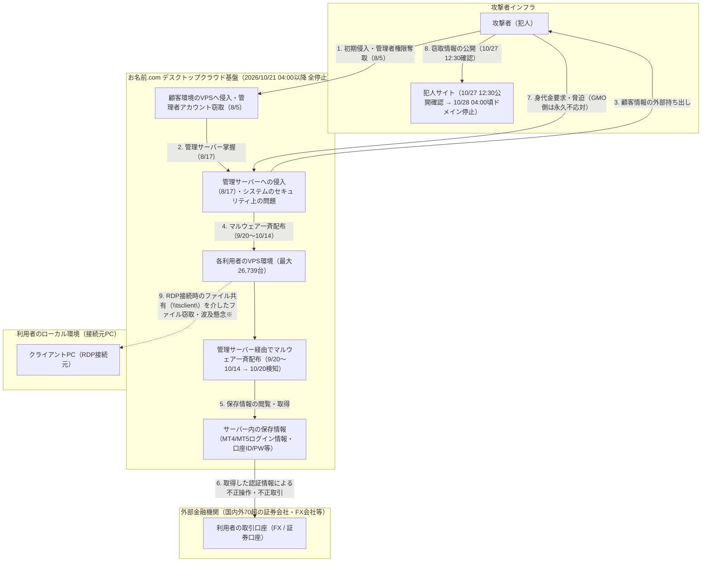
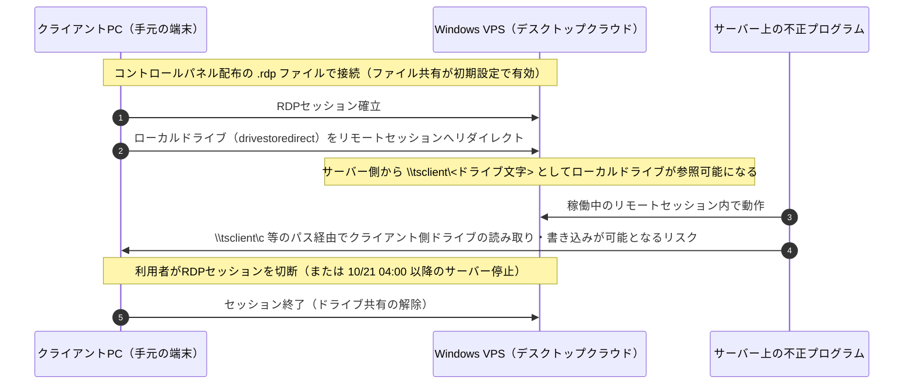

## 概要

- **事案の概要**: 2026年10月、GMOインターネット株式会社が提供するFX自動売買等向けのWindowsリモートデスクトップ（VPS）サービス「お名前.com デスクトップクラウド」において不正アクセスが確認され、同年10月21日4:00以降、全プランのサーバー（対象となり得る26,739件）が停止された[[1]][ref-1][[3]][ref-3]。2026年8月5日の初期侵入から約2か月半にわたり不正アクセスを検知できず、管理サーバー経由で顧客環境へマルウェアが一斉配布されていたことが11月2日の記者会見で公表された[[20]][ref-20][[21]][ref-21]。
- **主な被害・影響**: サーバー内に保存されていた証券会社・FX会社等の取引ツール（MetaTrader 4 / MetaTrader 5等）や取引口座の認証情報が窃取され、利用者の口座で意図しない不正売買によって残高が毀損する被害が発生したほか、外部に持ち出された顧客情報が犯人のウェブサイト上で公開される事態となった[[2]][ref-2][[4]][ref-4][[6]][ref-6]。
- **運営会社および捜査機関の対応**: GMOインターネットグループは犯人からの身代金要求に「永久に応じない」方針を表明し、現行基盤を廃止して独立クラウド基盤による代替サービス提供や不正取引損失の全額補償等を実施している[[4]][ref-4][[7]][ref-7]。また、社内ホワイトハッカーチームの調査で得た有力情報を警察へ提出し、警視庁は約70人態勢の捜査本部を設置して捜査を進めている[[9]][ref-9][[18]][ref-18]。

:::message
本記事は 2026年11月3日 時点のGMOインターネット株式会社および「お名前.com」の公式発表、Microsoft公式ドキュメント、ならびに新聞社・テレビ局・専門メディア等の報道および専門家の分析に基づいている。今後の調査・捜査の進展により内容が更新される可能性がある。
:::

## 被害・影響範囲と運営会社の対応施策

公式発表により公表されている被害・影響範囲は以下の通りである。

| 項目 | 公表されている内容 |
| :--- | :--- |
| **対象サービス** | お名前.com デスクトップクラウド（全プラン）[[1]][ref-1] |
| **影響の可能性があるサーバー数** | 26,739件（2026年10月21日4:00以降に全停止。対象となり得るサーバー総数であり、不正アクセスや情報取得が確認された件数ではない）[[1]][ref-1][[3]][ref-3] |
| **サーバー内の保存情報への影響** | サーバー内に保存されていた取引ツール（MT4/MT5等）や取引口座のID・パスワード、ブラウザに保存された各種サービスの認証情報等が第三者に閲覧・取得された可能性[[2]][ref-2][[3]][ref-3] |
| **顧客情報の外部持ち出し・公開** | システムのセキュリティ上の問題により顧客情報が外部に持ち出された事実を確認。2026年10月27日12:30に犯人サイトでの情報公開（1名分）を確認、翌10月28日4:00頃に当該サイトのドメイン停止を確認[[4]][ref-4][[6]][ref-6][[8]][ref-8] |
| **決済情報の有無** | クレジットカード情報を含む決済情報は本サービスのサーバー上で保持していない[[1]][ref-1][[2]][ref-2] |
| **二次被害（取引口座の不正操作）** | 取得された認証情報を悪用した第三者による取引口座での不正操作・不正取引の発生を確認（国内外70超の証券会社・FX会社等の口座が標的となり、金融庁はFX業者5社で顧客被害が確認されたことを公表。全体の被害件数・被害総額は未公表）[[2]][ref-2][[4]][ref-4][[15]][ref-15] |
| **接続元PCへのマルウェア感染有無** | 犯人から「10月27日12:00にランサムウェア攻撃を行う」との予告を受けたが、同社が全国から預かり解析した顧客端末からはマルウェアや攻撃の痕跡は確認されていない[[5]][ref-5] |

### 補償・救済措置および懸賞金制度の一覧

契約者に対する救済措置および犯人特定に向けた懸賞金制度として、以下の施策が発表されている。

| 施策・制度名 | 対象条件 | 内容・金額 | 補足 |
| :--- | :--- | :--- | :--- |
| **一律お見舞金** | 対象サービスを現在利用中の全契約者（金銭的被害の有無を問わない） | 一律 **5,000円** | 第4報で決定を公表[[4]][ref-4] |
| **不正取引による損失補償** | 本件不正アクセスに起因する不正取引により取引口座に実現損失が生じた利用者 | **実現損失の全額** （取引の差損および手数料等） | 取引所等から返金がない場合も同社が補償。2026年11月6日より順次ヒアリング・確定作業を実施[[4]][ref-4][[21]][ref-21] |
| **代替サービスの提供** | 引き続きWindowsデスクトップ環境の利用を希望する契約者 | **6か月間無償提供** | 現行基盤とは独立したクラウド基盤上で運用されている代替サービスを提供[[4]][ref-4][[21]][ref-21] |
| **GMO特別お見舞金** | 犯人により公開された情報に自身の情報が含まれていることを同社が確認した利用者 | **10,000円〜25,000円 / 区分** （1公開につき**上限300万円**） | 公開が確認された情報の区分（基本情報：10,000円、金融・認証情報：15,000円、機微情報等：25,000円）を合算して支給[[7]][ref-7] |
| **ランサムウェア被害端末の交換** | 本件に起因してPCがランサムウェアの被害に遭った利用者 | **同等性能の新規PCを無償提供** | 第9報にてお問い合わせ窓口への申し出を案内（解析済み端末での感染確認は0件）[[5]][ref-5] |
| **GMOサイバー犯罪撲滅・懸賞金** | 関与者の特定・検挙または事件解明に実質的に貢献する具体的かつ検証可能な情報の提供者 | 総額 **100万米ドル** （参考換算額：約1.5億円）上限 | 2026年10月28日12:00に専用窓口を開設。11月2日の会見時点で約700件の情報提供を受付し、警察・関係省庁へ共有[[7]][ref-7][[21]][ref-21] |

## インシデントの時系列

公式発表ならびに11月2日の記者会見・報道から判明している主要な経緯は以下の通りである（時刻はすべて日本時間：JST）。

| 日時 (JST) | 出来事 |
| :--- | :--- |
| **2026/08/05〜08/17** | 攻撃者が顧客環境のリモートデスクトップVPSへ侵入して管理者アカウントを窃取（8/5）し、同社の管理サーバーへ侵入（8/17）[[20]][ref-20][[21]][ref-21]。 |
| **2026/09/20〜10/14** | 管理サーバーを経由し、最大26,739台の顧客VPS（VM）環境へマルウェアが一斉配布される（この間、社内の監視では検知されず）[[20]][ref-20][[21]][ref-21]。 |
| **2026/10/19〜10/20** | 利用者からの問い合わせを受けて調査を開始（10/19）。一部サーバー環境での不正プログラム設置を初めて検知し、新規申込受付およびコントロールパネルを停止（10/20）[[1]][ref-1][[2]][ref-2]。 |
| **2026/10/21 04:00** | **【第1報】** 全プランのサーバー（26,739件）を順次停止[[1]][ref-1]。同日11:57、犯人から5,000万米ドル（約80億円）を要求する脅迫メールを受信[[5]][ref-5][[13]][ref-13]。 |
| **2026/10/22〜10/23** | **【第2報・第3報】** 警察へ相談（10/22 13:00）。取引口座での不正操作の報告を受け、別端末からのパスワード変更・全セッション切断・二要素認証設定・端末のフルスキャンとバックアップを要請[[2]][ref-2][[3]][ref-3]。 |
| **2026/10/24 11:50** | **【第4報】** システムの問題による顧客情報の外部持ち出しを確認。要求に応じない方針と、お見舞金・不正取引損失の全額補償・代替サービス提供、政府への「能動的サイバー防御」適用要請を発表[[4]][ref-4]。 |
| **2026/10/25〜10/27 11:59** | **【第5報〜第9報・代表ブログ】** 熊谷正寿代表がブログを公開（10/25）[[13]][ref-13]。犯人から「10/27 12:00の情報公開とランサムウェア攻撃」の予告（要求額100万米ドル）を受けていることを公表し、預かり端末の解析と12:00前のPC電源断・コード抜去を要請[[5]][ref-5][[15]][ref-15]。 |
| **2026/10/27 12:30〜19:10** | **【第10報〜第12報】** 犯人サイトでの情報公開を確認（12:30）し、アクセス・拡散の禁止を警告[[6]][ref-6]。同日、総務省が通信各社へサイトのブロッキングを要請[[19]][ref-19]。19:10に要求へ「永久に応じない」方針、特別お見舞金、総額100万米ドル上限の懸賞金創設を発表[[7]][ref-7]。 |
| **2026/10/28〜10/29** | **【第13報〜第16報】** 犯人サイトのドメイン停止（10/28 04:00頃）を確認[[8]][ref-8]。10月29日、警視庁が約70人態勢の捜査本部を設置し、GMOのホワイトハッカーチームが独自調査で入手した犯人特定につながる有力情報を警察へ提出[[9]][ref-9][[18]][ref-18]。 |
| **2026/11/02** | GMOインターネットグループおよびGMOインターネットが問題発覚後初となる記者会見を開催。侵入時期・経緯の公表と謝罪、および役員報酬の減額（熊谷代表は30%減×3か月など）を発表[[20]][ref-20][[21]][ref-21]。 |

## 攻撃の手口と被害構造の分析

本事案では、①クラウド（VPS）基盤への不正アクセスと顧客情報の持ち出し、②VPS内に保存されていた認証情報を悪用した外部金融機関（FX・証券口座）での不正取引、③RDP接続元である利用者PCへの波及懸念という3段階の問題が発生した。それぞれの構造を分析する。

### 1. 侵入経路と被害波及の全体像

公式発表および11月2日の記者会見で公表された侵入経緯と、本サービスのシステム構成を組み合わせると、被害波及の全体像は以下の通り整理できる。

*※注：経路9のうちランサムウェア攻撃の実行は犯人が予告していたものの、預かり端末の解析でマルウェア感染や攻撃の痕跡は確認されていない[[5]][ref-5]。*

### 2. なぜシステム侵害がFX・証券口座の不正取引につながったのか

「お名前.com デスクトップクラウド」は、主に外国為替証拠金取引（FX）の自動売買プログラム（Expert Advisor：EA）を24時間稼働させる用途向けに提供されていたWindows Server 2019ベースのVPSサービスである[[10]][ref-10]。本サービスの侵害が外部の金融口座での不正取引被害に直結した背景には、以下の構造的要因がある。

1. **顧客VPSからの管理者アカウント奪取と管理サーバー経由のマルウェア一斉配布**:
   第4報でサービス基盤側のセキュリティ上の問題であったことが公表され、11月2日の記者会見でGMOインターネットの山下浩史副社長（システム部門担当）より具体的な侵害タイムラインが明らかにされた[[4]][ref-4][[21]][ref-21]。
   会見での説明によると、**攻撃者は2026年8月5日に顧客環境のリモートデスクトップVPSへ侵入して管理者アカウントを奪取し、8月17日に同社の「管理サーバー」へ侵入、その後9月20日〜10月14日にかけて管理サーバー経由で最大26,739台の顧客VM（仮想マシン）にマルウェアを一斉配布した**[[20]][ref-20][[21]][ref-21]。これは毎日新聞が報じていたS&J株式会社の分析（VPS 1台を足場に管理者用の高権限アカウントを不正取得し、各サーバーへアクセス可能な「マスターキー」を奪った状態になったとの推定）とも合致する構造である[[16]][ref-16]。
2. **VPS上での取引ツールの常時稼働と認証情報の保存**:
   MT4/MT5などの取引ツールで自動売買を24時間継続するためには、VPS上でアプリケーションを常時ログイン状態で稼働させる必要があり、多くの利用者が証券会社・FX会社のログインIDやパスワード、あるいはブラウザ上の各種サービス認証情報をVPS内に保存して運用していた[[2]][ref-2][[3]][ref-3]。管理サーバー経由で配布されたマルウェアによって、これらの認証情報が窃取されたとみられる。
3. **既存セッションの維持と自動売買口座の認証仕様**:
   第3報で説明されている通り、取引ツールの仕様上、パスワード変更後も一定期間は既存の接続セッションが維持され、二要素認証（2FA）を介さずに注文送信が可能な口座が多く存在した[[3]][ref-3]。通常、FX・証券口座からの出金先は本人名義の登録銀行口座に制限されるため第三者が直接資金を引き出すことは難しいが、意図しない注文（不利な価格での大量発注・反対売買など）を繰り返すことで「口座残高を毀損させる（実現損失を生じさせる）」攻撃が成立する構造にあった[[4]][ref-4]。読売新聞の取材では、不正操作により約240万円の損害を被った利用者の事例も報じられている[[17]][ref-17]。

### 3. なぜ接続元PCへの波及が懸念されたのか（RDPファイル共有の初期設定）

VPS（サーバー）側の侵害にとどまらず、リモートデスクトップ接続していた「利用者手元のクライアントPC」への情報窃取やランサムウェア攻撃が警戒された技術的な背景には、Microsoftのリモートデスクトッププロトコル（**RDP：Remote Desktop Protocol**）の**ドライブリダイレクト機能**と、本サービスが提供していた `.rdp` 接続設定ファイルの初期設定がある[[10]][ref-10][[11]][ref-11]。

- **ドライブリダイレクトの仕組みとデフォルト有効化**:
  RDPには、接続元PCのローカルドライブをリモートセッション内にマウントする機能（RDPプロパティ `drivestoredirect:s:*` 等）が存在し、有効な状態で接続している間はリモートサーバー側から `\\tsclient\<ドライブ文字>` を通じて接続元PCのファイルシステムへ直接アクセスできる[[11]][ref-11][[12]][ref-12]。
  本サービスの公式活用ガイドには「**コントロールパネルからダウンロードしたRDPファイルでの接続では、あらかじめファイルの共有についても設定されておりますため、お客様にて上述の設定は不要です**」と明記されていた[[10]][ref-10]。11月2日の記者会見において、山下浩史副社長は顧客のローカルPCのファイルまで抜き取られた要因としてこのドライブ共有機能がデフォルトで有効化されていたことを挙げ、「**当初は顧客の利便性を考えて設定をオンにしていたが、昨今のセキュリティリスクの中でオフへ変更できなかった点にリスク分析の甘さがあった**」と運用上の不備を認めている[[21]][ref-21]。
- **端末解析の結果**:
  2026年10月21日4:00の全サーバー停止前に接続元PC側へ時限式のマルウェア等が植え付けられていた可能性を排除できなかったため、同社は10月25日より全国の利用者からPCを預かりホワイトハッカーチームによる解析を実施したが、マルウェア感染やランサムウェア攻撃の痕跡は確認されていない[[5]][ref-5]。なお、三井物産セキュアディレクションの福田美香氏は読売新聞の取材に対し、企業の補償などを装ったメールの添付ファイルやリンクからランサムウェアに感染させる二次被害手口への警戒も呼びかけている[[17]][ref-17]。

## 攻撃者（犯人）の動向と専門家の分析

公式発表ならびに新聞社・テレビ局等の報道から判明している犯人の要求・声明の変遷と、専門家による犯人像の分析は以下の通りである。

### 1. 犯人の要求・声明の変遷と脅迫サイトの停止

1. **当初の5,000万米ドル要求と口座破壊・離間工作（10月21日〜23日）**:
   サービス停止と同日の2026年10月21日11時57分に犯人から脅迫メールが送信され、**同日17時を期限として5,000万米ドル（約79億〜80億円）を暗号資産で支払うよう要求**された[[5]][ref-5][[13]][ref-13]。犯人は米国所在のサーバー上に開設した脅迫サイトで「顧客の口座を破壊する意図はなかったが、GMOが沈黙したため破壊した」「顧客が集団訴訟で補償を受けられるよう支援する」といった声明を出し、顧客の取引口座（国内外70超の証券・FX会社）での不正売買を実行することで顧客の動揺を誘い、GMOへ支払いの圧力をかけさせる戦術をとった[[4]][ref-4][[15]][ref-15][[16]][ref-16]。
2. **GMOの全額補償表明による矛先転換と100万米ドルへの減額（10月24日〜26日）**:
   10月24日11:50の第4報で、GMO側が「要求には応じない」「不正取引による顧客の損失は全額補償する」と発表すると、犯人は同日中にサイトを更新し、システム管理アカウントやRDPドライブリダイレクト設定の不備をGMOの「過失の証拠」として暴露するとともに、**10月27日12時（正午）を期限として要求額を50分の1にあたる100万米ドル（約1.5億〜1.6億円）に引き下げ、応じなければ顧客PCへのランサムウェア攻撃と個人情報の公開を行う**と脅迫の軸を切り替えた[[4]][ref-4][[15]][ref-15][[17]][ref-17]。
3. **個人情報の公開とドメインのテイクダウン（10月27日〜28日）**:
   予告期限の10月27日12:00を過ぎた同日12:30に、犯人サイト上で利用者1名分の詳細な個人情報・閲覧履歴等の公開が確認された（一方、予告していたランサムウェア攻撃は確認されず、犯人は「毎日正午に順次公開する」と主張した）[[14]][ref-14]。当該サイトには閲覧者の情報を犯人側が取得する仕組みが埋め込まれていたため、GMOはサイトへのアクセスやSNSでの拡散を厳に控えるよう警告し、公開確認から約15時間半後の**10月28日午前4時頃に犯人サイト（ミラーサイト含む）のドメイン停止**（テイクダウン）が確認された[[6]][ref-6][[8]][ref-8]。

### 2. 報道・専門家による犯人像の分析

- **マルウェア・通信ログの解析による「北朝鮮系ハッカー集団」関与の分析と偽装工作の指摘**:
  共同通信（2026年11月1日配信）の報道によると、GMOインターネットグループは攻撃を受けたサービスへの通信ログや使用されたマルウェアの特徴など複数の痕跡から、一連の不正アクセスの攻撃側に**北朝鮮系のハッカー集団がいる可能性が高い**と分析し、政府側に報告したとされる。また、共同通信がセキュリティ関係者の協力を得て実施した解析でも、犯行声明サイトの公開直後に接続していたIPアドレスのうち5つが、過去に北朝鮮のハッカー集団が使用していたものと一致した。一方で、犯行声明を掲載したサイトには米国や日本など複数の国に関わる痕跡も確認されており、専門家は海外情報を混在させることで調査をかく乱しようとした可能性を指摘している[[22]][ref-22]。
- **組織的犯行か個人・少数犯か（特定の集団名を名乗らない点と執拗さ）**:
  フジテレビ（FNN）の取材に対し、元警察庁サイバー捜査課長の棚瀬誠氏は、著名なランサムウェア集団は「自分たちに襲われたら身代金を払わないと危ない」というビジネス上のPR目的でグループ名を名乗るのが通例であるのに対し、「**今回（名乗って）ないというのは1つのポイントかもしれない**」と指摘している[[14]][ref-14]。
  また、株式会社サイバーセキュリティクラウドCTOの渡辺洋司氏も、従来の事例が「金銭をまとめて払えば公開しない」という交渉であるのに対し、本事案は「答えが出るまで1日1件あげていく」ような執拗さがあることから、「**組織だった犯行というよりは、もう少し個人的みたいなイメージがある**」「**どちらかというとGMOを標的として狙って、そこを執拗に攻撃するような意図は感じられる**」と推測している[[14]][ref-14]。
- **エンドユーザーの金融資産・個人端末を「新しい人質」にする劇場型手法**:
  従来の二重恐喝型ランサムウェアが企業の業務データ暗号化と企業機密の暴露を交渉材料とするのに対し、本事案では一般利用者のFX口座や個人端末・プライバシー情報が交渉の盾にされた。前出の棚瀬誠氏は「**企業のエンドユーザーであるサービスの利用者の個人端末まで攻撃して情報をさらすぞというのが、いわば新しい人質になっていると、この新しい人質を考え出せた人間であるといえる**」と分析している[[14]][ref-14]。

## 経営陣・捜査機関・政府の対応と発言

### 1. 経営陣の記者会見と謝罪（2か月半の検知遅れ・事前指摘の放置とガバナンス不全）

- **約2か月半にわたる不正侵入の検知遅れと事前指摘への対応不足**:
  2026年11月2日の記者会見（熊谷正寿グループ代表、GMOインターネットの伊藤正社長、山下浩史副社長、安田昌史グループCFO、川崎友紀グループ法務部長が出席）では、最初の侵入から顧客の問い合わせで発覚するまで約2か月半にわたり不正アクセスを検知できなかったことについて、山下副社長が「サービスの監視で気付けなかったことを深く受け止めている」と陳謝した[[20]][ref-20][[21]][ref-21]。
  また、グループ傘下の「GMOサイバーセキュリティ by イエラエ」の専門家が**2024年4月24日**の診断結果として本サービスの課題・改善点を指摘していたにもかかわらず、4回の緊急メンテナンス（4月26日〜5月20日）で対策が完了したと誤認し、開発スケジュールとの兼ね合いから抜本対応や再診断を後回しにしていた実態が明らかにされた。さらに、この指摘は事業責任者・伊藤社長・山下副社長まで共有されていたものの、取締役会への定量的なエスカレーション基準が存在しなかったため熊谷代表には事件後まで報告が上がっておらず、熊谷氏は「エスカレーションされていなかったことの仕組みは私の全責任」とガバナンス不全を認め、取締役会で役員報酬の減額（熊谷代表は30%減×3か月など）を決議したと発表した[[20]][ref-20][[21]][ref-21]。

### 2. 社内ホワイトハッカーによる有力情報の提出と警視庁70人態勢の捜査本部

- **ICPO出身者含む200名体制での独自調査と警察への情報提出**:
  GMOインターネットグループはグループ内のセキュリティ企業2社からICPO（国際刑事警察機構）出身者を含む200名規模のホワイトハッカーを動員し、ログ解析と裁判所を通じた開示請求を実施した結果、10月29日の第15報にて「**犯人の特定につながると考えられる有力な情報**」を入手し警察および関係各所へ提出したことを公表した[[9]][ref-9][[13]][ref-13]。
- **警視庁による約70人態勢の捜査本部設置と被害者保護**:
  FNN等の報道によると、警視庁は10月22日にGMO側から相談を受理した後、情報が公開された10月27日付で本事案を「生活安全部長指揮事件」に指定し、10月29日にはサイバー対策課に**生活安全部長をトップとする約70人態勢の捜査本部**を設置した。捜査本部は不正アクセス禁止法違反などの疑いでシステム侵害の経緯を調べるとともに、個人情報を公開された被害者に直接接触し、二次被害や身辺上の危険を防ぐための**被害者保護対策**を進めている[[18]][ref-18]。

### 3. 政府・関係省庁の対応（総務省のブロッキング要請・能動的サイバー防御の位置付け）

- **総務省による通信事業者への「ブロッキング（接続遮断）」要請**:
  読売新聞・朝日新聞・日本経済新聞・ITmedia等の報道により、総務省が10月27日付の文書で、通信4業界団体を通じ、顧客の個人情報が掲載された犯人サイトへの接続を強制的に遮断する「**ブロッキング**」を通信各社に要請していたことが判明した。総務省は二次被害拡大の現実的な恐れがあるとして遮断を求めた一方、憲法が保障する「通信の秘密」との兼ね合いから通信各社側で慎重な検討が行われていたところ、翌28日未明に犯人サイトのドメイン自体が停止されたため、結果的に通信各社による遮断発動には至らなかったとみられている[[8]][ref-8][[19]][ref-19]。
- **「能動的サイバー防御」の対象範囲**:
  なお、GMOインターネットが第4報で政府関係機関へ適用を緊急要請した「能動的サイバー防御」について、FNNの解説では、攻撃予兆の監視は「通信の秘密」に抵触する部分があるため重要インフラを担う15事業に対象が限定されており、同社グループは対象外であったと報じられている[[4]][ref-4][[15]][ref-15]。

## 参考資料・出典一覧

1. [お名前.com（GMOインターネット株式会社） - 【重要】[お名前.com デスクトップクラウド]第三者による不正アクセスに関するお詫びとお知らせ（2026年10月21日 4:00時点）（第1報）][ref-1]
2. [GMOインターネット株式会社 - 【重要】「お名前.com デスクトップクラウド」への不正アクセスに関するお詫びとお知らせ（第2報）][ref-2]
3. [GMOインターネット株式会社 - 【重要】「お名前.com デスクトップクラウド」への不正アクセスに関するお詫びとお知らせ（第3報）][ref-3]
4. [GMOインターネット株式会社 - 【重要】お名前.com デスクトップクラウドサービスに対するサイバー攻撃について（第4報） お客様へのお見舞金のお支払いと不正取引による損失の補償について][ref-4]
5. [GMOインターネット株式会社 - 【重要】「お名前.com デスクトップクラウド」への不正アクセスに関する現在の対応について（第9報）][ref-5]
6. [GMOインターネット株式会社 - 【重要】「お名前.com デスクトップクラウド」への不正アクセスに関する現在の対応について（第10報）][ref-6]
7. [GMOインターネット株式会社 - 【重要】「お名前.com デスクトップクラウド」への不正アクセスに関する現在の対応について（第12報）][ref-7]
8. [GMOインターネット株式会社 - 【重要】「お名前.com デスクトップクラウド」への不正アクセスに関する現在の対応について（第13報）][ref-8]
9. [GMOインターネット株式会社 - 【重要】「お名前.com デスクトップクラウド」への不正アクセスに関する現在の対応について（第15報）][ref-9]
10. [お名前.com デスクトップクラウド - ご活用ガイド][ref-10]
11. [Microsoft Learn - サポートされている RDP のプロパティ - Azure Virtual Desktop][ref-11]
12. [Microsoft Learn - How to connect clients to Terminal Services in Windows Server 2003][ref-12]
13. [クマガイコム（GMOインターネットグループ代表・熊谷正寿公式ブログ） - 「お名前.com デスクトップクラウド」への不正アクセスと、私たちが「能動的サイバー防御」を具申した理由][ref-13]
14. [FNNプライムオンライン（フジテレビ） - 「GMO」攻撃者側サイト停止 “劇場型”不正アクセス犯人像は「“個人的”な犯行か」「新しい“人質”考え出せた人間」専門家][ref-14]
15. [FNNプライムオンライン（フジテレビ） - 【解説】「脅迫しているサーバーはアメリカにある」GMOに“身代金”要求の攻撃者が利用者とみられる情報公開か 専門家「AIによる攻撃で日本企業の被害が突出」][ref-15]
16. [毎日新聞 - 「マスターキー」奪われた状態か GMOへの攻撃、専門家が分析][ref-16]
17. [読売新聞 - 利用者にサイバー攻撃仕掛けると身代金要求、ＧＭＯ「脅迫に応じない」…２４０万円失った男性「ＰＣ買い替え検討」][ref-17]
18. [FNNプライムオンライン（フジテレビ） - GMO不正アクセスで警視庁が捜査本部設置 70人態勢で全容解明へ][ref-18]
19. [ITmedia NEWS - 総務省、GMO攻撃者サイトの「ブロッキング」を通信各社に要請 報道][ref-19]
20. [ITmedia ビジネスオンライン - 「31年間『もうける』と言ったことはない」GMO熊谷代表、不正アクセスで謝罪も露呈した“組織の壁”【会見の要点まとめ】][ref-20]
21. [＠IT - 「ネットのセキュリティもGMO」の実態　イエラエの事前指摘はなぜ放置されたか：GMO記者会見を読む][ref-21]
22. [共同通信（ライブドアニュース配信） - 【独自】GMO攻撃、北朝鮮ハッカーか　複数の痕跡、政府に報告][ref-22]

[ref-1]: https://www.onamae.com/news/article/11584
[ref-2]: https://internet.gmo/news/article/247/
[ref-3]: https://internet.gmo/news/article/248/
[ref-4]: https://internet.gmo/news/article/249/
[ref-5]: https://internet.gmo/news/article/255/
[ref-6]: https://internet.gmo/news/article/256/
[ref-7]: https://internet.gmo/news/article/258/
[ref-8]: https://internet.gmo/news/article/259/
[ref-9]: https://internet.gmo/news/article/261/
[ref-10]: https://www.onamae-desktop.com/guide/top/
[ref-11]: https://learn.microsoft.com/ja-jp/azure/virtual-desktop/rdp-properties
[ref-12]: https://learn.microsoft.com/en-us/troubleshoot/windows-server/remote/connect-client-to-terminal-services-remote-desktop-connection
[ref-13]: https://www.kumagai.com/?eid=19600
[ref-14]: https://www.fnn.jp/articles/-/1141589
[ref-15]: https://www.fnn.jp/articles/-/1140836
[ref-16]: https://mainichi.jp/articles/20261025/k00/00m/020/174000c
[ref-17]: https://www.yomiuri.co.jp/national/20261026-GYT1T00306/
[ref-18]: https://www.fnn.jp/articles/-/1144559
[ref-19]: https://www.itmedia.co.jp/news/article/2610/30/2000002765/
[ref-20]: https://www.itmedia.co.jp/business/articles/2611/02/news072.html
[ref-21]: https://atmarkit.itmedia.co.jp/ait/articles/2611/03/news014.html
[ref-22]: https://news.livedoor.com/article/detail/32708232/
